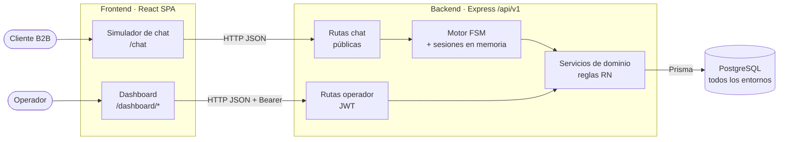
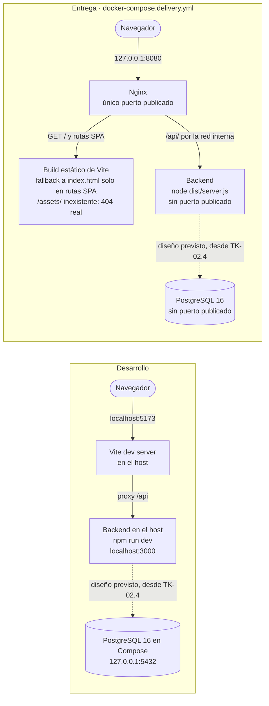
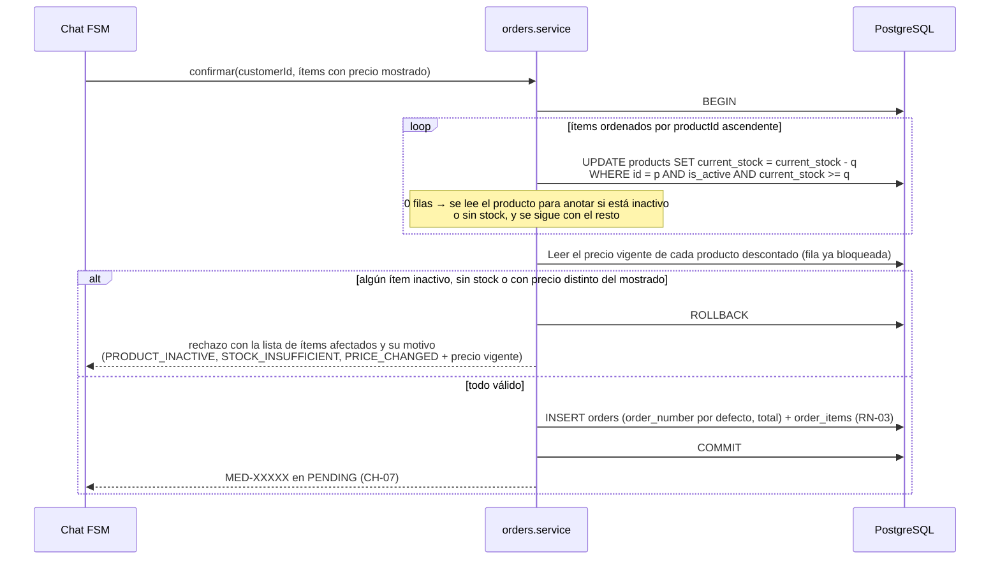

# Arquitectura — MedSupply AI

Qué construye el sistema: [PRD](PRD.md) v1.3. Modelo de datos: [spec 01](../specs/01_data_models.spec.md). Contrato de la API: definido de forma centralizada en `docs/openapi.yaml` (RNF-02); es el contrato base aprobado para la Entrega 2 y conserva aspectos provisionales pendientes de revisión, documentados en OBS-03 de la spec 03. Este documento define **cómo se organiza** el sistema.

Cada módulo, endpoint y pantalla lleva la fase del PRD: `MVP` se construye en este ciclo; `V2` queda documentado para orientar el diseño, pero no se implementa ni se crea su esquema.

## Vista general

Monolito modular cliente-servidor. Una sola aplicación web contiene el dashboard y el simulador de chat, y consume una API REST JSON. Todo corre sobre PostgreSQL (RNF-01).



Cómo llegan las peticiones del navegador al backend en cada entorno (detalle en [Entornos](#entornos)). La flecha del backend a la base es el diseño previsto: TK-00.3 prepara el esquema y las migraciones, y la primera conexión funcional de la aplicación es la consulta de clientes (CL-03, TK-02.4), todavía sin endpoints; TK-01.1 reutilizará el cliente creando la instancia única en el servidor.



> **Validación del diagrama pendiente.** Este diagrama representa la arquitectura propuesta y sus flujos previstos. Su sintaxis y su representación visual todavía no se han validado con una herramienta Mermaid: en la revisión anterior no había ninguna disponible para hacerlo. La falta de validación no demuestra que el diagrama sea incorrecto, pero tampoco permite afirmar que esté validado.

## Backend

### Capas

`routes → controllers → services → Prisma` (RNF-07)

| Capa | Responsabilidad | No debe |
|---|---|---|
| Routes | Declarar endpoints y middlewares (auth, validación) | Contener lógica |
| Controllers | Validar la entrada (Zod), llamar al servicio y formatear la respuesta | Acceder a Prisma ni aplicar reglas RN |
| Services | Reglas de negocio y transacciones | Conocer HTTP (`req`, `res`) |
| Chat FSM | Interpretar mensajes, mantener estado y carrito por sesión, llamar a servicios | Duplicar reglas de los servicios ni acceder a Prisma |

### Cliente de base de datos

`backend/src/lib/prisma.ts` expone `createPrismaClient(databaseUrl)`, una fábrica con URL explícita y adaptador `pg` (TK-02.4). No crea instancias al importarse ni lee el entorno: quien crea el cliente lo cierra con `$disconnect()`. Los servicios lo reciben como dependencia.

### Módulos

| Módulo | Fase | Requisitos | Spec |
|---|---|---|---|
| `auth` | `MVP` | AU-01, AU-02, AU-03 | 05 |
| `customers` | `MVP` solo consulta | CL-02, CL-03, RN-12. Sin endpoints HTTP en el MVP | 05 |
| | `V2` | CL-01: endpoints y pantalla de gestión | 05 |
| `products` (catálogo, stock, alertas) | `MVP` | IN-01, IN-02, IN-03 (consulta de alertas), RN-01, RN-09, RN-10 | 02 |
| `orders` | `MVP` | CH-07, CH-08, PE-01, PE-02, RN-02..05, RN-08 | 04 |
| `chat` | `MVP` | CH-01..CH-08, CH-11 (menú sin la opción Reclamo) | 03 |
| `purchase-orders` | `V2` | IN-03 (parte V2), RP, RN-11 | 02 |
| `claims` | `V2` | CH-10, RE, RN-06, RN-07 | 04 |

Cada módulo agrupa sus rutas, controller, servicio y esquemas Zod. Un módulo usa a otro solo a través de su servicio. Por ejemplo, `chat` llama a `customers.service` para identificar al cliente (CL-03) y a `orders.service` para confirmar una compra. Los módulos `V2` no se crean en el MVP: no hay carpetas, rutas ni tablas vacías "para después".

### Flujos principales del MVP

**Identificación en el chat (CH-01, CH-02, CL-02, CL-03).** `POST /chat/sessions` recibe el teléfono. `customers.service` lo normaliza (RN-12) y busca el cliente por coincidencia exacta del teléfono normalizado. Si no existe o está inactivo, la sesión responde el mensaje de CH-02 y no ofrece el menú.

**Expiración de la sesión de chat (CH-11, CA-16).** Cada sesión guarda la hora de su último mensaje aceptado, que se renueva con cada mensaje. Si pasa más tiempo que `CHAT_SESSION_TTL_MINUTES` (por defecto 30), la sesión es inválida: `POST /chat/sessions/:id/messages` responde error de sesión inválida (código definido en `docs/openapi.yaml`), no procesa el mensaje y descarta la sesión con su carrito. Un barrido periódico elimina además de memoria las sesiones expiradas que nadie vuelve a usar.

**Confirmación de pedido (CH-06, CH-07, RN-02..04, RNF-03, RNF-04, CA-14, CA-15).** El resumen de CH-06 se calcula con los precios vigentes al mostrarlo, y el FSM guarda en la sesión el precio mostrado de cada ítem. Al confirmar, el FSM envía al servicio el carrito con esos precios.



El precio se lee después del `UPDATE`: como la fila del producto ya está bloqueada por esta transacción, un cambio de precio simultáneo espera al commit, y la comparación con el precio mostrado y el precio guardado son coherentes con el instante de la confirmación (RN-03).

Ante el rechazo, el FSM aplica CH-06: para `STOCK_INSUFFICIENT` ofrece ajustar, quitar o cancelar; para `PRODUCT_INACTIVE` informa que el producto ya no está disponible; para `PRICE_CHANGED` muestra un nuevo resumen con los precios vigentes y pide una nueva confirmación, que vuelve a pasar por esta misma operación. El servicio aplica las reglas; el FSM solo decide qué mensaje mostrar.

**Cancelación por operador (PE-02, RN-05, CA-12).** En una transacción: actualización condicional del estado (`WHERE id = ? AND status IN ('PENDING','PROCESSING')`). Si no cambia ninguna fila, se responde conflicto y no se toca el stock. Si cambia, se suma la cantidad de cada ítem al stock. Como solo una petición puede ganar la actualización condicional, el stock se restituye una sola vez aunque lleguen cancelaciones simultáneas.

**Avance de estado (PE-02, RN-05).** Actualización condicional `WHERE id = ? AND status = <estado actual esperado>`, hacia el estado siguiente de RN-05. Una transición no permitida o una carrera perdida responde conflicto.

**Ajuste de stock (IN-02, CA-13).** Actualización condicional `WHERE id = ? AND current_stock = expectedStock`. Si no cambia ninguna fila, se responde conflicto `STOCK_CHANGED` y el stock no se modifica.

**Alertas (IN-03, RN-09).** Consulta de solo lectura de productos activos con `current_stock <= min_stock_alert`. No crea órdenes de reposición en el MVP.

### API (vista general)

Prefijo `/api/v1`. El contrato completo (parámetros, payloads, errores y paginación) vive solo en `docs/openapi.yaml` (RNF-02). Esta tabla es un índice y no lo duplica.

| Grupo | Fase | Endpoints | Acceso |
|---|---|---|---|
| Health | `MVP` | `GET /health` (comprobación técnica para Docker Compose y CI) | Público |
| Auth | `MVP` | `POST /auth/login` | Público |
| Chat | `MVP` | `POST /chat/sessions` (inicia con teléfono) · `POST /chat/sessions/:id/messages` | Público |
| Products | `MVP` | `GET/POST /products` · `GET/PATCH /products/:id` · `POST /products/:id/deactivate` · `PATCH /products/:id/stock` (con `expectedStock`) · `GET /products/alerts` | JWT |
| Orders | `MVP` | `GET /orders` · `GET /orders/:id` · `PATCH /orders/:id/status` (avance y cancelación por operador) | JWT |
| Customers | `V2` | `GET/POST /customers` · `GET/PATCH /customers/:id` · `POST /customers/:id/deactivate` | JWT |
| Purchase orders | `V2` | `GET/POST /purchase-orders` · `PATCH /purchase-orders/:id/status` | JWT |
| Claims | `V2` | `GET /claims` · `GET /claims/:id` · `POST /claims/:id/resolve` | JWT |

No existe ningún endpoint de borrado (RN-10). `GET /products/alerts` se declara antes de `GET /products/:id` para que el router no lo capture como un `id`.

### Decisiones transversales

- **Errores:** las respuestas de error que genera el backend son siempre `{ "error": { "code": "STOCK_INSUFFICIENT", "message": "…" } }` con el status HTTP correspondiente (400, 401, 404, 409, 422); las respuestas HTML que Nginx genera en la entrega para 413, 502 y 504 son una limitación de infraestructura (ver [Limitaciones conocidas del MVP](#limitaciones-conocidas-del-mvp)). Los conflictos de estado o de concurrencia (`STOCK_INSUFFICIENT`, `PRODUCT_INACTIVE`, `PRICE_CHANGED`, `STOCK_CHANGED`, transiciones de pedido no permitidas) responden 409 cuando llegan por HTTP; dentro del chat, el FSM los traduce a mensajes. El catálogo de códigos vive en `docs/openapi.yaml`.
- **Transacciones:** confirmar un pedido (RN-02), cancelarlo (RN-05) y ajustar stock (IN-02) se ejecutan en transacciones interactivas de Prisma (`prisma.$transaction(async (tx) => …)`) con el aislamiento por defecto de PostgreSQL (`READ COMMITTED`).
- **Concurrencia de stock (RN-02, RNF-03):** el stock se descuenta con una actualización condicional (`current_stock >= cantidad`). En PostgreSQL, la fila queda bloqueada por la primera transacción y la segunda reevalúa la condición tras el commit, así que nunca descuenta de más. No se usan `SELECT … FOR UPDATE` ni niveles de aislamiento más altos.
- **Prevención de interbloqueos (RNF-04 b):** dentro de una transacción, los ítems se actualizan siempre en orden ascendente de `productId`. Si PostgreSQL aun así aborta la transacción por interbloqueo o conflicto de serialización (Prisma `P2034`), el servicio la reintenta entera hasta 3 veces antes de responder error.
- **Transiciones condicionales:** todo cambio de estado de un pedido se hace con una actualización condicionada al estado esperado. Es lo que garantiza CA-12 sin bloqueos explícitos.
- **Número de pedido (RN-04):** lo asigna PostgreSQL desde una secuencia propia al insertar el pedido, con al menos cinco dígitos y sin límite de longitud. Las secuencias no se revierten con la transacción, de ahí los saltos permitidos. Como `MED-100000` se ordena alfabéticamente antes que `MED-99999`, los listados se ordenan por fecha de creación o por `id`, nunca por `order_number`. Detalle en la spec 01.
- **SQL y PostgreSQL:** el acceso a datos va por Prisma. Las funciones propias de PostgreSQL (secuencias, `CHECK`, índices parciales en V2) se declaran en las migraciones, no en el código de los servicios.
- **Autenticación (AU-03, RNF-08):** JWT firmado (HS256), enviado como `Authorization: Bearer`. Expira según `JWT_EXPIRES_IN` (por defecto `8h`); un token expirado responde 401 y el frontend redirige a `/login` (CA-11). Contraseñas con bcrypt. La clave de firma y la expiración se leen de variables de entorno.
- **Secretos (RNF-08):** credenciales de base de datos, clave JWT y credenciales del operador del seed solo en variables de entorno. El repositorio incluye `.env.example` sin valores reales.

## Frontend

Una sola SPA con dos áreas:

| Ruta | Fase | Área | Acceso |
|---|---|---|---|
| `/chat` | `MVP` | Simulador de chat | Público |
| `/login` | `MVP` | Login del operador | Público |
| `/dashboard` | `MVP` | Alertas de stock (inicio, solo consulta) | JWT |
| `/dashboard/products` · `/dashboard/orders` | `MVP` | Gestión de productos y stock · pedidos | JWT |
| `/dashboard/customers` · `/dashboard/claims` · `/dashboard/purchase-orders` | `V2` | Gestión | JWT |

- El frontend **no aplica reglas de negocio**. Solo muestra lo que devuelve la API y valida formatos básicos para dar feedback rápido.
- El menú del dashboard y el del chat muestran solo funciones `MVP` (CH-03).
- El token JWT se guarda en memoria y en `localStorage`. Un 401 redirige a `/login` (CA-11).

## Stack tecnológico

| Capa | Tecnología | Justificación |
|---|---|---|
| Frontend | React 18 + TypeScript + Vite | Tipado estático y arranque/compilación rápidos. Ecosistema conocido por el agente. |
| UI | Ant Design | Tablas, formularios, modales y layout listos para un dashboard. También sirve para armar el chat sin otra librería. |
| Enrutado | React Router | Separa las áreas `/chat` y `/dashboard` y protege rutas. |
| Backend | Node.js + Express + TypeScript | API REST simple y explícita. Mismo lenguaje que el frontend. |
| Validación | Zod | Esquemas tipados reutilizables para validar entradas de la API. |
| ORM | Prisma | Esquema declarativo, migraciones y cliente tipado. |
| Base de datos | PostgreSQL 16 en todos los entornos | Un solo motor (RNF-01): las pruebas de concurrencia validan el mismo comportamiento que producción. |
| Autenticación | JWT + bcrypt | Stateless, suficiente para un único rol (AU-02). |
| Contrato API | OpenAPI 3 (`docs/openapi.yaml`) | Contrato único y versionado (RNF-02). |
| Testing | Jest + Supertest · Jest · Playwright | Jest + Supertest: unit e integración de la API contra PostgreSQL real. Jest: unit de la lógica del frontend, sin renderizar componentes. Playwright: E2E de los criterios `CA-` del MVP. |
| Contenedores | Docker Compose · imágenes oficiales `postgres` 16 (Debian), `node` 26 (slim) para el backend y para la etapa de build del frontend, y `nginx` (alpine) para servir el frontend | Entorno local y despliegue de la entrega reproducibles (RNF-05), sin plataforma externa. PostgreSQL en su variante Debian, igual que el servicio `postgres:16` de CI. Las imágenes se fijan por versión exacta y digest para que un clon limpio construya siempre lo mismo. |
| Servidor web (entrega) | Nginx | Sirve el build estático de Vite y hace de proxy inverso de `/api/` hacia el backend: el navegador ve un solo origen, no hace falta CORS y el backend no se publica. En desarrollo ese papel lo cumple el proxy de Vite. |
| CI | GitHub Actions | Lint, typecheck y tests en cada push y pull request contra PostgreSQL real (RNF-06). |
| Metodología | SDD con Claude Code | Specs aprobadas antes de generar código (ver [CLAUDE.md](../CLAUDE.md)). |

## Estructura del repositorio

```
├── backend/                      API Express (Prisma desde TK-00.3) y su Dockerfile de entrega
├── frontend/                     SPA React, su Dockerfile de entrega y la configuración de Nginx
├── docker/                       Script de inicialización de PostgreSQL (rol de aplicación y medsupply_test)
├── docs/                         PRD, arquitectura y openapi.yaml
├── specs/                        Especificación técnica por módulo
├── backlog/                      Historias de usuario con sus tickets
├── .github/workflows/            Pipeline de CI
├── docker-compose.yml            Desarrollo: solo PostgreSQL
├── docker-compose.delivery.yml   Entrega: PostgreSQL, migrate, seed, backend y Nginx
├── .env.example                  Variables de entorno sin valores reales
└── CLAUDE.md                     Reglas para el agente
```

## Entornos

| Entorno | Base de datos | Cómo se ejecuta |
|---|---|---|
| Desarrollo | PostgreSQL 16 en Docker Compose (`docker-compose.yml`), base `medsupply` | `docker compose up -d` levanta solo la base, publicada en `127.0.0.1:5432`. Backend y frontend corren con `npm run dev` en el host; Vite reenvía `/api` al backend en `localhost:3000`. Seed con datos de ejemplo (TK-00.4). |
| Test | Misma instancia de Compose de desarrollo, base aparte `medsupply_test` | `npm run test:db` (backend) recrea `medsupply_test` al iniciar (`DROP`/`CREATE` desde la base `postgres` con el rol de aplicación, sin `FORCE`) y la migra, y la limpia en `beforeEach` con un `Client` dedicado. El pool del arnés tiene más de una conexión, pero no demuestra concurrencia de negocio (RNF-04 se prueba en TK-05.3 y TK-05.5). Los E2E (`npm run test:e2e` en `frontend/`, Playwright con Chromium) reutilizan `medsupply_test` y el PostgreSQL de desarrollo (5432), con el backend compilado y arrancado en el puerto 3100 y Vite en el 5174, en serie después de `test:db`. |
| CI | Servicio `postgres:16` de GitHub Actions | Instala dependencias, aplica migraciones y corre lint, typecheck, tests de unidad e integración (incluida concurrencia) y E2E. El pipeline falla si falla cualquier paso (RNF-06). |
| Entrega | PostgreSQL 16 en Docker Compose (`docker-compose.delivery.yml`), base `medsupply` | `docker compose -f docker-compose.delivery.yml up -d --build --wait` levanta base, backend y frontend desde un clon limpio. Por diseño, el mismo comando aplica las migraciones y carga el seed. `migrate` aplica ya las migraciones reales (TK-00.3); el seed llega con TK-00.4 y hasta entonces `seed` muestra un aviso fijo `PROVISIONAL:` y termina sin operar sobre la base. La autenticación (TK-01.1, TK-01.2) y los listados de productos y pedidos (TK-03.1, TK-03.3, TK-06.2, TK-06.4) llegan después. La demostración funcional completa de RNF-05 se acredita en una validación de integración final, cuando estén todos. La aplicación queda en `http://127.0.0.1:8080`. No hay plataforma externa. |

### Docker Compose

- **Dos archivos independientes.** `docker-compose.yml` (desarrollo) y `docker-compose.delivery.yml` (entrega), cada uno con su propio nombre de proyecto y sus propios volúmenes: levantar o borrar uno no toca los datos del otro. No hay `docker-compose.override.yml`; cada comando usa solo el archivo que nombra.
- **Bases y rol de aplicación.** Un script de inicialización de PostgreSQL, montado en solo lectura, crea un rol de aplicación `NOSUPERUSER`, dueño de las bases, con la contraseña tomada de una variable de entorno. En desarrollo el rol tiene además `CREATEDB` y el script crea `medsupply_test` junto a `medsupply`; en entrega no existe `medsupply_test` y el rol no tiene `CREATEDB`, así que el script distingue el entorno. La contraseña del superusuario de la imagen debe ser distinta de la del rol de aplicación (ver Variables). La aplicación se conecta con el rol de aplicación, nunca con el superusuario. La primera conexión funcional de la aplicación es la consulta de clientes (CL-03, TK-02.4), sin endpoints; TK-01.1 reutilizará el cliente creando la instancia única en el servidor. Un único rol, dueño de las bases, sirve para migrar y para ejecutar la aplicación: es una limitación aceptada del MVP (ver Limitaciones conocidas).
- **Reinicio de la base.** PostgreSQL ejecuta los scripts de inicialización solo cuando el volumen de datos está vacío. Para volver a ejecutarlos se recrea el volumen con `docker compose down -v` (con `-f docker-compose.delivery.yml` en entrega), lo que borra los datos.
- **Orden de arranque de la entrega.** `db` (sano según `pg_isready`) → `migrate` (un solo uso, ejecuta `prisma migrate deploy` con las migraciones de `backend/prisma/migrations`) → `seed` (un solo uso, carga el seed de TK-00.4) → `backend` (sano) → Nginx (sano). El backend depende de `db` con `service_healthy` y de `migrate` y `seed` con `service_completed_successfully`: si cualquiera de los dos falla, el backend no arranca. El backend nunca ejecuta migraciones al arrancar. `migrate` ya es real (TK-00.3). `seed` sigue siendo provisional hasta TK-00.4: solo muestra un aviso fijo con prefijo `PROVISIONAL:` y termina con 0, sin operar sobre la base; TK-00.4 reemplaza su comando completo por la operación real.
- **Healthchecks.** La base usa `pg_isready`; el backend, una petición a `GET /api/v1/health` con `node -e` y `fetch`; Nginx, `wget`. Ninguno usa credenciales ni requiere `curl` en la imagen.
- **Red y puertos.** Solo se publican puertos en `127.0.0.1`. En desarrollo, únicamente PostgreSQL (`5432`). En entrega, únicamente Nginx (`8080`); la base y el backend solo son accesibles por la red interna de Compose. Nginx sirve el build de Vite y reenvía `/api/` al backend, así que frontend y API comparten origen. Las rutas de navegación de la SPA reciben `index.html` (fallback); lo que no existe bajo `/assets/` responde 404 real, sin fallback ni `index.html`; `/api` sin barra final responde 4xx, sin redirección ni fallback. El 404 no se extiende a otras rutas. Nginx limita el cuerpo de las peticiones con `client_max_body_size` de 1m como máximo y rechaza con 413 los que lo superan. Además aplica `server_tokens off` y las cabeceras `X-Content-Type-Options: nosniff`, `X-Frame-Options: DENY` y `Referrer-Policy: no-referrer`, y sirve `index.html` con `Cache-Control: no-cache`. La política de seguridad de contenido (CSP) queda fuera del alcance del MVP.
- **Imágenes.** Oficiales y fijadas por versión exacta y digest del índice multiarquitectura. El Dockerfile del backend tiene tres etapas. `build` instala dependencias con `npm ci --ignore-scripts`, genera el cliente de Prisma (`npm run db:generate`; no se versiona ni se copia del host) y compila con `npm run build` (`tsconfig.build.json`, solo `src/`; el cliente generado queda en `dist/generated`). El target `migrate` deriva de `build` y añade el CLI de Prisma, el motor de migraciones (descargado en el build con un `RUN` explícito, porque `--ignore-scripts` no lo instala, de modo que `migrate` no necesita red al ejecutarse), `prisma.config.ts`, `prisma/schema.prisma` y las migraciones; corre como `node` y ejecuta `prisma migrate deploy`. La imagen del servicio `migrate` (`medsupply-migrate:delivery`) es distinta de la del backend. La etapa final (`runtime`) instala `npm ci --omit=dev --omit=optional --ignore-scripts`, de modo que no contiene `node_modules/prisma`, `.bin/prisma` ni el motor de migraciones (`--omit=dev` por sí solo los instalaría como dependencias `devOptional`). En la imagen arranca con `node dist/server.js` directamente; el script `npm start` ejecuta lo mismo en el host. La etapa final lleva solo dependencias de producción, sin `tsx` ni modo watch, corre con un usuario no root y `NODE_ENV=production`, con `init: true` para reenviar señales y `restart: "no"`. El frontend fija `VITE_API_BASE_URL=/api/v1` con `ENV` en su Dockerfile, antes de `npm run build`, sin `ARG` que lo sobrescriba; Compose no declara `build.args` para él. Eso fija la configuración de build; que el bundle use esa base y que el tráfico real vaya al mismo origen se verifica cuando una pantalla importe el cliente HTTP (TK-01.2) y en la validación de integración final. La etapa de build del frontend usa `node` 26 slim. Las dependencias se instalan con `npm ci --ignore-scripts`.
- **Migraciones.** Las migraciones SQL editadas a mano se envuelven en `BEGIN;`/`COMMIT;`, porque Prisma no revierte una migración que falla a medias. En entrega se aplican con `prisma migrate deploy` (nunca `migrate dev`, `migrate reset` ni `db push`) desde el servicio `migrate`, que ejecuta el binario local del CLI, nunca `npx`. La recuperación ante una migración fallida está documentada y no se automatiza. En la entrega no hay datos que preservar: corregir y `docker compose -f docker-compose.delivery.yml down -v` para recrear la base desde cero (borra los datos). En desarrollo `down -v` no es válido (borraría también `medsupply`): `medsupply_test` se vacía y se vuelve a migrar de forma aislada, y `medsupply` exige inspeccionar el estado antes de decidir. Tras un fallo, el error visible puede ser el secundario `current transaction is aborted`; hay que buscar el primer error real. Procedimiento operativo en [README.md](../README.md#migración-fallida-en-desarrollo).
- **Variables (RNF-08).** Un único `.env.example` versionado, sin valores reales; el `.env` de la raíz no se versiona. Compose exige las credenciales con `${VAR:?}` y no arranca si falta alguna, y construye la `DATABASE_URL` interna con el nombre del servicio de base como host. No hay `env_file` global: cada servicio recibe solo las variables que usa, con una excepción documentada: `db` recibe también la contraseña del rol de aplicación, porque su script de inicialización crea ese rol. La variable de la contraseña del superusuario solo la recibe `db`. Las dos contraseñas son exclusivamente alfanuméricas. Los valores de ambas contraseñas deben ser distintos, como requisito de configuración y garantía documental, sin validación programática; las variables tienen nombres distintos. `migrate` recibe solo su `DATABASE_URL` (rol de aplicación) y `PRISMA_HIDE_UPDATE_MESSAGE`; `seed`, mientras sea provisional, no recibe credenciales y las recibirá con TK-00.4. Ninguna imagen lleva secretos en `ARG` ni `ENV`, y no hay argumentos de build: D.2 #11 B sustituye la excepción de D4 que permitía un único argumento de build.

## Limitaciones conocidas del MVP

- **`medsupply_test` compartida:** la usan la integración (`test:db`) y los E2E (`test:e2e`), que se ejecutan en serie según el flujo documentado en el README, sin mecanismo de bloqueo. La recreación falla con un error controlado si hay conexiones abiertas a la base (no usa `FORCE`).
- **Rol único de base de datos:** el mismo rol, dueño de las bases, aplica las migraciones y ejecuta la aplicación (sin `GRANT` ni `REVOKE` adicionales). Una vulnerabilidad de inyección SQL tendría permisos de dueño. Por eso quedan prohibidos `$queryRawUnsafe` y `$executeRawUnsafe`: el SQL crudo solo con consultas parametrizadas.
- **Identidad en el chat:** el simulador confía en el teléfono que se ingresa. En WhatsApp real el canal verificaría el número. Tampoco se valida la existencia ni la titularidad del número (RN-12).
- **Sesiones en memoria:** se pierden al reiniciar el backend y no escalan a varias instancias. Es aceptable para el MVP (PRD §10).
- **Token en `localStorage`:** queda expuesto si existiera una vulnerabilidad XSS. Es aceptable para un MVP académico sin datos reales.
- **Acceso solo local:** la entrega queda accesible solo desde la misma máquina, en `http://127.0.0.1:8080`. La dirección de escucha no es configurable.
- **Errores de Nginx:** las respuestas de error que genera el propio Nginx (413, 502, 504) son HTML y pueden quedar fuera del formato JSON del contrato (`docs/openapi.yaml`). El contrato no cambia y esa salida no se transforma. El límite de cuerpo y el rechazo con 413 están aprobados y no dependen de esta limitación (ver [Entornos](#entornos)).
