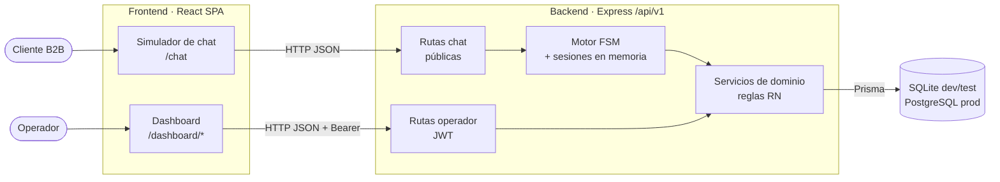

# Arquitectura — MedSupply AI

Qué construye el sistema: [PRD](PRD.md). Modelo de datos: [spec 01](../specs/01_data_models.spec.md). Este documento define **cómo se organiza** el sistema.

## Vista general

Monolito modular cliente-servidor. Una sola aplicación web contiene el dashboard y el simulador de chat, y consume una API REST JSON.



## Backend

### Capas

`routes → controllers → services → Prisma`

| Capa | Responsabilidad | No debe |
|---|---|---|
| Routes | Declarar endpoints y middlewares (auth, validación) | Contener lógica |
| Controllers | Validar la entrada (Zod), llamar al servicio y formatear la respuesta | Acceder a Prisma ni aplicar reglas RN |
| Services | Reglas de negocio y transacciones | Conocer HTTP (`req`, `res`) |
| Chat FSM | Interpretar mensajes, mantener estado y carrito por sesión, llamar a servicios | Duplicar reglas de los servicios |

### Módulos

| Módulo | Requisitos | Spec |
|---|---|---|
| `auth` | AU | 05 |
| `customers` | CL | 05 |
| `products` (catálogo, stock, alertas) | IN | 02 |
| `purchase-orders` | RP | 02 |
| `orders` | PE, CH-07..09 | 04 |
| `claims` | RE, CH-10 | 04 |
| `chat` | CH | 03 |

Cada módulo agrupa sus rutas, controller, servicio y esquemas Zod. Un módulo usa a otro solo a través de su servicio. Por ejemplo, `chat` llama a `orders.service` para confirmar una compra.

### API (vista general)

Prefijo `/api/v1`. El contrato detallado (payloads y errores) se define en cada spec.

| Grupo | Endpoints | Acceso |
|---|---|---|
| Auth | `POST /auth/login` | Público |
| Chat | `POST /chat/sessions` (inicia con teléfono) · `POST /chat/sessions/:id/messages` | Público |
| Customers | `GET/POST /customers` · `GET/PATCH /customers/:id` · `POST /customers/:id/deactivate` | JWT |
| Products | `GET/POST /products` · `GET/PATCH /products/:id` · `POST /products/:id/deactivate` · `PATCH /products/:id/stock` · `GET /products/alerts` | JWT |
| Purchase orders | `GET/POST /purchase-orders` · `PATCH /purchase-orders/:id/status` | JWT |
| Orders | `GET /orders` · `GET /orders/:id` · `PATCH /orders/:id/status` | JWT |
| Claims | `GET /claims` · `GET /claims/:id` · `POST /claims/:id/resolve` | JWT |

### Decisiones transversales

- **Errores:** siempre `{ "error": { "code": "STOCK_INSUFFICIENT", "message": "…" } }` con el status HTTP correspondiente (400, 401, 404, 409, 422).
- **Transacciones:** confirmar un pedido (RN-02), cancelarlo (RN-05) y recibir una reposición (RN-11) se ejecutan en `prisma.$transaction`.
- **Concurrencia de stock (RN-02):** el stock se descuenta con una actualización condicional (`currentStock >= cantidad`). Si ninguna fila cambia, la transacción se revierte y se informa al cliente. No se usan bloqueos explícitos, así que funciona igual en SQLite y PostgreSQL.
- **Portabilidad:** nada de SQL ni funciones exclusivas de un motor. La excepción son los `CHECK` de la spec 01.
- **Autenticación:** JWT firmado (HS256) con expiración, enviado como `Authorization: Bearer`. Contraseñas con bcrypt.

## Frontend

Una sola SPA con dos áreas:

| Ruta | Área | Acceso |
|---|---|---|
| `/chat` | Simulador de chat | Público |
| `/login` | Login del operador | Público |
| `/dashboard` | Alertas de stock (inicio) | JWT |
| `/dashboard/products` · `/customers` · `/orders` · `/claims` · `/purchase-orders` | Gestión | JWT |

- El frontend **no aplica reglas de negocio**. Solo muestra lo que devuelve la API y valida formatos básicos para dar feedback rápido.
- El token JWT se guarda en memoria y en `localStorage`. Un 401 redirige a `/login` (CA-11).

## Stack tecnológico

| Capa | Tecnología | Justificación |
|---|---|---|
| Frontend | React 18 + TypeScript + Vite | Tipado estático y arranque/compilación rápidos. Ecosistema conocido por el agente. |
| UI | Ant Design | Tablas, formularios, modales y layout listos para un dashboard. También sirve para armar el chat sin otra librería. |
| Enrutado | React Router | Separa las áreas `/chat` y `/dashboard` y protege rutas. |
| Backend | Node.js + Express + TypeScript | API REST simple y explícita. Mismo lenguaje que el frontend. |
| Validación | Zod | Esquemas tipados reutilizables para validar entradas de la API. |
| ORM | Prisma | Esquema declarativo, migraciones y cliente tipado. Soporta SQLite y PostgreSQL. |
| Base de datos | SQLite (dev/test) · PostgreSQL (prod) | SQLite no requiere instalación. PostgreSQL da robustez en producción. |
| Autenticación | JWT + bcrypt | Stateless, suficiente para un único rol (AU-02). |
| Testing | Jest + Supertest · Playwright | Unit e integración de la API. E2E de los criterios `CA-`. |
| Metodología | SDD con Claude Code | Specs aprobadas antes de generar código (ver [CLAUDE.md](../CLAUDE.md)). |

## Estructura del repositorio

```
├── backend/          API Express + Prisma (se crea en TK-00.1)
├── frontend/         SPA React (se crea en TK-00.2)
├── docs/             PRD y arquitectura
├── specs/            Especificación técnica por módulo
├── backlog/          Historias de usuario con sus tickets
├── CLAUDE.md         Reglas para el agente
└── PROMPTS.md        Registro de prompts
```

## Entornos

| Entorno | Base de datos | Notas |
|---|---|---|
| Desarrollo | SQLite `backend/prisma/dev.db` | Seed con datos de ejemplo |
| Test | SQLite en archivo aparte | Se reinicia en cada suite |
| Producción | PostgreSQL | Despliegue por definir |

## Limitaciones conocidas del MVP

- **Identidad en el chat:** el simulador confía en el teléfono que se ingresa. En WhatsApp real el canal verificaría el número.
- **Sesiones en memoria:** se pierden al reiniciar el backend y no escalan a varias instancias. Es aceptable para el MVP (PRD §9).
