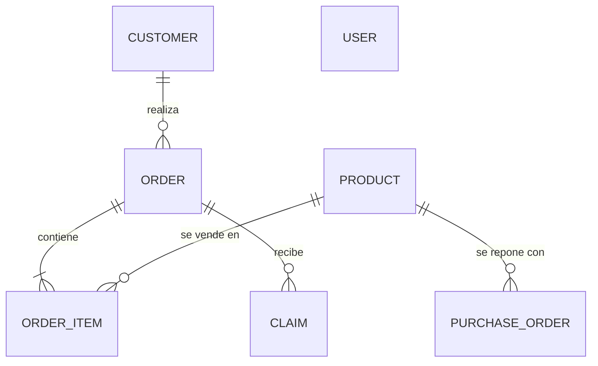

# Spec 01 — Modelo de datos

| Estado | Cubre | Tickets |
|---|---|---|
| Borrador (Entrega 1) | Entidades de PRD §7, RN-01/03/04/06/10 | TK-00.3, TK-00.4 |

Este documento define la persistencia. Las reglas de negocio se citan por ID: su lógica vive en los servicios del backend ([ARCHITECTURE](../docs/ARCHITECTURE.md)).

## Diagrama entidad-relación

`USER` no se relaciona con las demás entidades: el MVP no registra qué operador hizo cada acción.

## Convenciones

- Modelos Prisma en `PascalCase` y campos en `camelCase`. Tablas y columnas en `snake_case` vía `@@map` / `@map`.
- Todas las entidades tienen `id` (entero autoincremental), `createdAt` y `updatedAt`, gestionados por Prisma. No se repiten en las tablas.
- Dinero: `Decimal(12,2)`. Nunca `Float`.
- Fechas en UTC.
- Relaciones con `onDelete: Restrict`: nada se borra en cascada (RN-10).
- Los enums de Prisma se usan en SQLite y PostgreSQL (Prisma ≥ 6.2).

## Entidades

### User — operador del dashboard

| Campo | Tipo | Restricciones |
|---|---|---|
| email | String | Único, minúsculas |
| passwordHash | String | Hash bcrypt, nunca se expone en la API |
| name | String | Requerido |

### Customer — clínica o farmacia

| Campo | Tipo | Restricciones |
|---|---|---|
| businessName | String | Requerido |
| taxId | String | Único. Documento tributario (NIT/RUT) |
| phone | String | Único. Normalizado a E.164 (`+573001234567`) antes de guardar y de buscar |
| isActive | Boolean | Default `true` (CL-02, RN-10) |

### Product — insumo médico

| Campo | Tipo | Restricciones |
|---|---|---|
| name | String | Requerido |
| description | String? | Opcional |
| price | Decimal(12,2) | `> 0` |
| currentStock | Int | `>= 0` (RN-01) |
| minStockAlert | Int | `>= 0` |
| isActive | Boolean | Default `true` (RN-10) |

### Order — pedido confirmado

| Campo | Tipo | Restricciones |
|---|---|---|
| orderNumber | String | Único. Formato RN-04 |
| customerId | Int | FK → Customer |
| status | `OrderStatus` | `PENDING` · `PROCESSING` · `DISPATCHED` · `DELIVERED` · `CANCELLED`. Default `PENDING` |
| totalAmount | Decimal(12,2) | Suma de `quantity × unitPrice` de sus ítems, calculada al confirmar |

- El teléfono del cliente no se copia en el pedido: se obtiene vía `customerId`.
- **`orderNumber` (RN-04):** se genera dentro de la misma transacción de creación como `MED-` + `id` rellenado a 5 dígitos. En PostgreSQL, una transacción revertida puede dejar un número sin usar. Se acepta.

### OrderItem — línea de un pedido

| Campo | Tipo | Restricciones |
|---|---|---|
| orderId | Int | FK → Order |
| productId | Int | FK → Product |
| quantity | Int | `> 0` |
| unitPrice | Decimal(12,2) | Precio del producto al confirmar (RN-03) |

Único `(orderId, productId)`: el carrito agrupa el mismo producto en una sola línea.

### Claim — reclamo

| Campo | Tipo | Restricciones |
|---|---|---|
| orderId | Int | FK → Order |
| type | `ClaimType` | `RETURN` · `DEFECTIVE` · `INCOMPLETE` |
| description | String | Requerido |
| status | `ClaimStatus` | `OPEN` · `APPROVED` · `REJECTED`. Default `OPEN` |
| resolutionNote | String? | Obligatoria cuando `status ≠ OPEN` (RE-02) |
| resolvedAt | DateTime? | Se asigna al resolver |

"Máximo un reclamo `OPEN` por pedido" (RN-06) se valida en el servicio dentro de una transacción. Prisma no soporta índices únicos parciales.

### PurchaseOrder — orden de reposición

| Campo | Tipo | Restricciones |
|---|---|---|
| productId | Int | FK → Product |
| requestedQuantity | Int | `> 0` |
| supplierName | String? | Texto libre opcional (RP-01) |
| status | `PurchaseOrderStatus` | `DRAFT` · `SENT` · `RECEIVED`. Default `DRAFT` |
| sentAt | DateTime? | Se asigna al pasar a `SENT` |
| receivedAt | DateTime? | Se asigna al pasar a `RECEIVED` |

`receivedAt` no nulo indica que el stock ya se sumó (RN-11).

## Restricciones en base de datos

Prisma no declara `CHECK`. Se agregan con SQL manual en la migración inicial y deben funcionar igual en SQLite y PostgreSQL:

- `product.current_stock >= 0`, `product.min_stock_alert >= 0`, `product.price > 0`
- `order_item.quantity > 0`
- `purchase_order.requested_quantity > 0`

Son una red de seguridad: los servicios validan antes y devuelven errores legibles.

## Índices

| Tabla | Índice | Uso |
|---|---|---|
| order | `customer_id`, `status` | Pedidos del cliente en el chat (RN-08), filtro PE-01 |
| claim | `order_id`, `status` | Validación RN-06, filtro RE-01 |
| purchase_order | `status` | Filtro RP-03 |
| product | `is_active` | Catálogo (CH-04) y alertas (RN-09) |

## Fuera del modelo persistente

- **Sesión de chat y carrito:** viven en memoria del backend y se pierden al reiniciar (PRD §9). Ver `specs/03_conversational_bot.spec.md`.
- **Historial de cambios de estado y auditoría por operador:** fuera del MVP.

## Seed

| Datos | Propósito |
|---|---|
| 1 operador, con credenciales tomadas de variables de entorno | AU-02 |
| 3 clientes activos y 1 inactivo | CA-06 |
| ~10 productos: al menos 1 con stock 0, 2 con stock ≤ mínimo y 1 inactivo | CA-01, CH-04, RN-09 |
| Pedidos de ejemplo en cada estado, al menos 1 `DELIVERED` | CA-07, CA-09 |
