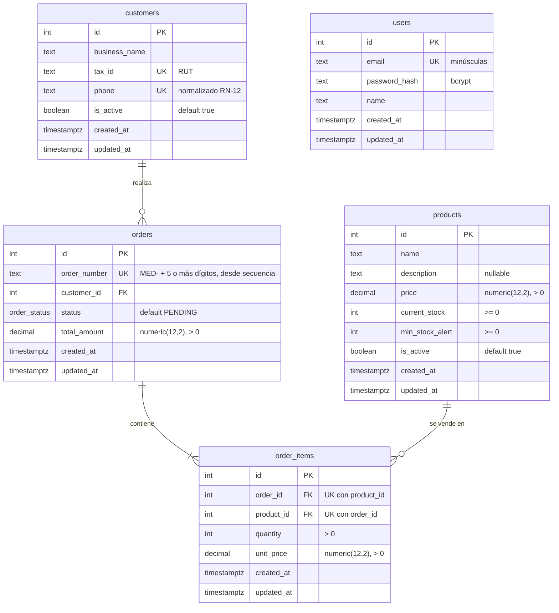
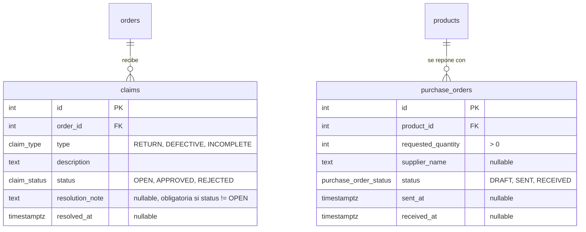

# Spec 01 — Modelo de datos

| Estado | Cubre | Tickets |
|---|---|---|
| Aprobada v1.1 (Entrega 2) | Entidades de PRD §7, CL-03, RN-01/03/04/05/09/10/12 | TK-00.3, TK-00.4 |

Este documento define la persistencia. Las reglas de negocio se citan por ID: su lógica vive en los servicios del backend ([ARCHITECTURE](../docs/ARCHITECTURE.md)). La base de datos es PostgreSQL 16 en todos los entornos (RNF-01).

**Alcance físico.** El esquema inicial del MVP contiene solo `User`, `Customer`, `Product`, `Order` y `OrderItem`. `Claim` y `PurchaseOrder` son de V2: su diseño conceptual se conserva al final de este documento, pero no se crean modelos Prisma, tablas, enums ni migraciones para ellas en el MVP.

## Diagrama entidad-relación (MVP, esquema físico)

Nombres físicos (tablas y columnas). `PK` clave primaria, `FK` clave foránea, `UK` único.

`users` no se relaciona con las demás tablas: el MVP no registra qué operador hizo cada acción.

## Convenciones

- Modelos Prisma en `PascalCase` y campos en `camelCase`. Tablas en `snake_case` y plural, y columnas en `snake_case`, vía `@@map` / `@map`. El modelo `Order` se mapea a la tabla `orders` con `@@map("orders")`.
- Nulabilidad: todo campo sin `?` en Prisma es `NOT NULL`. En las tablas de entidades, solo `products.description` admite nulos.
- Todas las tablas tienen `id` como PK (entero autoincremental, `Int @id @default(autoincrement())`), `created_at` y `updated_at` (`@default(now())` y `@updatedAt`).
- Fechas: `timestamptz` (`@db.Timestamptz(3)`), siempre en UTC.
- Dinero: `numeric(12,2)` (`Decimal @db.Decimal(12, 2)`). Nunca `Float`.
- Textos: `text`. Las longitudes máximas se validan en la API (contrato en `docs/openapi.yaml`), no en la base.
- Enums: enums nativos de PostgreSQL vía `enum` de Prisma, con nombre físico en `snake_case` (`OrderStatus` → tipo `order_status`, `@@map("order_status")`).
- Relaciones con `onDelete: Restrict`: nada se borra en cascada (RN-10).
- Las claves foráneas se indexan explícitamente: PostgreSQL no lo hace solo.

## Entidades del MVP

### User → `users` — operador del dashboard (AU-01, AU-02)

| Campo | Columna | Tipo | Restricciones |
|---|---|---|---|
| id | `id` | Int | PK |
| email | `email` | String | Requerido. Único. Se guarda en minúsculas (el servicio lo convierte antes de guardar y de buscar) |
| passwordHash | `password_hash` | String | Requerido. Hash bcrypt. Nunca se expone en la API (RNF-08) |
| name | `name` | String | Requerido |

### Customer → `customers` — clínica o farmacia (CL-02, CL-03)

| Campo | Columna | Tipo | Restricciones |
|---|---|---|---|
| id | `id` | Int | PK |
| businessName | `business_name` | String | Requerido |
| taxId | `tax_id` | String | Requerido. Único. RUT del cliente |
| phone | `phone` | String | Requerido. Único. Se guarda ya normalizado (RN-12). La búsqueda de CL-03 normaliza la entrada y compara por igualdad exacta con esta columna |
| isActive | `is_active` | Boolean | Default `true` (CL-02, RN-10) |

En el MVP los clientes solo se crean por seed, y el seed aplica la misma normalización de RN-12 que el chat. La gestión desde el dashboard es V2 (CL-01).

### Product → `products` — insumo médico (IN-01, IN-02, RN-09)

| Campo | Columna | Tipo | Restricciones |
|---|---|---|---|
| id | `id` | Int | PK |
| name | `name` | String | Requerido |
| description | `description` | String? | Opcional |
| price | `price` | Decimal(12,2) | `> 0` |
| currentStock | `current_stock` | Int | `>= 0` (RN-01) |
| minStockAlert | `min_stock_alert` | Int | `>= 0` |
| isActive | `is_active` | Boolean | Default `true` (RN-10) |

- El ajuste de stock de IN-02 no necesita una columna de versión: el control optimista compara `current_stock` con el `expectedStock` recibido (CA-13).
- Una alerta (RN-09) es una consulta, no un dato guardado: `is_active = true AND current_stock <= min_stock_alert`.

### Order → `orders` — pedido confirmado (CH-07, PE-01, PE-02)

| Campo | Columna | Tipo | Restricciones |
|---|---|---|---|
| id | `id` | Int | PK |
| orderNumber | `order_number` | String | Requerido. Único. Lo asigna la base al insertar (RN-04, ver abajo) |
| customerId | `customer_id` | Int | FK → `customers.id`, `Restrict` |
| status | `status` | `OrderStatus` | `PENDING` · `PROCESSING` · `DISPATCHED` · `DELIVERED` · `CANCELLED`. Default `PENDING` (RN-05) |
| totalAmount | `total_amount` | Decimal(12,2) | `> 0`. Suma de `quantity × unit_price` de sus ítems, calculada al confirmar |

- El teléfono del cliente no se copia en el pedido: se obtiene vía `customer_id`.
- Un pedido cancelado conserva sus ítems. La restitución de stock (RN-05) solo modifica `products.current_stock`.
- **Estados (RN-05):** la base solo restringe los valores posibles con el enum. Las transiciones permitidas y la restitución única de stock las aplica `orders.service` con una actualización condicional sobre el estado esperado (ARCHITECTURE, "Cancelación por operador" y "Avance de estado"). No requieren columnas, triggers ni restricciones adicionales.
- **`order_number` (RN-04):** la migración inicial crea, antes que la tabla `orders` que la usa como valor por defecto, la secuencia `order_number_seq` y la función `next_order_number()`, que toma un valor de la secuencia y devuelve `'MED-'` seguido del número completado con ceros hasta cinco dígitos, sin recortarlo si tiene más (`MED-00001`, `MED-99999`, `MED-100000`). Equivale a `lpad(n::text, greatest(5, length(n::text)), '0')` sobre un único `nextval`. La columna la usa como valor por defecto, declarado en Prisma con `@default(dbgenerated("next_order_number()"))`. Se asigna en el mismo `INSERT`, así que nunca queda nulo. Si la transacción se revierte, el valor consumido de la secuencia no se reutiliza: es el salto que RN-04 permite.
- **Orden:** `order_number` no sirve para ordenar, porque `MED-100000` va alfabéticamente antes que `MED-99999`. Los listados ordenan por `created_at` o `id`.

### OrderItem → `order_items` — línea de un pedido (RN-03)

| Campo | Columna | Tipo | Restricciones |
|---|---|---|---|
| id | `id` | Int | PK |
| orderId | `order_id` | Int | FK → `orders.id`, `Restrict` |
| productId | `product_id` | Int | FK → `products.id`, `Restrict` |
| quantity | `quantity` | Int | `> 0` |
| unitPrice | `unit_price` | Decimal(12,2) | `> 0`. Precio del producto al confirmar (RN-03) |

Único `(order_id, product_id)`: el carrito agrupa el mismo producto en una sola línea.

## Restricciones en base de datos

Prisma no declara `CHECK`. Se agregan con SQL en la migración inicial:

| Tabla | Restricción | Regla |
|---|---|---|
| `products` | `current_stock >= 0` | RN-01 |
| `products` | `min_stock_alert >= 0` | IN-01 |
| `products` | `price > 0` | IN-01 |
| `orders` | `total_amount > 0` | CH-06 |
| `order_items` | `quantity > 0` | CH-05 |
| `order_items` | `unit_price > 0` | RN-03 |
| `customers` | `phone ~ '^\+[0-9]+$'` | RN-12: solo se guarda el formato normalizado |

Son una red de seguridad: los servicios validan antes y devuelven errores legibles. La de `current_stock` es además la última barrera de RN-01 si fallara la actualización condicional.

## Índices

| Tabla | Índice | Tipo | Uso |
|---|---|---|---|
| `users` | `email` | Único | Login (AU-01) |
| `customers` | `phone` | Único | Identificación en el chat (CL-03) |
| `customers` | `tax_id` | Único | Unicidad del RUT |
| `products` | `is_active` | Simple | Catálogo (CH-04) y alertas (RN-09) |
| `orders` | `order_number` | Único | Consulta por número (CH-08). No se usa para ordenar |
| `orders` | `customer_id` | Simple | FK y pedidos del cliente en el chat (RN-08) |
| `orders` | `(status, created_at)` | Compuesto | Listado filtrado por estado y ordenado por fecha (PE-01) |
| `order_items` | `(order_id, product_id)` | Único | Una línea por producto. También sirve como índice de la FK `order_id` |
| `order_items` | `product_id` | Simple | FK |

## Fuera del modelo persistente

- **Sesión de chat y carrito:** viven en memoria del backend y se pierden al reiniciar (PRD §10). Se detallarán en `specs/03_conversational_bot.spec.md` (pendiente de redacción).
- **Alertas de stock:** se calculan con una consulta (RN-09), no se guardan.
- **Expiración de la sesión de chat (CH-11)** y **de la sesión del operador (AU-03):** se controlan en memoria y en el JWT, respectivamente. No requieren columnas.
- **Precio mostrado en el resumen (RN-03, CH-06):** vive en la sesión de chat solo para compararlo al confirmar. El pedido guarda únicamente el precio vigente al confirmar (`order_items.unit_price`).
- **Historial de cambios de estado y auditoría por operador:** fuera del MVP.

## Seed

El seed es idempotente: correrlo dos veces no duplica datos. Los clientes se cargan aplicando la normalización de RN-12, igual que en el chat.

| Datos | Propósito |
|---|---|
| 1 operador, con credenciales tomadas de variables de entorno | AU-02, RNF-08 |
| 3 clientes activos y 1 inactivo, con teléfonos escritos en distintos formatos de entrada (con espacios, sin `+56`, con `+56`) | CA-06, CL-02, RN-12 |
| ~10 productos: al menos 1 con stock 0, 2 activos con stock ≤ mínimo (uno de ellos con stock = mínimo), 1 inactivo con stock ≤ mínimo y 1 inactivo más | CH-04, CA-01, RN-09, RN-10 |
| Pedidos de ejemplo en cada estado de RN-05, de al menos 2 clientes distintos e incluido al menos 1 en `PROCESSING` | CA-07, CA-12, PE-01 |

Los pedidos del seed no descuentan stock: el stock inicial de cada producto se fija directamente.

## Puntos abiertos (no bloqueantes)

No son decisiones aprobadas ni cambian el esquema. Se registran para resolverlos donde se indica.

| Punto | Situación | Dónde se resuelve |
|---|---|---|
| Idempotencia del seed para pedidos | `order_number` lo genera la base, así que no sirve como clave natural para evitar duplicados al repetir el seed | TK-00.4 (implementación del seed) |
| Desempate al ordenar pedidos con el mismo `created_at` | ARCHITECTURE permite ordenar por fecha de creación o por `id`; no fija un criterio secundario | Spec 04, TK-06.2 |
| Formato y normalización de `tax_id` (RUT) | El PRD no define reglas; en el MVP solo lo carga el seed | V2 (CL-01), fuera del alcance MVP |
| Decisiones de la spec 02 con posible impacto en el modelo | DP-01 (reactivación) usa el `is_active` existente; DP-06 (concurrencia en la edición general), si se decidiera un control optimista, podría requerir una columna nueva y una revisión de esta spec | Responsable del producto, vía spec 02 |

## Diseño conceptual V2 (no forma parte del esquema físico del MVP)

Se documenta para que el modelo del MVP no impida añadirlo después. No se crean tablas, enums ni migraciones en el MVP (PRD §7).

- **Claim → `claims`** (CH-10, RE-01, RE-02, RN-06, RN-07): con PostgreSQL como único motor, "máximo un reclamo `OPEN` por pedido" (RN-06) puede garantizarse con un índice único parcial `(order_id) WHERE status = 'OPEN'`, creado por SQL en la migración. `CHECK (status = 'OPEN' OR resolution_note IS NOT NULL)` para RE-02.
- **PurchaseOrder → `purchase_orders`** (RP-01..03, RN-11): `received_at` no nulo indica que el stock ya se sumó. La transición a `RECEIVED` debe ser una actualización condicional sobre `status = 'SENT'` para sumar el stock una sola vez. Índice en `status` (RP-03) y en `product_id`.
- Ambas tablas añadirían `created_at` y `updated_at` según las convenciones, y sus FK con `Restrict`.
