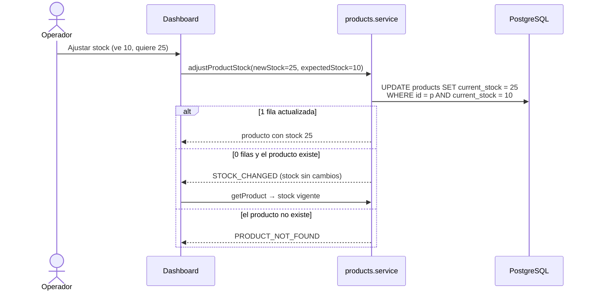

# Spec 02 — Sistema de inventario

| Estado | Cubre | Tickets |
|---|---|---|
| Aprobada v1.1 (Entrega 2) | IN-01, IN-02, IN-03 (`MVP`), RN-01, RN-09, RN-10 · lado inventario de RN-02, RN-03, RN-05 · Criterios: CA-01, CA-03, CA-04, CA-05, CA-12, CA-13, CA-14, CA-15 · V2: IN-03 (reposición), RP, RN-11, CA-02 | `MVP`: TK-03.1, TK-03.2, TK-03.3, TK-03.4, TK-04.1, TK-04.3, TK-04.5 · `V2`: TK-04.2, TK-04.4 |

**Fuentes.** [PRD](../docs/PRD.md) v1.2 · [ARCHITECTURE](../docs/ARCHITECTURE.md) · [`docs/openapi.yaml`](../docs/openapi.yaml) `info.version` 1.0.0 · [spec 01](01_data_models.spec.md) · [backlog](../backlog/README.md) US-03, US-04, US-05.

Esta spec define **el comportamiento funcional** del módulo `products` (catálogo, stock y alertas). No repite:

- el modelo de datos, las restricciones `CHECK` ni los índices: ver spec 01, entidad `Product`;
- los payloads, schemas, parámetros ni los status HTTP: ver `docs/openapi.yaml` por `operationId`;
- la máquina de estados del chat ni sus mensajes: ver spec 03;
- la transacción de confirmación y las transiciones del pedido: ver spec 04 y ARCHITECTURE.

Las reglas se citan por su ID del PRD. Los identificadores `ESC-`, `DP-` y `OBS-` son **locales de esta spec**: numeran escenarios, decisiones pendientes y observaciones. No son requisitos nuevos.

## 1. Objetivo

Que el operador mantenga un catálogo de productos con precio y existencias reales, y que el resto del sistema (chat y pedidos) pueda confiar en que:

1. el stock nunca es negativo (RN-01);
2. un ajuste manual nunca pisa un cambio de stock que el operador no vio (IN-02, CA-13);
3. un producto inactivo no se vende ni se pierde su historial (RN-02, RN-10);
4. los productos en stock crítico son visibles para el operador (IN-03, RN-09).

## 2. Alcance

### 2.1 Incluido en el MVP

| Capacidad | Requisitos | Operación |
|---|---|---|
| Listar y consultar productos (activos e inactivos) | IN-01 | `listProducts`, `getProduct` |
| Crear productos | IN-01, RN-01 | `createProduct` |
| Editar nombre, descripción, precio y stock mínimo | IN-01, RN-03 | `updateProduct` |
| Desactivar productos, sin borrarlos | IN-01, RN-10 | `deactivateProduct` |
| Ajuste manual absoluto del stock con control optimista | IN-02, RN-01, CA-13 | `adjustProductStock` |
| Consulta de alertas de stock crítico | IN-03 (`MVP`), RN-09, CA-01 | `listStockAlerts` |
| Capacidades de servicio que consumen el chat y los pedidos (sin endpoint propio) | CH-04, CH-05, RN-02, RN-05 | Ver §8.2 |
| Pantallas de inventario y panel de alertas | IN-01, IN-02, IN-03 | TK-03.3, TK-04.3 |

### 2.2 Diferido a V2 (no implementable en el MVP)

| Capacidad | IDs | Tickets |
|---|---|---|
| Crear una orden de reposición desde una alerta | IN-03 (`V2`) | TK-04.4 |
| Órdenes de reposición `DRAFT → SENT → RECEIVED` y su listado filtrado | RP-01, RP-02, RP-03 | TK-04.2, TK-04.4 |
| Suma de stock única al recibir una orden | RN-11, CA-02 | TK-04.2 |

En el MVP no existen el módulo `purchase-orders`, su tabla, sus endpoints ni su pantalla (PRD §4.2, ARCHITECTURE). El panel de alertas no ofrece "Reponer" (TK-04.3). Ver §14.

### 2.3 Fuera de esta spec

- Lotes, vencimientos, registro sanitario y proveedores como entidad (PRD §4.3).
- Borrado físico de productos (RN-10).
- Reactivación de productos: no hay requisito ni operación (DP-01).
- Historial o auditoría de cambios de stock y de qué operador los hizo (spec 01, "Fuera del modelo persistente").
- Mensajes, estados y opciones del chat (spec 03).

## 3. Actores y responsabilidades

| Actor / componente | Responsabilidad en el inventario | No hace |
|---|---|---|
| **Operador** (AU-01, AU-02) | Crea, edita, desactiva productos, ajusta stock y consulta alertas desde el dashboard | No borra productos ni reactiva productos |
| **Cliente B2B** (vía chat) | Ve el catálogo de productos activos y agrega productos al carrito (CH-04, CH-05) | No modifica stock directamente; solo a través de la confirmación del pedido |
| **`products.service`** | Aplica RN-01, RN-09, RN-10 e IN-02. Ofrece al chat y a `orders` las consultas de catálogo y disponibilidad | No conoce HTTP ni el carrito |
| **`orders.service`** | Descuenta stock al confirmar (RN-02) y lo restituye al cancelar (RN-05). Detalle en spec 04 | — |
| **Chat FSM** | Usa `products.service` para listar el catálogo y validar cantidades (TK-05.2) | No consulta Prisma ni aplica reglas `RN-` (RNF-07) |
| **Frontend (dashboard)** | Muestra productos, alertas y conflictos que devuelve la API | No aplica reglas `RN-` (RNF-07, ARCHITECTURE "Frontend"); ver DP-04 |
| **PostgreSQL** | Garantiza `current_stock >= 0` como última barrera (spec 01) y serializa las actualizaciones condicionales sobre la misma fila | — |

## 4. Conceptos y terminología

| Término | Significado en esta spec | Fuente |
|---|---|---|
| **Producto** | Insumo médico vendible con nombre, descripción opcional, precio, stock actual, stock mínimo y estado activo/inactivo | IN-01, spec 01 |
| **Activo / inactivo** | Un producto activo puede venderse por chat. Uno inactivo no aparece en el catálogo ni en alertas, no se vende y conserva su historial | RN-10, RN-09, RN-02 |
| **Stock actual** (`currentStock`) | Unidades existentes. Entero ≥ 0 | RN-01 |
| **Stock mínimo** (`minStockAlert`) | Umbral de alerta. Entero ≥ 0 | IN-01, RN-09 |
| **Agotado ("Sin stock")** | Producto activo con stock actual 0. Se lista en el catálogo del chat pero no se puede elegir | CH-04 |
| **En alerta** | Producto activo con stock actual ≤ stock mínimo. Se calcula al consultar, no se guarda | RN-09, spec 01 |
| **Ajuste manual** | Operación del operador que **fija** el stock en un valor absoluto (no suma ni resta) | IN-02 |
| **`expectedStock`** | Stock que el operador tenía a la vista al pedir el ajuste. El ajuste solo se aplica si coincide con el stock actual | IN-02, `AdjustStockRequest` |
| **Conflicto `STOCK_CHANGED`** | Rechazo de un ajuste porque el stock actual ya no coincide con `expectedStock`. El stock no cambia | IN-02, CA-13 |
| **Descuento** | Resta de las cantidades de un pedido al confirmarlo, dentro de una transacción atómica | RN-02, RNF-03 |
| **Restitución** | Suma de las cantidades de un pedido cancelado, exactamente una vez | RN-05, CA-12 |
| **Carrito** | Selección en memoria de la sesión de chat. **No reserva stock** | RN-02, PRD §10 |

## 5. Reglas de negocio

### 5.1 Reglas del PRD aplicadas por el inventario

Todas se aplican en `products.service` o, cuando se indica, en `orders.service` (RNF-07).

| Regla | Fase | Cómo se aplica en el inventario | Servicio | Operaciones |
|---|---|---|---|---|
| **RN-01** | `MVP` | Ninguna operación deja `currentStock < 0`: la creación y el ajuste rechazan valores negativos; el descuento al confirmar es condicional a `current_stock >= cantidad`; el `CHECK` de la spec 01 es la última barrera | `products`, `orders` | `createProduct`, `adjustProductStock`, confirmación (§8.2) |
| **RN-02** | `MVP` | Al confirmar, cada ítem se descuenta solo si el producto sigue activo y tiene stock suficiente. Un producto desactivado después de agregarse al carrito provoca el rechazo y el stock no cambia. El carrito no reserva stock | `orders` (spec 04) | Confirmación (§8.2) |
| **RN-03** | `MVP` | Editar el precio no modifica `unit_price` ni `total_amount` de pedidos existentes. El precio vigente es el que se compara y se guarda al confirmar | `products`, `orders` | `updateProduct`, confirmación |
| **RN-05** | `MVP` (operador) | Al cancelar un pedido desde `PENDING` o `PROCESSING`, la cantidad de cada ítem vuelve al stock del producto una sola vez | `orders` (spec 04) | `changeOrderStatus` |
| **RN-09** | `MVP` | Un producto está en alerta si `isActive` y `currentStock <= minStockAlert`. Es una consulta de solo lectura | `products` | `listStockAlerts` |
| **RN-10** | `MVP` | Los productos no se eliminan, se desactivan. Un inactivo no aparece en el catálogo del chat y conserva su historial (pedidos e ítems) | `products` | `deactivateProduct` |

### 5.2 Requisitos funcionales del inventario

| Requisito | Fase | Comportamiento | Operaciones |
|---|---|---|---|
| **IN-01** | `MVP` | Crear (queda activo), editar nombre, descripción, precio y stock mínimo, y desactivar productos | `createProduct`, `updateProduct`, `deactivateProduct`, `listProducts`, `getProduct` |
| **IN-02** | `MVP` | Ajuste absoluto a un entero ≥ 0, condicionado a que el stock actual sea igual a `expectedStock`. Si no coincide: conflicto `STOCK_CHANGED` y el stock no cambia | `adjustProductStock` |
| **IN-03** | `MVP` | Consulta de productos en alerta con su stock actual y mínimo | `listStockAlerts` |

### 5.3 Restricciones del contrato que esta spec adopta

No son reglas nuevas: provienen de `docs/openapi.yaml` y se citan para que la spec sea verificable.

| Restricción | Fuente en el contrato |
|---|---|
| El stock actual **solo** se modifica por HTTP con `adjustProductStock`; `updateProduct` no lo admite | `info.description` (Convenciones), `updateProduct`, `UpdateProductRequest` (`additionalProperties: false`, sin `currentStock`) |
| `updateProduct` no admite `isActive`: no se activa ni desactiva por edición | `UpdateProductRequest` |
| No existe ninguna operación de borrado | `info.description` (Convenciones) |
| Desactivar un producto ya inactivo no cambia nada y responde éxito | `deactivateProduct` |
| `listProducts` devuelve activos e inactivos; `listStockAlerts` solo activos en alerta; ambos ordenados por nombre ascendente | `listProducts`, `listStockAlerts` |
| El precio es un importe > 0 con dos decimales | `MoneyInput`, `Money` |
| `STOCK_INSUFFICIENT`, `PRODUCT_INACTIVE` y `PRICE_CHANGED` son códigos de dominio que `orders.service` devuelve al chat; ningún endpoint HTTP del MVP los devuelve | `info.description` (Códigos de dominio de la confirmación) |

### 5.4 Supuestos que no se dan por sentados

| Supuesto | Comportamiento aprobado | Fuente |
|---|---|---|
| Un producto inactivo puede agregarse al carrito | **No** se lista en el catálogo del chat, así que no puede elegirse desde él. Si se desactiva entre que se lista y se elige o se agrega, el chat revalida su estado con la consulta de disponibilidad y no lo agrega (DP-03, resuelta). Si se desactiva después de agregarse, la confirmación lo rechaza | CH-04, RN-10, RN-02 |
| Desactivar un producto elimina su stock | **No.** La desactivación solo cambia el estado; `currentStock` conserva su valor | RN-10, `deactivateProduct` |
| Un ajuste manual puede sobrescribir cambios concurrentes | **No.** Se aplica solo si el stock actual es igual a `expectedStock`; si no, `STOCK_CHANGED` | IN-02, CA-13, ARCHITECTURE (ajuste de stock) |
| El stock puede modificarse con la edición general | **No.** `updateProduct` no acepta `currentStock` | `UpdateProductRequest`, convenciones del contrato |
| Un producto puede eliminarse físicamente | **No.** No hay operación de borrado y las FK usan `Restrict` | RN-10, spec 01 |
| Los pedidos existentes pierden integridad si cambia el catálogo | **No.** Precio y total quedan congelados en el pedido; los ítems referencian al producto, que nunca se borra | RN-03, RN-10, spec 01 |
| La desactivación permite confirmar una compra iniciada antes | **No.** La confirmación revalida que el producto siga activo | RN-02, CH-06, CA-14 |

## 6. Flujos funcionales

### F-1 · Listar y consultar productos (IN-01)

1. El operador abre la pantalla de inventario (TK-03.3).
2. El dashboard llama a `listProducts` y muestra precio, stock actual, stock mínimo y estado de cada producto, activos e inactivos.
3. Para un producto concreto se usa `getProduct` (por ejemplo, para releer el stock tras un conflicto).

Sin efectos secundarios.

### F-2 · Crear producto (IN-01)

1. El operador completa nombre, descripción opcional, precio, stock actual y stock mínimo.
2. `createProduct` valida el cuerpo según `CreateProductRequest` y el servicio crea el producto **activo**.
3. Si el stock inicial es ≤ mínimo, el producto aparece en alertas desde ese momento (RN-09).

Precondición: sesión de operador válida (AU-01). El stock inicial se fija aquí sin `expectedStock`, porque el producto no existía.

### F-3 · Editar producto (IN-01, RN-03)

1. El operador modifica uno o más de: nombre, descripción, precio, stock mínimo.
2. `updateProduct` aplica los cambios. El stock actual no se toca.
3. Efectos:
   - Cambio de precio: los pedidos existentes conservan su precio (RN-03). Si un cliente tiene un resumen abierto con el precio anterior, su confirmación será rechazada con `PRICE_CHANGED` (CA-15, §7).
   - Cambio de stock mínimo: el producto puede entrar o salir de alertas (RN-09).
   - Cambio de nombre: el detalle de pedidos muestra el nombre actual, porque `OrderItem.productName` no es un dato histórico (contrato, schema `OrderItem`).

### F-4 · Desactivar producto (IN-01, RN-10)

1. El operador elige desactivar. `deactivateProduct` marca el producto como inactivo.
2. Efectos:
   - Deja de aparecer en el catálogo del chat (CH-04, RN-10) y en las alertas (RN-09).
   - Sigue apareciendo en `listProducts` y `getProduct`, con `isActive = false`.
   - `currentStock`, precio y stock mínimo no cambian.
   - Los pedidos que lo contienen no cambian.
   - Un carrito que ya lo contenga no se modifica en memoria; la confirmación lo rechazará con `PRODUCT_INACTIVE` (RN-02, CA-14).
3. Repetir la desactivación no tiene efectos y responde éxito.

### F-5 · Ajustar stock manualmente (IN-02, CA-13)

1. El operador ve el stock actual de un producto (F-1).
2. Indica el nuevo valor absoluto. El dashboard envía `newStock` y, como `expectedStock`, el stock que mostraba (TK-03.3).
3. `products.service` ejecuta una actualización condicional: fija el stock solo si el producto existe y su stock actual es igual a `expectedStock` (ARCHITECTURE, "Ajuste de stock").
4. Resultado:
   - **Aplicado:** el stock pasa a `newStock` y la respuesta devuelve el producto actualizado.
   - **Conflicto:** ninguna fila cambió porque el stock ya no coincide; se responde `STOCK_CHANGED` y el stock conserva su valor actual. El dashboard informa del conflicto y recarga el valor actual (TK-03.3); el operador decide si repetir el ajuste con el nuevo valor a la vista.
5. Efectos: el producto puede entrar o salir de alertas (RN-09) y de "Sin stock" en el catálogo (CH-04).

El ajuste es absoluto: no suma ni resta sobre el valor vigente. Por eso necesita `expectedStock`; una suma relativa no lo necesitaría, pero IN-02 define un valor fijo.

### F-6 · Consultar alertas (IN-03, RN-09, CA-01)

1. El operador abre la página de inicio del dashboard (`/dashboard`).
2. El panel llama a `listStockAlerts` y muestra cada producto en alerta con su stock actual y mínimo (TK-04.3).
3. El panel es solo de consulta: no ofrece "Reponer" ni ninguna acción V2.

Sin efectos secundarios.

### F-7 · Catálogo y disponibilidad para el chat (CH-04, CH-05)

Capacidad de `products.service` que consume el chat (TK-05.2). No tiene endpoint propio: el chat la usa dentro de `sendChatMessage`.

1. **Catálogo:** devuelve los productos activos con su precio y su stock actual. El chat marca "Sin stock" los de stock 0 y no permite elegirlos (CH-04).
2. **Disponibilidad al agregar:** al elegir un producto y al indicar una cantidad, el chat consulta al servicio el estado actual del producto: **si está activo** y su stock actual. Si ya no está activo, el chat no lo agrega al carrito (DP-03, resuelta). Si la cantidad supera el stock, ofrece ajustar al disponible o descartar el ítem (CH-05, CA-04).
3. La consulta no reserva stock (RN-02). El valor puede cambiar antes de confirmar; la confirmación lo revalida.

Los mensajes, estados y opciones del chat son de la spec 03.

### F-8 · Descuento de stock al confirmar un pedido (RN-02, RN-03, RNF-03)

Lo ejecuta `orders.service` (spec 04, TK-05.3) según el flujo de confirmación de ARCHITECTURE. Desde el inventario se garantiza:

1. Cada ítem se descuenta con una actualización condicional: producto activo y `current_stock >= cantidad`, en orden ascendente de `productId`.
2. Si algún ítem está inactivo, sin stock suficiente o con precio distinto del mostrado, se revierte todo: **ningún** producto cambia su stock y no se crea el pedido.
3. Si todo es válido, cada producto baja exactamente en la cantidad pedida, en la misma transacción que crea el pedido.
4. Tras el descuento, el producto puede entrar en alerta (RN-09) o quedar agotado (CH-04).

### F-9 · Restitución de stock al cancelar (RN-05, CA-12)

Lo ejecuta `orders.service` (spec 04, TK-06.1). Desde el inventario se garantiza que, al cancelar un pedido en `PENDING` o `PROCESSING`, el stock de cada producto aumenta en la cantidad del ítem **una sola vez**. RN-05 no exceptúa a los productos inactivos: su stock también se restituye, aunque sigan fuera del catálogo y de las alertas.

## 7. Comportamientos alternativos y concurrencia

Todas las modificaciones de stock son actualizaciones condicionales sobre la misma fila de `products`; PostgreSQL las serializa (ARCHITECTURE, "Concurrencia de stock").

| Situación | Resultado esperado | Fuente |
|---|---|---|
| Se confirma un pedido entre que el operador lee el stock y envía el ajuste | El ajuste se rechaza con `STOCK_CHANGED`; el stock queda como lo dejó el pedido | IN-02, CA-13 |
| Se cancela un pedido (restitución) entre la lectura y el ajuste | El ajuste se rechaza con `STOCK_CHANGED`; el stock queda restituido | IN-02, RN-05 |
| Dos ajustes simultáneos sobre el mismo producto con el mismo `expectedStock` | Exactamente uno se aplica; el otro recibe `STOCK_CHANGED`. El stock final es el `newStock` del que se aplicó | IN-02, ARCHITECTURE |
| Ajuste con `expectedStock` correcto mientras el producto está en uno o más carritos | El ajuste se aplica: el carrito no reserva stock. Si el nuevo stock no alcanza, la confirmación posterior se rechaza con `STOCK_INSUFFICIENT` | RN-02, CH-06 |
| Desactivación y confirmación simultáneas sobre el mismo producto | Si la desactivación se confirma primero, la confirmación se rechaza con `PRODUCT_INACTIVE` y el stock no cambia. Si la confirmación bloquea la fila primero, el pedido se crea y luego el producto queda inactivo | RN-02, ARCHITECTURE (confirmación) |
| Cambio de precio y confirmación simultáneos | El cambio de precio espera al commit de la confirmación; la comparación con el precio mostrado y el precio guardado corresponden al instante de la confirmación | RN-03, ARCHITECTURE (confirmación) |
| Edición general (`updateProduct`) y ajuste de stock simultáneos | No compiten: tocan columnas distintas y la edición no modifica el stock | Contrato (`updateProduct`) |
| Dos ediciones generales simultáneas del mismo producto | No hay requisito de control de concurrencia para la edición general. Ver DP-06 | — |
| Producto desactivado después de agregarse al carrito y antes de confirmar | La confirmación se rechaza con `PRODUCT_INACTIVE`, no se crea el pedido y el stock no cambia; el producto nunca forma parte de un pedido confirmado. La experiencia conversacional posterior (retirarlo del carrito, nuevo resumen y nueva confirmación) es de la spec 03 (DP-02 de la spec 03; DP-05 de esta spec, resuelta) | RN-02, CH-06, CA-14, TK-05.6 |
| Producto desactivado después de listarse en el catálogo y antes de agregarse | La consulta de disponibilidad informa que ya no está activo y el chat no lo agrega al carrito (F-7; DP-03, resuelta; DP-01 de la spec 03) | RN-02, RN-10, CH-04, TK-05.2 |
| Edición o ajuste de stock de un producto inactivo | El contrato no lo restringe. Ver DP-02 | — |

## 8. Operaciones relacionadas

### 8.1 Operaciones HTTP (`docs/openapi.yaml`, tag `Products`)

Todas exigen sesión de operador (`bearerAuth`, AU-01); sin ella responden `components/responses/Unauthorized` (CA-11). Las respuestas de error usan el schema `Error`. Los status HTTP, payloads y parámetros están solo en el contrato.

| `operationId` | Propósito funcional | Reglas | Precondiciones | Éxito y efectos | Errores de dominio | Requisitos · Tickets |
|---|---|---|---|---|---|---|
| `listProducts` | Ver todo el catálogo del operador, activos e inactivos | IN-01 | Sesión válida | Lista ordenada por nombre. Sin efectos | — | IN-01 · TK-03.1, TK-03.3 |
| `createProduct` | Dar de alta un producto | IN-01, RN-01 | Sesión válida; cuerpo según `CreateProductRequest` | Producto activo con el stock inicial indicado. Puede entrar en alertas | `VALIDATION_ERROR` (precio ≤ 0 o sin dos decimales, stock o mínimo negativos o no enteros, nombre vacío) · `MALFORMED_REQUEST` | IN-01, RN-01 · US-03 crit. 1–2 · TK-03.1 |
| `getProduct` | Ver un producto; releer el stock vigente tras un conflicto | IN-01 | Producto existente (activo o no) | Producto. Sin efectos | `PRODUCT_NOT_FOUND` · `VALIDATION_ERROR` (id inválido) | IN-01, IN-02 · TK-03.1, TK-03.3 |
| `updateProduct` | Editar nombre, descripción, precio o stock mínimo | IN-01, RN-03, RN-09 | Producto existente; al menos un campo (`UpdateProductRequest`) | Campos actualizados. Pedidos existentes intactos. Puede entrar o salir de alertas. Un cambio de precio invalida los resúmenes abiertos (CA-15) | `PRODUCT_NOT_FOUND` · `VALIDATION_ERROR` (incluido enviar `currentStock` o `isActive`) · `MALFORMED_REQUEST` | IN-01, RN-03 · US-03 crit. 5 · TK-03.1 |
| `deactivateProduct` | Retirar un producto de la venta sin perder su historial | IN-01, RN-10, RN-02 | Producto existente | `isActive = false`; stock, precio y pedidos intactos; sale del catálogo y de alertas. Idempotente | `PRODUCT_NOT_FOUND` · `VALIDATION_ERROR` (id inválido) | IN-01, RN-10, CA-14 · US-03 crit. 6 · TK-03.1 |
| `adjustProductStock` | Fijar el stock a un valor absoluto sin pisar cambios no vistos | IN-02, RN-01, RN-09 | Producto existente; `newStock` y `expectedStock` enteros ≥ 0 (`AdjustStockRequest`) | Si stock actual = `expectedStock`: stock = `newStock`. Puede entrar o salir de alertas y de "Sin stock" | `STOCK_CHANGED` (stock sin cambios) · `PRODUCT_NOT_FOUND` · `VALIDATION_ERROR` · `MALFORMED_REQUEST` | IN-02, CA-13 · US-03 crit. 3–4 · TK-03.2, TK-03.3, TK-03.4 |
| `listStockAlerts` | Ver los productos en stock crítico | IN-03, RN-09 | Sesión válida | Productos activos con stock ≤ mínimo, por nombre. Solo lectura | — | IN-03, RN-09, CA-01 · US-04 crit. 1 · TK-04.1, TK-04.3, TK-04.5 |

`listStockAlerts` (`/products/alerts`) se declara en el router antes de `getProduct` (`/products/{productId}`) para que `alerts` no se interprete como un id (ARCHITECTURE, TK-04.1).

### 8.2 Capacidades de servicio sin endpoint propio

No forman parte del contrato HTTP. Se nombran por su función; los nombres de las funciones los fija la implementación.

| Capacidad | Consumidor | Reglas | Spec que la detalla | Tickets |
|---|---|---|---|---|
| Catálogo del chat: productos activos con precio y stock | Chat FSM (vía `sendChatMessage`) | CH-04, RN-10 | 03 | TK-05.2 |
| Disponibilidad de un producto al elegirlo y al agregarlo al carrito: si está activo y su stock actual | Chat FSM | CH-05, RN-02 (sin reserva), RN-10 · DP-03 (resuelta) | 03 | TK-05.2 |
| Descuento condicional del stock al confirmar | `orders.service` | RN-01, RN-02, RN-03, RNF-03, RNF-04 | 04 | TK-05.3, TK-05.5 |
| Restitución del stock al cancelar | `orders.service` | RN-05 | 04 | TK-06.1 |

### 8.3 Brechas del contrato

No se detectó ninguna operación necesaria para el alcance MVP aprobado que falte en `docs/openapi.yaml`. La reactivación de productos no tiene operación, pero tampoco requisito (DP-01); el resaltado de stock crítico en la tabla de inventario puede resolverse con las operaciones existentes (DP-04).

## 9. Errores y situaciones excepcionales

| Situación | Código | Estado tras el error | Qué hace el dashboard |
|---|---|---|---|
| Cuerpo con JSON inválido | `MALFORMED_REQUEST` | Sin cambios | Muestra error genérico |
| Datos fuera de esquema: precio ≤ 0 o mal formado, stock o mínimo negativos o no enteros, campos no permitidos, id no entero | `VALIDATION_ERROR` | Sin cambios | Muestra el error junto al formulario |
| Producto inexistente | `PRODUCT_NOT_FOUND` | Sin cambios | Informa y recarga la lista |
| `expectedStock` distinto del stock actual | `STOCK_CHANGED` | Stock sin cambios | Informa del conflicto y recarga el valor actual (TK-03.3) |
| Sin sesión o sesión expirada | `UNAUTHORIZED` | Sin cambios | Redirige a `/login` (CA-11, TK-01.2) |
| Intento de borrar un producto | No existe la operación | Producto intacto | No ofrece la acción |
| Error no controlado | `INTERNAL_ERROR` | Sin cambios persistidos parciales (transacciones) | Muestra error genérico |
| Violación del `CHECK current_stock >= 0` (si fallara la actualización condicional) | La base rechaza la escritura; el servicio no deja stock negativo | Stock sin cambios | — |

Los rechazos de la confirmación (`STOCK_INSUFFICIENT`, `PRODUCT_INACTIVE`, `PRICE_CHANGED`) no llegan al dashboard: el chat los traduce a mensajes (spec 03).

## 10. Integridad y consistencia de datos

1. **Stock no negativo (RN-01).** Garantizado en tres capas: validación del contrato, actualizaciones condicionales del servicio y `CHECK` en la base (spec 01).
2. **Vías de modificación del stock en el MVP.** Por HTTP, solo `adjustProductStock` (contrato). Por dominio, solo el descuento al confirmar (RN-02) y la restitución al cancelar (RN-05). El stock inicial se fija en `createProduct` y en el seed (spec 01). En V2 se sumaría la recepción de reposición (RN-11).
3. **Sin borrado (RN-10).** No hay operación de borrado y las FK de `order_items.product_id` usan `Restrict` (spec 01). Un pedido siempre referencia un producto existente.
4. **Precio histórico (RN-03).** `order_items.unit_price` y `orders.total_amount` se fijan al confirmar y no cambian con ediciones posteriores del producto.
5. **Nombre no histórico.** El detalle del pedido muestra el nombre actual del producto (schema `OrderItem.productName`). Es el comportamiento aprobado en el contrato, no una pérdida de integridad.
6. **Desactivación no destructiva.** Un producto inactivo conserva stock, precio, mínimo y pedidos; solo cambia su visibilidad comercial (catálogo y alertas).
7. **Atomicidad de la confirmación (RNF-03).** O bajan todos los productos del pedido y se crea el pedido, o no cambia ninguno.
8. **Restitución única (RN-05, CA-12).** La cancelación es condicional al estado; solo la primera petición que gana restituye stock.
9. **Alertas derivadas (RN-09).** No se persisten: cualquier cambio de stock, mínimo o estado se refleja en la siguiente consulta.

## 11. Escenarios verificables

Nivel: **I** integración contra PostgreSQL (Jest + Supertest), **C** concurrencia con peticiones en paralelo (RNF-04), **E** E2E (Playwright), **U** unidad. Los escenarios que verifica otro módulo se listan para completar la trazabilidad del inventario y se marcan "ver spec 0N".

### 11.1 Catálogo del operador (IN-01, RN-10)

| ID | Dado | Cuando | Entonces | Nivel | Trazas |
|---|---|---|---|---|---|
| ESC-01 | Un operador autenticado | Crea un producto con nombre, precio `"1250.00"`, stock 10 y mínimo 3 | El producto existe con `isActive = true`, stock 10 y mínimo 3, y aparece en `listProducts` | I | IN-01 · US-03 crit. 1 · `createProduct` · TK-03.1 |
| ESC-02 | Un operador autenticado | Crea un producto con precio `"0.00"`, o `"1250"`, o stock −1, o mínimo −1, o stock `2.5` | Se rechaza con `VALIDATION_ERROR` y no se crea ningún producto | I | IN-01, RN-01 · US-03 crit. 2 · `createProduct` · TK-03.1 |
| ESC-03 | Un producto con precio `"100.00"` y un pedido confirmado con 2 unidades | El operador cambia el precio a `"150.00"` | `getProduct` devuelve `"150.00"`; el ítem del pedido conserva `unitPrice "100.00"` y el total no cambia | I | RN-03 · US-03 crit. 5 · `updateProduct`, `getOrder` · TK-03.1 |
| ESC-04 | Un producto con stock 10 | El operador envía `updateProduct` con `currentStock: 50` (solo o junto a otro campo) | Se rechaza con `VALIDATION_ERROR` y el stock sigue en 10 | I | IN-02 · `updateProduct` · TK-03.1 |
| ESC-05 | Un producto activo con stock 5 y mínimo 2 | El operador cambia el mínimo a 5; luego a 4 | Con mínimo 5 aparece en `listStockAlerts`; con mínimo 4 deja de aparecer | I | RN-09 · `updateProduct`, `listStockAlerts` · TK-03.1, TK-04.1 |
| ESC-06 | Un producto activo con stock 2, mínimo 5 y un pedido que lo contiene | El operador lo desactiva | `isActive = false`; stock sigue en 2; aparece en `listProducts`; no aparece en `listStockAlerts` ni en el catálogo del chat; el pedido conserva sus ítems | I | RN-10, RN-09, CH-04 · US-03 crit. 6 · `deactivateProduct` · TK-03.1 |
| ESC-07 | Un producto ya inactivo | El operador lo vuelve a desactivar | Responde éxito y ningún dato del producto cambia | I | RN-10 · `deactivateProduct` · TK-03.1 |
| ESC-08 | Un producto existente | (a) Se revisan las operaciones de `docs/openapi.yaml` y las rutas registradas en el backend; (b) se envía una petición de borrado sobre su recurso | (a) No existe ninguna operación ni ruta de borrado de productos; (b) la petición no borra nada: `getProduct` devuelve el producto con los mismos datos que antes. No se verifica un código de respuesta concreto, porque el contrato no lo define para una operación inexistente | I | RN-10 · TK-03.1 ("no existe endpoint de borrado") |
| ESC-09 | Un id de producto inexistente | Se llama a `getProduct`, `updateProduct`, `deactivateProduct` o `adjustProductStock` | Cada una responde `PRODUCT_NOT_FOUND` y no se crea ni modifica nada | I | IN-01, IN-02 · TK-03.1, TK-03.2 |
| ESC-10 | Sin token o con token expirado | Se llama a cualquier operación de §8.1 | Responde `UNAUTHORIZED` sin efectos | I | AU-01, AU-03, CA-11 · TK-01.1 |

### 11.2 Ajuste de stock (IN-02, CA-13)

| ID | Dado | Cuando | Entonces | Nivel | Trazas |
|---|---|---|---|---|---|
| ESC-11 | Un producto con stock 10 | El operador ajusta con `newStock 25`, `expectedStock 10` | El stock queda en 25 y la respuesta lo refleja | I, E | IN-02, CA-13 · US-03 crit. 3 · `adjustProductStock` · TK-03.2, TK-03.4 |
| ESC-12 | Un producto con stock 10 | El operador ajusta con `newStock 25`, `expectedStock 8` | Responde `STOCK_CHANGED` y el stock sigue en 10 | I, E | IN-02, CA-13 · US-03 crit. 4 · `adjustProductStock` · TK-03.2, TK-03.4 |
| ESC-13 | Un producto con stock 10 que el operador leyó | Se confirma un pedido de 3 unidades y luego el operador ajusta con `expectedStock 10` | Responde `STOCK_CHANGED`; el stock queda en 7 | I | IN-02, CA-13, RN-02 · TK-03.2 |
| ESC-14 | Un producto con stock 7, un pedido `PENDING` de 3 unidades sobre él y el operador que leyó el stock 7 | El pedido se cancela y luego el operador ajusta con `expectedStock 7` | Responde `STOCK_CHANGED`; el stock queda en 10 | I | IN-02, RN-05 · TK-03.2, TK-06.1 |
| ESC-15 | Un producto con stock 10 | Se envían en paralelo dos ajustes con `expectedStock 10` y `newStock` 20 y 30 | Exactamente uno se aplica y el otro recibe `STOCK_CHANGED`; el stock final es 20 o 30, el del que se aplicó | C | IN-02 · TK-03.2 |
| ESC-16 | Un producto con stock 10 | Se ajusta con `newStock −1`, o `newStock 2.5`, o sin `expectedStock` | Responde `VALIDATION_ERROR` y el stock sigue en 10 | I | IN-02, RN-01 · TK-03.2 |
| ESC-17 | Un producto con stock 10 | Se ajusta con `newStock 0`, `expectedStock 10` | El stock queda en 0, el producto activo aparece en alertas (0 ≤ cualquier mínimo) y el chat lo muestra "Sin stock" sin permitir elegirlo | I · E ver spec 03 | IN-02, RN-09, CH-04 · TK-03.2, TK-05.2 |
| ESC-18 | Un producto activo con stock 10 en el carrito de un cliente con 4 unidades | El operador ajusta a 2 con `expectedStock 10` | El ajuste se aplica (el carrito no reserva). Al confirmar, el pedido se rechaza con `STOCK_INSUFFICIENT` y el stock sigue en 2 | I · ver spec 04 | RN-02, IN-02, CA-05 · TK-03.2, TK-05.3 |

### 11.3 Alertas (IN-03, RN-09, CA-01)

| ID | Dado | Cuando | Entonces | Nivel | Trazas |
|---|---|---|---|---|---|
| ESC-19 | Productos activos con (stock, mínimo) = (3, 3), (2, 3), (4, 3), y uno inactivo con (1, 3) | Se consulta `listStockAlerts` | Aparecen solo (3, 3) y (2, 3), ordenados por nombre, con su stock actual y mínimo | I | RN-09, CA-01 · US-04 crit. 1 · TK-04.1 |
| ESC-20 | Un producto activo con stock 10 y mínimo 5 | El operador ajusta su stock a 5 desde el dashboard | El producto aparece en el panel de alertas; el producto inactivo del seed con stock ≤ mínimo no aparece | E | CA-01 · TK-04.5 |
| ESC-21 | Cualquier estado del catálogo | Se consulta `listStockAlerts` | Ningún producto cambia (stock, mínimo, estado, `updatedAt`) | I | IN-03 (`MVP`, solo consulta) · TK-04.1 |
| ESC-22 | El panel de alertas | El operador lo abre | No ofrece "Reponer" ni ninguna acción V2 | E | IN-03 (`V2` excluido) · TK-04.3 |
| ESC-23 | Un producto activo con stock 6 y mínimo 5 | Se confirma un pedido de 1 unidad | El producto aparece en `listStockAlerts` | I | RN-09, RN-02 · TK-04.1, TK-05.3 |

### 11.4 Inventario en la compra conversacional (lado inventario)

Los mensajes del bot se verifican en la spec 03; la transacción, en la spec 04. Aquí se verifica el efecto sobre el stock.

| ID | Dado | Cuando | Entonces | Nivel | Trazas |
|---|---|---|---|---|---|
| ESC-24 | Dos productos activos con stock 10 y 5 | Un cliente confirma 3 y 2 unidades | Se crea el pedido y los stocks quedan en 7 y 3 | I, E | CA-03, RN-02 · TK-05.3, TK-05.5 |
| ESC-25 | Un carrito con los productos A (activo) y B, y B se desactiva después de agregarse | El cliente confirma | No se crea el pedido y el stock de A y de B no cambia | I, E | RN-02, CA-14 · TK-05.3, TK-05.5 |
| ESC-26 | Un carrito con A (stock suficiente) y B (stock 1, pide 2) | El cliente confirma | No se crea el pedido; el stock de A y de B no cambia y ninguno queda negativo | I | RN-01, RN-02, RNF-03 · TK-05.3 |
| ESC-27 | Un producto con stock 1 | Varias confirmaciones simultáneas de 1 unidad | Exactamente una crea pedido; el stock final es 0, nunca negativo | C | RN-01, CA-05, RNF-04 (a) · TK-05.5 |
| ESC-28 | Dos carritos con A y B en orden inverso | Se confirman en paralelo (con stock para ambos y para uno solo) | Cada petición recibe una respuesta: pedido confirmado o rechazo por `STOCK_INSUFFICIENT`. Ninguna expone un error interno ni queda sin respuesta. No hay pedidos parciales y el stock final de cada producto es el inicial menos lo confirmado, nunca negativo. Que una transacción espere el bloqueo de fila de otra, o que el servicio la reintente ante `P2034` (ARCHITECTURE), es el comportamiento normal de PostgreSQL y no se considera fallo | C | RNF-04 (b) · TK-05.5 |
| ESC-29 | Un resumen mostrado con precio `"100.00"` y el operador cambia el precio a `"120.00"` | El cliente confirma; luego confirma el nuevo resumen | La primera confirmación no crea pedido ni cambia stock; la segunda descuenta el stock y el ítem guarda `"120.00"` | I, E | RN-03, CA-15 · TK-05.3, TK-05.6 |
| ESC-30 | Un pedido `PROCESSING` con 3 unidades de un producto con stock 7 | El operador lo cancela dos veces en paralelo | El stock queda en 10 (restituido una sola vez) | C · ver spec 04 | RN-05, CA-12 · TK-06.1 |
| ESC-31 | Un pedido `PENDING` con un producto que luego se desactivó | El operador lo cancela | El stock del producto inactivo aumenta en la cantidad del ítem; el producto sigue inactivo y fuera de alertas | I · ver spec 04 | RN-05, RN-10, RN-09 · TK-06.1 |

## 12. Matriz de trazabilidad

### 12.1 Requisitos y reglas

| ID PRD | Fase | Sección | `operationId` / capacidad | Criterios PRD | Criterios backlog | Tickets | Escenarios |
|---|---|---|---|---|---|---|---|
| IN-01 | `MVP` | 5.2, F-1..F-4 | `listProducts`, `getProduct`, `createProduct`, `updateProduct`, `deactivateProduct` | — | US-03 crit. 1, 2, 5, 6 | TK-03.1, TK-03.3 | ESC-01..10 |
| IN-02 | `MVP` | 5.2, F-5, §7 | `adjustProductStock` | CA-13 | US-03 crit. 3, 4 | TK-03.2, TK-03.3, TK-03.4 | ESC-11..18 |
| IN-03 | `MVP` | 5.2, F-6 | `listStockAlerts` | CA-01 | US-04 crit. 1 | TK-04.1, TK-04.3, TK-04.5 | ESC-19..23 |
| IN-03 | `V2` | §14 | — | — | US-04 crit. 2 | TK-04.4 | — |
| RN-01 | `MVP` | 5.1, §10 | `createProduct`, `adjustProductStock`, descuento | CA-05 | US-03 crit. 2 | TK-03.1, TK-03.2, TK-05.3 | ESC-02, 16, 26, 27 |
| RN-02 | `MVP` | 5.1, F-7, F-8, §7 | Descuento al confirmar, disponibilidad | CA-03, CA-05, CA-14 | US-05 crit. 7, 8, 9 | TK-05.2, TK-05.3, TK-05.5 | ESC-13, 18, 23..28 |
| RN-03 | `MVP` | 5.1, F-3, §10 | `updateProduct`, descuento | CA-15 | US-03 crit. 5 · US-05 crit. 10 | TK-03.1, TK-05.3, TK-05.6 | ESC-03, 29 |
| RN-05 | `MVP` | 5.1, F-9 | `changeOrderStatus` (restitución) | CA-12 | US-06 crit. 5 | TK-06.1 | ESC-14, 30, 31 |
| RN-09 | `MVP` | 5.1, F-6 | `listStockAlerts` | CA-01 | US-04 crit. 1 | TK-04.1, TK-04.3, TK-04.5, TK-03.3 | ESC-05, 06, 17, 19..23 |
| RN-10 | `MVP` | 5.1, F-4, §10 | `deactivateProduct` | CA-14 | US-03 crit. 6 | TK-03.1 | ESC-06..08, 31 |
| CH-04 | `MVP` | F-7 | Catálogo del chat | — | US-05 crit. 3 | TK-05.2 | ESC-06, 17 |
| CH-05 | `MVP` | F-7 | Disponibilidad | CA-04 | US-05 crit. 4 | TK-05.2 | (spec 03: ESC-22, ESC-43) |
| CH-06 | `MVP` | §7 | Descuento al confirmar | CA-05, CA-14, CA-15 | US-05 crit. 8–10 | TK-05.6 | ESC-25, 29 |
| RNF-03 | `MVP` | F-8, §10 | Descuento al confirmar | — | — | TK-05.3 | ESC-26 |
| RNF-04 | `MVP` | §7 | Descuento al confirmar | CA-05 | — | TK-05.5 | ESC-27, 28 |
| RNF-07 | `MVP` | §3, 5.1 | Todas | — | — | Definición de hecho | Revisión de código |
| RP-01..03, RN-11 | `V2` | §14 | — | CA-02 | US-04 crit. 2–6 | TK-04.2, TK-04.4 | — |

### 12.2 Operaciones del contrato

| `operationId` | Requisitos | Tickets | Escenarios |
|---|---|---|---|
| `listProducts` | IN-01 | TK-03.1, TK-03.3 | ESC-01, 06 |
| `createProduct` | IN-01, RN-01 | TK-03.1 | ESC-01, 02 |
| `getProduct` | IN-01, IN-02 | TK-03.1, TK-03.3 | ESC-03, 09 |
| `updateProduct` | IN-01, RN-03, RN-09 | TK-03.1 | ESC-03, 04, 05, 09 |
| `deactivateProduct` | IN-01, RN-10 | TK-03.1 | ESC-06, 07, 09 |
| `adjustProductStock` | IN-02, RN-01 | TK-03.2, TK-03.4 | ESC-09, 11..18 |
| `listStockAlerts` | IN-03, RN-09 | TK-04.1, TK-04.3, TK-04.5 | ESC-05, 19..23 |
| `sendChatMessage` (consumidor) | CH-04..CH-07 | TK-05.2, TK-05.6 | ESC-17, 24..29 (ver spec 03) |
| `changeOrderStatus` (consumidor) | PE-02, RN-05 | TK-06.1 | ESC-14, 30, 31 (ver spec 04) |

## 13. Supuestos, restricciones, decisiones pendientes y observaciones

### 13.1 Supuestos y restricciones

- Una sola moneda, sin impuestos ni descuentos (PRD §10).
- El carrito vive en la sesión del chat y no reserva stock (RN-02, PRD §10).
- Un único rol de operador y sin auditoría por operador (AU-02, spec 01).
- PostgreSQL 16 con aislamiento `READ COMMITTED` y actualizaciones condicionales, sin `SELECT … FOR UPDATE` (ARCHITECTURE, RNF-01).
- El nombre de producto no es único: la spec 01 no define índice único sobre `name`.

### 13.2 Decisiones pendientes

DP-03 y DP-05 están **resueltas**: se aprobaron con las decisiones DP-01 y DP-02 de la spec 03 (alternativa A). Las demás siguen pendientes: ninguna está aprobada ni se resuelve en esta spec. Cuando la tabla describe lo que permite el contrato vigente, lo hace para dejar constancia del estado actual, no como decisión tomada. Cada una requiere aprobación humana y, si cambia una regla, se actualizan primero el PRD o el contrato.

| ID | Tema | Situación | Fuentes | Quién decide |
|---|---|---|---|---|
| DP-01 | Reactivación de productos | IN-01 solo prevé crear, editar y desactivar. No hay operación para reactivar y `UpdateProductRequest` no admite `isActive`. Un producto desactivado por error no puede volver a venderse en el MVP | IN-01, RN-10, `UpdateProductRequest` | Responsable del producto. Si se requiere: PRD (IN-01) y contrato (`info.version`) |
| DP-02 | Edición y ajuste de stock de un producto inactivo | Ni el PRD ni el contrato los prohíben ni los autorizan de forma explícita. El contrato vigente no los impide y esta spec no añade restricción, pero no es una decisión aprobada | IN-01, IN-02, `updateProduct`, `adjustProductStock` | Responsable del producto |
| DP-03 | Producto desactivado entre que el chat lo lista y el cliente lo agrega | **Resuelta (aprobada, DP-01 de la spec 03, alternativa A).** El chat revalida el estado al elegir el producto y al validar la cantidad; si está inactivo, informa, no lo agrega y vuelve al catálogo. Para ello la consulta de disponibilidad informa si el producto está activo (F-7, §8.2). No se crea ningún endpoint | RN-02, CH-04, CH-05, RN-10 | Resuelta |
| DP-04 | Resaltado de stock crítico en la tabla de inventario | TK-03.3 pide resaltar "stock ≤ mínimo (RN-09)". El schema `Product` no trae un indicador de alerta, así que el frontend tendría que calcular RN-09, lo que contradice que el frontend no aplica reglas `RN-`. Además TK-03.3 no menciona la condición "activo" de RN-09 | TK-03.3, RN-09, RNF-07, ARCHITECTURE "Frontend", schema `Product` | Responsable del producto. **Alternativa recomendada, sin cambio de contrato:** el dashboard llama a `listStockAlerts` y a `listProducts`, y resalta en la tabla los productos cuyo `id` figura en el resultado de alertas. Así la condición de RN-09, incluida la de "activo", la aplica solo el servicio. No se propone ningún campo nuevo |
| DP-05 | Opciones del bot tras `PRODUCT_INACTIVE` y orden de presentación con varios motivos | **Resuelta (aprobada, DP-02 y DP-03 de la spec 03, alternativa A).** Responsabilidad del inventario: que la confirmación informe el rechazo `PRODUCT_INACTIVE` y que el producto nunca forme parte de un pedido confirmado, sin cambio de stock. La retirada del carrito, el nuevo resumen, la reconfirmación y el orden de los motivos se especifican solo en la spec 03 | CH-06, RN-02, TK-05.6 | Resuelta |
| DP-06 | Concurrencia en la edición general | No hay requisito de control para dos `updateProduct` simultáneos sobre el mismo producto. El contrato vigente no prevé ningún control, así que la última escritura prevalecería; esto describe el estado actual y no es una decisión aprobada | IN-01, `updateProduct` | Responsable del producto, si se considera necesario |

### 13.3 Observaciones documentales

Inconsistencias detectadas en otras fuentes. No se corrigen en esta tarea.

| ID | Observación | Dónde |
|---|---|---|
| OBS-01 | Cerrada. La arquitectura citaba "PRD v1.1" y decía que `docs/openapi.yaml` "se crea en un paso posterior". Corregidos ambos asuntos: el primer párrafo cita ahora el PRD v1.2 (como OBS-04 de la spec 03) y describe `docs/openapi.yaml` como contrato ya definido, base aprobada para la Entrega 2 con aspectos provisionales en OBS-03 de la spec 03 | `docs/ARCHITECTURE.md`, primer párrafo |
| OBS-02 | Resuelta: la spec 01, de la que depende esta spec, está "Aprobada v1.1 (Entrega 2)". Revisada contra el modelo aprobado sin contradicciones. Su sección "Puntos abiertos" recoge el posible impacto de DP-01 y DP-06 en el modelo | `specs/01_data_models.spec.md`, cabecera y "Puntos abiertos" |
| OBS-03 | El contrato se declara "aprobada provisionalmente para chat y pedidos" en su descripción, mientras `CLAUDE.md` lo indica como aprobado. No queda explícito el estado de aprobación de las operaciones de productos | `docs/openapi.yaml` ("Estado del contrato"), `CLAUDE.md` |
| OBS-04 | US-03 crit. 2 cita RN-01 para rechazar un precio ≤ 0, pero RN-01 trata solo del stock; el precio > 0 proviene de IN-01 y del `CHECK` de la spec 01. La cabecera de US-03 no lista RN-09, que usa TK-03.3 | `backlog/US-03_catalogo_inventario.md` |
| OBS-05 | TK-03.1 exige probar que un cambio de precio no afecta pedidos existentes (RN-03), pero solo depende de TK-01.1; la creación de pedidos llega en TK-05.3. El test necesitará pedidos insertados como datos de prueba | `backlog/US-03_catalogo_inventario.md`, TK-03.1 |

## 14. Diseño diferido a V2 (no implementable en el MVP)

Se registra para mantener la trazabilidad; no se crean módulo, tabla, endpoints ni pantalla en el MVP.

| ID | Comportamiento | Referencia |
|---|---|---|
| IN-03 (`V2`) | Desde una alerta se crea una orden de reposición con el producto precargado | TK-04.4 |
| RP-01 | Crear órdenes de reposición en `DRAFT` | TK-04.2 |
| RP-02, RN-11 | Avance `DRAFT → SENT → RECEIVED`; al recibir se suma la cantidad al stock una sola vez | TK-04.2, CA-02 |
| RP-03 | Listado filtrado por estado | TK-04.2, TK-04.4 |

El diseño conceptual de `PurchaseOrder` está en la spec 01. Cuando V2 se priorice, esta sección se ampliará, el contrato incorporará sus operaciones y la suma de stock de RN-11 se agregará a las vías de modificación del stock de §10. La interacción entre la recepción y el ajuste manual (`STOCK_CHANGED`) deberá especificarse entonces.
