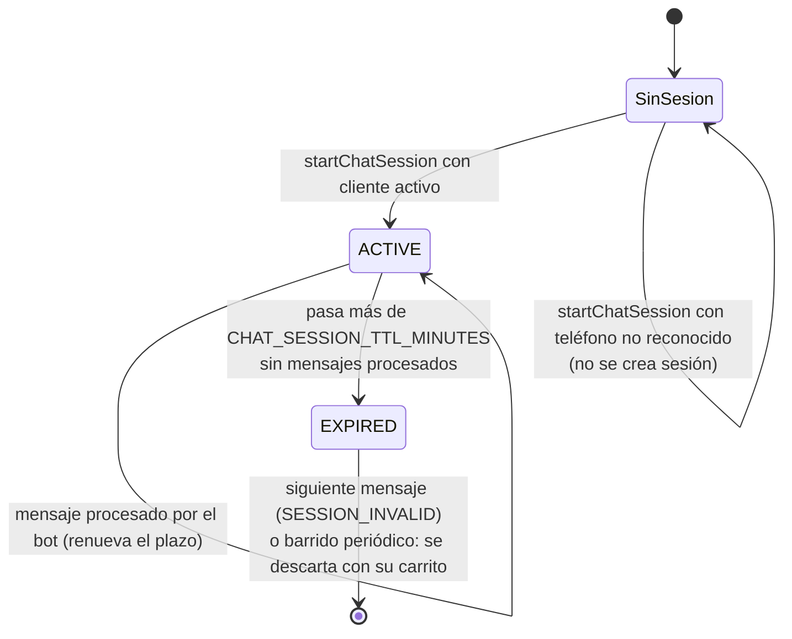
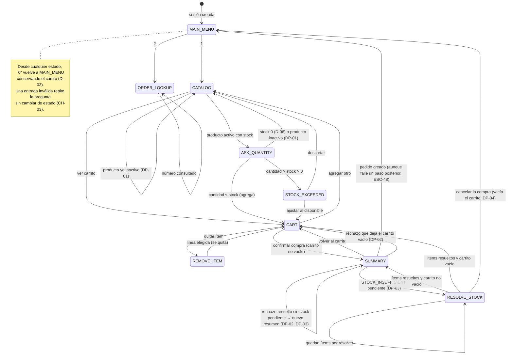

# Spec 03 — Bot conversacional

| Estado | Cubre | Tickets |
|---|---|---|
| Aprobada v1.0 (Entrega 2). Fecha de aprobación: 2026-11-18. Decisiones D-01..D-12 y DP-01..DP-11 aprobadas (alternativa A) el 2026-11-18 | CH-01..CH-08 (partes `MVP`), CH-11, CL-02, CL-03 (consumo), RN-08 · lado chat de RN-02, RN-03, RN-04, RN-12 · Criterios: CA-03, CA-04, CA-05, CA-06, CA-07, CA-14, CA-15, CA-16 · V2: CH-03 (opción 3), CH-08 (reclamo), CH-09, CH-10 | `MVP`: TK-05.7, TK-05.1, TK-05.2, TK-05.4, TK-05.5, TK-05.6, TK-06.3 · relacionados: TK-02.4, TK-05.3 · `V2`: TK-06.6, TK-07.2 |

**Fuentes.** [PRD](../docs/PRD.md) v1.2 · [ARCHITECTURE](../docs/ARCHITECTURE.md) · [`docs/openapi.yaml`](../docs/openapi.yaml) `info.version` 1.0.0 (estado provisional para chat y pedidos, ver OBS-03) · [spec 01](01_data_models.spec.md) Aprobada v1.1 · [spec 02](02_inventory_system.spec.md) · [backlog](../backlog/README.md) US-02 (`MVP`), US-05, US-06, US-07 (`V2`).

Esta spec define **el comportamiento conversacional** del módulo `chat`: identificación, sesión, menú, catálogo, carrito, resumen, confirmación y "Mis pedidos". No repite:

- payloads, schemas, parámetros ni status HTTP: ver `docs/openapi.yaml` por `operationId`;
- la normalización telefónica en detalle (RN-12, TK-02.4): la implementa `customers.service`; ver PRD y OBS-01;
- las reglas de inventario (catálogo, disponibilidad, alertas): ver spec 02;
- la transacción de confirmación, el número de pedido y las transiciones del pedido: ver ARCHITECTURE, spec 01 y spec 04.

El chat **no aplica reglas `RN-`**: las delega en los servicios y solo decide qué mensaje mostrar y a qué estado pasar (RNF-07, ARCHITECTURE "Capas").

**Identificadores locales.** `ESC-`, `D-`, `DP-` y `OBS-` numeran escenarios, decisiones de diseño, decisiones (antes pendientes, ya resueltas) y observaciones **de esta spec**. Cuando se cita un identificador de otra spec, se indica (por ejemplo, "DP-03 de la spec 02").

## 1. Objetivo

Que un cliente B2B registrado y activo compre por chat varios productos con validación de stock en cada paso y sin intervención del operador (PRD §3, objetivo 1), y consulte sus propios pedidos (objetivo 3), mediante un menú determinista sin IA en el producto (PRD §4.3).

## 2. Alcance

### 2.1 Incluido en el MVP

| Capacidad | Requisitos | Sección |
|---|---|---|
| Identificación por teléfono y rechazo de no registrados o inactivos | CH-01, CH-02, CL-02, CL-03, RN-12 | F-1 |
| Sesión en memoria con expiración por inactividad | CH-11 | §4.1, F-2 |
| Menú principal con 1) Catálogo y compra, 2) Mis pedidos; `0` vuelve al menú; entrada inválida repite la pregunta | CH-03 (`MVP`) | §4.2, F-3 |
| Catálogo de productos activos con precio; "Sin stock" no elegible | CH-04 | F-4 |
| Carrito: agregar con cantidad entera > 0, ajustar o descartar si supera el stock, ver y quitar ítems | CH-05 | F-5 |
| Resumen y confirmación final con revalidación de estado, stock y precio | CH-06, RN-02, RN-03 | F-6, F-7 |
| Número de orden en `PENDING` tras confirmar | CH-07, RN-04 | F-7 |
| "Mis pedidos": consulta de un pedido propio por número | CH-08 (`MVP`), RN-08 | F-8 |
| Simulador web estilo WhatsApp | CH-01 | TK-05.4 |

### 2.2 Diferido a V2 (no implementable en el MVP)

| Capacidad | IDs | Tickets |
|---|---|---|
| Opción 3) Reclamo en el menú | CH-03 (`V2`), CH-10, RN-06 | TK-07.2 |
| Estado del reclamo en "Mis pedidos" | CH-08 (`V2`) | TK-07.2 |
| Cancelación de pedidos por el cliente | CH-09, RN-05 (cliente), CA-08 | TK-06.6 |

En el MVP el menú no muestra estas opciones y el bot no ofrece cancelar un pedido (CH-03, TK-06.3). Ver §13.

### 2.3 Fuera de esta spec

- Integración con WhatsApp real y verificación de titularidad del teléfono (PRD §4.3, RN-12 "Alcance").
- Listado de todos los pedidos del cliente: CH-08 solo prevé la consulta por número de orden.
- Modificar la cantidad de una línea del carrito como acción propia: CH-05 prevé agregar, ver y quitar ítems. Agregar un producto ya presente suma a su línea (US-05 crit. 5, D-05).
- Persistencia de sesiones o carritos y recuperación tras reinicio del backend (PRD §10, ARCHITECTURE "Limitaciones conocidas").
- Límite de intentos de identificación (`startChatSession`, limitación conocida del contrato).
- Cierre explícito de la conversación por el bot (DP-11).
- Idempotencia de la confirmación y persistencia de sesiones en PostgreSQL: pertenecen a una evolución posterior (§12.4). En el MVP no existen clave de idempotencia, tabla de sesiones ni cambios de contrato.

## 3. Actores y componentes

| Actor / componente | Responsabilidad | No hace |
|---|---|---|
| **Cliente B2B** | Indica su teléfono y conversa con el bot (CH-01) | — |
| **Simulador de chat (frontend, `/chat`)** | Envía el teléfono y los mensajes; muestra los mensajes que devuelve la API; ofrece reiniciar la conversación (TK-05.4) | No contiene lógica de flujo ni reglas `RN-`. No usa `active` para detectar la expiración (DP-11) |
| **Chat FSM (`chat`)** | Interpreta mensajes, mantiene la sesión, el estado de conversación y el carrito; procesa en serie los mensajes de cada sesión (DP-08); llama a los servicios; elige el mensaje | No accede a Prisma ni aplica reglas `RN-` (ARCHITECTURE "Capas") |
| **`customers.service`** | Normaliza el teléfono (RN-12) e identifica al cliente (CL-03) | — |
| **`products.service`** | Catálogo de productos activos y disponibilidad (si el producto está activo y su stock actual) (spec 02 F-7, §8.2) | No conoce el carrito |
| **`orders.service`** | Confirma el pedido de forma atómica y devuelve el número o los motivos de rechazo; consulta un pedido por número filtrando por cliente (RN-08) | No conoce mensajes del chat |

## 4. Modelo de estados

Se usan cuatro modelos **separados** (D-01). Ninguno se deduce de otro.

| Modelo | Dueño | Dónde vive | Sección |
|---|---|---|---|
| Estado de **sesión** | Chat FSM | Memoria del backend | §4.1 |
| Estado de **conversación** | Chat FSM | Memoria, dentro de la sesión | §4.2 |
| Estado del **carrito** | Chat FSM | Memoria, dentro de la sesión | §4.3 |
| Estado del **pedido** | `orders.service` | PostgreSQL (spec 01) | §4.4 |

### 4.1 Sesión

| Estado | Significado | Datos | Transiciones |
|---|---|---|---|
| Sin sesión | No hay sesión para esa conversación | — | `startChatSession` crea `ACTIVE` solo si el cliente existe y está activo (CL-02, CL-03) |
| `ACTIVE` | Acepta mensajes | Identificador opaco (UUID), cliente identificado, hora del último mensaje aceptado, estado de conversación, carrito | Renueva la hora todo mensaje que llega a ser procesado por el bot, **incluidas las entradas conversacionales inválidas**. **No** la renuevan: JSON inválido (`MALFORMED_REQUEST`), mensajes rechazados por la validación de transporte (`VALIDATION_ERROR`) ni peticiones con sesión inválida o expirada (`SESSION_INVALID`) (DP-06) |
| `EXPIRED` | Superó el plazo de inactividad. Es lógico: no necesita guardarse | — | El siguiente mensaje responde `SESSION_INVALID`, no se procesa y la sesión se descarta con su carrito. El barrido periódico la elimina si nadie vuelve a usarla (ARCHITECTURE, TK-05.7) |

- El plazo es `CHAT_SESSION_TTL_MINUTES`, configurable, 30 minutos por defecto (CH-11, TK-00.1).
- Una sesión descartada no se recupera: el cliente inicia otra con `startChatSession`, con el carrito vacío (CH-11, PRD §10). El botón de reinicio del simulador hace lo mismo (TK-05.4).
- Las sesiones se pierden al reiniciar el backend (PRD §10). No hay persistencia.
- **Varias sesiones del mismo cliente** pueden estar abiertas a la vez, cada una con su propio carrito. La competencia por stock entre ellas se resuelve con las validaciones transaccionales de la confirmación (RN-02; DP-09).
- **Procesamiento en serie por sesión (DP-08).** Los mensajes de una misma sesión se procesan de uno en uno; ver F-7, "Mensajes simultáneos". La garantía supone **una sola instancia del backend**, coherente con las sesiones en memoria (ARCHITECTURE, "Limitaciones conocidas").
- **La sesión no se persiste.** Su estado no forma parte de ninguna transacción de PostgreSQL; la relación entre la confirmación del pedido y el cambio de estado de la sesión se define en F-7, "Cierre de la confirmación", con sus límites en §12.4.
- **`active` en las respuestas (DP-11).** En el MVP, toda respuesta normal de `sendChatMessage` lleva `active: true`. La expiración se comunica solo con `SESSION_INVALID`.

### 4.2 Conversación

Estados del FSM dentro de una sesión `ACTIVE`. Las transiciones se declaran como tabla o mapa, no como `if` anidados (TK-05.1).

| Estado | Descripción | Datos que conserva | Opciones (eventos) | Destino y condición | Entrada inválida |
|---|---|---|---|---|---|
| `MAIN_MENU` | Menú principal (CH-03 `MVP`) | Carrito | `1` Catálogo y compra · `2` Mis pedidos | `1` → `CATALOG` · `2` → `ORDER_LOOKUP` | Repite el menú. `3` es inválido en el MVP |
| `CATALOG` | Lista de productos activos con precio; los de stock 0 como "Sin stock" (CH-04) | Carrito · correspondencia número mostrado → producto de la última lista (D-04) | Número de un producto de la lista · ver carrito | Producto que **sigue activo** y con stock > 0 → `ASK_QUANTITY` · producto ya inactivo → informa que no está disponible, no lo agrega y repite la lista (DP-01) · ver carrito → `CART` | Número fuera de la lista, producto "Sin stock" o texto no reconocido: informa y repite la lista |
| `ASK_QUANTITY` | Pide la cantidad del producto elegido (CH-05) | Carrito · producto elegido | Entero > 0 | Se revalida estado y stock (spec 02 F-7): inactivo → informa y `CATALOG` (DP-01) · cantidad resultante de la línea ≤ stock → agrega y `CART` (D-05) · > stock y stock > 0 → `STOCK_EXCEEDED` · stock 0 → informa que está agotado y `CATALOG` (D-06) | 0 no es cantidad (vuelve al menú); negativo, decimal o texto: repite la pregunta |
| `STOCK_EXCEEDED` | La cantidad supera el stock (CH-05, CA-04) | Carrito · producto · cantidad pedida · stock disponible informado | `1` ajustar al disponible · `2` descartar el ítem | `1` → la línea queda en el máximo disponible y `CART` · `2` → no se agrega nada y `CATALOG` | Repite las dos opciones |
| `CART` | Muestra las líneas del carrito (CH-05) | Carrito | Agregar otro producto · quitar un ítem · confirmar compra | Agregar → `CATALOG` · quitar → `REMOVE_ITEM` (si hay líneas) · confirmar → `SUMMARY` si hay líneas; si está vacío, informa y sigue en `CART` | Repite el carrito y sus opciones |
| `REMOVE_ITEM` | Pide la línea a quitar (CH-05) | Carrito | Número de línea | Línea válida → se quita y `CART` | Repite la lista de líneas |
| `SUMMARY` | Resumen con ítems, subtotales y total a precios vigentes; pide confirmación final (CH-06) | Carrito · **precio mostrado de cada ítem** (D-07) | `1` confirmar · `2` volver al carrito | Ver F-7: pedido creado → `MAIN_MENU` con el carrito vacío, aunque después falle otro paso (D-08, "Cierre de la confirmación") · rechazo → resolución según DP-02 y DP-03 · error sin pedido creado (ROLLBACK) → sigue en `SUMMARY` con el mismo contexto (DP-07) · `2` → `CART` (el resumen deja de ser válido, D-07) | Repite el resumen y sus opciones |
| `RESOLVE_STOCK` | Resuelve, de uno en uno y en el orden del carrito, los ítems sin stock suficiente (CH-06, D-09) | Carrito · lista de ítems pendientes con su stock disponible | `1` ajustar al disponible · `2` quitar el ítem · `3` cancelar la compra | `1`/`2` → siguiente ítem pendiente; si no quedan: `SUMMARY` nuevo, o `CART` si el carrito quedó vacío · `3` → **vacía el carrito** y `MAIN_MENU` (DP-04) | Repite las opciones del ítem en curso |
| `ORDER_LOOKUP` | Pide un número de orden y muestra el pedido si es propio (CH-08, RN-08) | Carrito (intacto) | Texto con un número de orden | Pedido propio → muestra número, estado, ítems y total · cualquier otro → "Pedido no encontrado". En ambos casos sigue en `ORDER_LOOKUP` (D-11) | No aplica: toda entrada distinta de `0` se trata como número de orden (D-12, DP-10) |

Reglas comunes a todos los estados:

- **`0`** vuelve a `MAIN_MENU` y muestra el menú (CH-03). **El carrito se conserva** (D-03). Si se sale de `SUMMARY`, el resumen deja de ser válido (D-07).
- **Entrada inválida:** el bot repite la pregunta del estado actual; no cambia el estado ni el carrito (CH-03). No es un error HTTP (contrato, `sendChatMessage`) y sí renueva el plazo de la sesión (DP-06).
- Las claves de entrada (`1`, `2`, `3`, número de producto o de línea) siguen D-02. Los textos exactos de los mensajes se fijan en la implementación, salvo los que el PRD cita literalmente ("Sin stock", "Pedido no encontrado") y el de expiración (DP-05).

### 4.3 Carrito

| Estado | Condición | Efecto en la conversación |
|---|---|---|
| Vacío | Sin líneas | `CART` informa que está vacío; no se puede pasar a `SUMMARY` ni a `REMOVE_ITEM` |
| Con ítems | Una o más líneas `{producto, cantidad}`, una por producto (US-05 crit. 5, spec 01 único `(order_id, product_id)`) | Permite resumen y confirmación |

- El carrito **no reserva stock** (RN-02). No guarda precios: el precio se toma vigente al mostrar el resumen (CH-06).
- Se **vacía** cuando: se crea el pedido (D-08), el cliente cancela la compra en `RESOLVE_STOCK` (DP-04) o quita la última línea. Pierde líneas cuando la confirmación retira productos inactivos (DP-02). Se **pierde** con la sesión al expirar o reiniciar (D-03, CH-11, PRD §10).
- **Nunca entra al carrito** un producto que ya está inactivo al elegirlo o al validar su cantidad (DP-01).
- Un producto desactivado **después** de agregarse permanece en el carrito hasta la confirmación. Ahí se rechaza con `PRODUCT_INACTIVE`, se retira del carrito y el pedido nunca lo incluye (RN-02, CA-14, DP-02).

### 4.4 Pedido (solo lectura para el chat)

El chat solo **crea** un pedido mediante `orders.service` tras una confirmación válida (estado inicial `PENDING`, CH-07) y lo **consulta** en "Mis pedidos". Las transiciones de RN-05 son del operador y se especifican en la spec 04. En el MVP el chat no cancela pedidos (CH-09 es `V2`).

## 5. Reglas y decisiones aplicables

### 5.1 Reglas del PRD

| Regla / requisito | Cómo se manifiesta en el chat | Quién la aplica |
|---|---|---|
| CH-02, CL-02, CL-03 | Teléfono no registrado, de cliente inactivo o inválido: mensaje de contacto, sin menú y sin sesión | `customers.service` identifica; el FSM elige el mensaje |
| RN-12 | El teléfono se normaliza según la definición única de RN-12 y se compara por igualdad con el normalizado del cliente. Esta spec no añade reglas propias de normalización | `customers.service` (TK-02.4) |
| CH-03 (`MVP`) | Menú con dos opciones; `0` y entrada inválida | FSM |
| CH-04, RN-10 | Catálogo solo de activos; stock 0 como "Sin stock", no elegible | `products.service` (spec 02 F-7) |
| CH-05, CA-04 | Cantidad entera > 0; si supera el stock, ajustar o descartar | FSM con la disponibilidad de `products.service` |
| RN-02 | El carrito no reserva; la confirmación revalida producto activo y stock; gana el primero en confirmar | `orders.service` |
| RN-03, CA-15 | El resumen usa precios vigentes; si cambian antes de confirmar, no se crea el pedido y se muestra un nuevo resumen que exige otra confirmación | `orders.service` detecta `PRICE_CHANGED`; el FSM muestra el nuevo resumen |
| RN-02, CA-14 | Un producto desactivado tras agregarse al carrito se rechaza y el pedido no se crea con él | `orders.service` detecta `PRODUCT_INACTIVE`; el FSM lo retira y pide reconfirmar (DP-02) |
| CH-07, RN-04 | Pedido confirmado: número `MED-` seguido de al menos cinco dígitos, sin máximo, en `PENDING` | `orders.service` y la base (spec 01) |
| CH-08, RN-08, CA-07 | Solo pedidos del cliente de la sesión; cualquier otro número: "Pedido no encontrado" | `orders.service` filtra por cliente |
| CH-11, CA-16 | Inactividad mayor al plazo: sesión inválida, mensaje no procesado, carrito perdido | FSM (almacén de sesiones) |

**No se crea ningún pedido sin una confirmación válida del cliente en `SUMMARY`** (CH-06): ni al agregar al carrito, ni al mostrar el resumen, ni al resolver un rechazo. Toda vuelta tras un rechazo pasa por un resumen nuevo y una confirmación nueva, y **una confirmación válida produce como máximo un pedido** (DP-08).

### 5.2 Decisiones de diseño (aprobadas)

Aprobadas por el responsable del proyecto el 2026-11-18. Ninguna cambia una regla del PRD.

| ID | Decisión aprobada | Base |
|---|---|---|
| D-01 | Sesión, conversación, carrito y pedido mantienen ciclos de vida separados (§4) | ARCHITECTURE (FSM con sesión y carrito en memoria; pedido en `orders`) |
| D-02 | Las opciones se eligen con números (`1`, `2`, `3` según el estado); los números de producto y de línea corresponden a la lista mostrada; `0` está reservado para volver al menú principal | CH-03 ("menú determinista", PRD §4.3) |
| D-03 | Volver al menú con `0` conserva el carrito. El carrito se pierde al reiniciar o expirar la sesión | PRD §10 |
| D-04 | Los números de producto se resuelven con la última lista de catálogo mostrada en esa sesión; no cambian de significado por una actualización posterior del catálogo | CH-04 |
| D-05 | Al agregar un producto ya presente, se valida contra el stock la cantidad total resultante de la línea; "ajustar" deja la línea en el máximo disponible | US-05 crit. 5, CH-05 |
| D-06 | Si el stock disponible es 0, el bot informa que el producto está agotado y vuelve al catálogo; no ofrece ajustar la cantidad a 0 | CH-04 (agotado no elegible) |
| D-07 | El resumen conserva los precios mostrados al cliente. Si el cliente sale del resumen sin confirmar (`2` o `0`), ese resumen deja de ser válido y cualquier confirmación posterior exige un resumen nuevo con precios vigentes | ARCHITECTURE (confirmación), RN-03 |
| D-08 | Al crear el pedido: se vacía el carrito, se vuelve a `MAIN_MENU` y todo mensaje posterior se procesa según ese estado; repetir la entrada anterior no genera otro pedido. Cubre las repeticiones secuenciales; la concurrencia la cubre DP-08 | CH-07 |
| D-09 | Los ítems con `STOCK_INSUFFICIENT` se resuelven de uno en uno, en el orden del carrito | CH-06 |
| D-10 | El resumen no realiza la validación definitiva de estado y stock; la confirmación es el único punto de validación atómica | RN-02, ARCHITECTURE |
| D-11 | Tras mostrar un pedido o informar que no fue encontrado, el bot sigue en `ORDER_LOOKUP` para otra consulta; `0` vuelve al menú principal | CH-08 |
| D-12 | En `ORDER_LOOKUP`, toda entrada que no identifique un pedido del cliente produce "Pedido no encontrado", sin distinguir formato inválido, pedido inexistente o pedido de otro cliente | RN-08 ("cualquier otro número de orden") |

Las resoluciones DP-01..DP-11 están en §12.1 y se aplican en las secciones que cada una indica.

## 6. Flujos funcionales

### F-1 · Identificación (CH-01, CH-02, CL-02, CL-03, RN-12)

1. El cliente indica en el simulador el teléfono desde el que "escribe".
2. El frontend llama a `startChatSession`.
3. `customers.service` normaliza el teléfono (RN-12) y busca al cliente por igualdad del teléfono normalizado (CL-03).
4. Resultado:
   - **Cliente activo:** se crea la sesión `ACTIVE` en `MAIN_MENU` y la respuesta trae el saludo y el menú (CH-03).
   - **Teléfono no registrado, de cliente inactivo, con formato inválido o no normalizable** (incluido uno solo de espacios): **no se crea sesión**; la respuesta trae el mensaje de CH-02 y no muestra el menú (CA-06). La respuesta es la misma en los cuatro casos.
   - **Teléfono ausente o vacío:** error de validación del contrato; no se crea sesión.
5. Un cliente puede iniciar otra conversación mientras tiene una abierta; cada una tiene su carrito (DP-09).

### F-2 · Ciclo de la sesión (CH-11, CA-16)

1. Cada mensaje enviado con `sendChatMessage` comprueba primero la sesión.
2. Si no existe, o si desde el último mensaje procesado pasó más de `CHAT_SESSION_TTL_MINUTES`: responde `SESSION_INVALID`, **no procesa el mensaje** y descarta la sesión con su carrito. El texto es el de ejemplo del contrato para `SESSION_INVALID` (DP-05).
3. Si está activa: procesa el mensaje según §4.2 y renueva la hora de actividad. La renuevan también las entradas conversacionales inválidas; no la renuevan los rechazos por JSON inválido, validación de transporte o sesión inválida (DP-06).
4. Para seguir, el cliente inicia una conversación nueva (F-1). El simulador muestra la respuesta de la API y permite reiniciar (TK-05.4); detecta la expiración por `SESSION_INVALID`, no por `active` (DP-11).

### F-3 · Navegación (CH-03)

`MAIN_MENU` ofrece solo las opciones `MVP`. `0` vuelve al menú desde cualquier estado conservando el carrito (D-03). Una entrada inválida repite la pregunta del estado actual. El carrito se alcanza dentro de "Catálogo y compra"; el menú no tiene una opción propia de carrito (OBS-06).

### F-4 · Catálogo (CH-04)

1. En `MAIN_MENU`, `1` lleva a `CATALOG`.
2. El FSM pide a `products.service` el catálogo (productos activos con precio y stock, spec 02 F-7) y lo muestra numerado. Los de stock 0 aparecen como "Sin stock". Los inactivos no aparecen (RN-10).
3. El cliente elige un número, que se resuelve con la lista mostrada (D-04). El FSM revalida el producto con la consulta de disponibilidad (spec 02 F-7, §8.2):
   - activo con stock > 0 → `ASK_QUANTITY`;
   - **ya inactivo** → informa que no está disponible, no lo agrega y sigue en `CATALOG` (DP-01);
   - "Sin stock", número fuera de la lista o texto → entrada inválida, repite la lista.

### F-5 · Carrito (CH-05, CA-04)

1. En `ASK_QUANTITY`, el cliente indica un entero > 0. Otra entrada repite la pregunta.
2. El FSM vuelve a consultar la disponibilidad (estado y stock actual) y compara con la cantidad resultante de la línea (D-05):
   - **inactivo:** informa, no lo agrega y vuelve a `CATALOG` (DP-01);
   - **≤ stock:** agrega o suma a la línea y pasa a `CART`;
   - **> stock y stock > 0:** `STOCK_EXCEEDED` ofrece `1` ajustar al máximo disponible o `2` descartar (CA-04);
   - **stock 0:** informa que está agotado y vuelve a `CATALOG` (D-06).
3. En `CART` el cliente puede agregar otro producto, quitar un ítem (`REMOVE_ITEM`) o confirmar la compra.
4. Confirmar con el carrito vacío no avanza: el bot informa que está vacío.

### F-6 · Resumen (CH-06)

1. Desde `CART`, confirmar lleva a `SUMMARY`.
2. El FSM obtiene los **precios vigentes** de cada producto del carrito, calcula subtotales y total, y guarda en la sesión el precio mostrado de cada ítem (ARCHITECTURE "Confirmación de pedido", D-07).
3. Pide confirmación explícita: `1` confirmar, `2` volver al carrito. Ningún pedido existe todavía. El resumen no valida estado ni stock (D-10).

### F-7 · Confirmación (CH-06, CH-07, RN-02, RN-03, RN-04, CA-03, CA-05, CA-14, CA-15)

1. En `SUMMARY`, `1` envía a `orders.service` el cliente de la sesión y los ítems con su precio mostrado.
2. `orders.service` ejecuta la operación atómica de ARCHITECTURE (descuento condicional en orden de `productId`, comparación con el precio vigente, número desde la secuencia). Su detalle es de la spec 04 (TK-05.3).
3. El servicio devuelve **un** resultado:

| Resultado de `orders.service` | Efecto persistido | Respuesta del chat | Estado siguiente |
|---|---|---|---|
| Pedido creado | Pedido `PENDING` con sus ítems y precio congelado; stock descontado (CA-03) | Número de orden y estado `PENDING` (CH-07) | Carrito vacío, `MAIN_MENU` (D-08) |
| Rechazo con motivos | Nada: no hay pedido ni cambio de stock (RNF-03) | Se resuelve con el procedimiento siguiente (DP-02, DP-03) | Según el procedimiento |
| Error **sin pedido creado**: la transacción hizo ROLLBACK (incluido agotar los reintentos por interbloqueo, ARCHITECTURE) | Nada | Error `INTERNAL_ERROR` del contrato, con su mensaje genérico, sin detalles internos | Sigue en `SUMMARY` con el carrito y los precios mostrados; el cliente puede reintentar con `1`, y el reintento vuelve a validar estado, stock y precios (DP-07) |
| Error **después** de que `orders.service` devolvió el pedido creado (por ejemplo, al construir la respuesta) | Pedido `PENDING` ya confirmado (COMMIT) | Error `INTERNAL_ERROR` del contrato, con su mensaje genérico | `MAIN_MENU` con el carrito vacío: la sesión **no** vuelve a `SUMMARY` (ver "Cierre de la confirmación", ESC-48) |

**Cierre de la confirmación (C1).** El pedido vive en PostgreSQL y la sesión en memoria, así que **no** se confirman en una misma transacción: esta spec **no** garantiza la atomicidad conjunta de pedido y sesión. Lo que sí garantiza, con una sola instancia del backend:

1. **Orden de cierre.** En cuanto `orders.service` devuelve un pedido creado, el FSM pasa la sesión a `MAIN_MENU` y vacía el carrito como **primer paso** tras esa devolución, antes de construir la respuesta o de cualquier otra operación que pueda fallar.
2. **Irreversibilidad.** Ningún error posterior a ese paso devuelve la sesión a `SUMMARY` ni restaura el carrito o los precios mostrados.
3. **Distinción de DP-07.** La sesión conserva `SUMMARY` solo cuando `orders.service` **no** devolvió un pedido creado, es decir, cuando la transacción hizo ROLLBACK.
4. **Exclusión con el siguiente mensaje.** Por DP-08, el siguiente mensaje de la sesión no se procesa hasta que termina el procesamiento en curso, incluido el paso 1; por eso siempre lo encuentra en `MAIN_MENU` si se creó el pedido.

Resultado verificable: una confirmación cuyo pedido se creó produce como máximo un pedido, aunque falle un paso posterior y el cliente reintente (ESC-35, ESC-48). Los casos fuera de esta garantía están en §12.4.

**Procedimiento ante un rechazo (DP-02, DP-03).** Se aplica en este orden, sobre la lista completa de ítems y motivos que devuelve el servicio:

1. **Productos inactivos (`PRODUCT_INACTIVE`, DP-02):** se retiran del carrito y se informa al cliente que ya no están disponibles.
2. **Stock insuficiente (`STOCK_INSUFFICIENT`):** si quedan ítems con este motivo, se pasa a `RESOLVE_STOCK` y se resuelven de uno en uno (D-09): ajustar al disponible, quitar el ítem o cancelar la compra (DP-04: vacía el carrito y vuelve al menú).
3. **Nuevo resumen:** con los ítems restantes se genera un resumen nuevo con los precios vigentes, lo que incorpora cualquier `PRICE_CHANGED` (CA-15), y se pide una confirmación nueva. Si el carrito quedó vacío, se vuelve a `CART` para que el cliente continúe o abandone la compra.
4. **Nunca** se confirma con el resumen anterior: la confirmación nueva repite el paso 2 con todas sus validaciones. Si el precio vuelve a cambiar, se repite `PRICE_CHANGED` (RN-03).

Un rechazo solo por `PRICE_CHANGED` va directo al paso 3. Ningún pedido creado incluye un producto inactivo.

`STOCK_INSUFFICIENT`, `PRODUCT_INACTIVE` y `PRICE_CHANGED` son **códigos de dominio internos** entre `orders.service` y el FSM. No son errores HTTP: la respuesta de `sendChatMessage` es una respuesta normal del bot con los mensajes correspondientes (contrato, "Códigos de dominio de la confirmación").

**Mensajes repetidos o simultáneos en la misma sesión.**
- **Repetido** después de crear el pedido: el estado ya es `MAIN_MENU`, así que la entrada se interpreta como opción del menú y no se crea otro pedido (D-08).
- **Simultáneos (DP-08):** los mensajes de una misma sesión se procesan **secuencialmente**. Garantías obligatorias:
  1. Si llegan dos mensajes a la vez, el segundo espera a que termine el procesamiento del primero.
  2. El segundo se interpreta con el estado de conversación ya actualizado por el primero.
  3. La creación del pedido y la transición del estado de conversación quedan dentro del **mismo procesamiento serializado**: la transición se aplica como primer paso tras la devolución del pedido ("Cierre de la confirmación"), antes de liberar la sesión para el siguiente mensaje. No es una transacción conjunta de PostgreSQL (§12.4).
  4. Una confirmación efectiva produce como máximo un pedido.
  5. Una segunda confirmación no genera otro pedido a partir del mismo resumen: tras el primer pedido el estado es `MAIN_MENU` y el resumen ya no existe.
  6. La serialización se limita a la sesión: no bloquea a otras sesiones, ni siquiera a otras del mismo cliente.

  **Relación entre las piezas:** la serialización ordena los mensajes de la sesión; la transacción de `orders.service` hace atómico el pedido con su stock (RNF-03); el cierre de la confirmación fija el estado de la sesión antes de que pueda entrar otro mensaje. Las tres juntas dan la garantía de "como máximo un pedido" dentro de los límites de §12.4. El mecanismo concreto (cola, cerrojo u otro) es de implementación (TK-05.7). Supone una sola instancia del backend. No hay código HTTP nuevo ni cambio de contrato.
- **Sesiones distintas** por las mismas unidades: gana la primera; las demás reciben `STOCK_INSUFFICIENT` (RN-02, CA-05, RNF-04).

### F-8 · Mis pedidos (CH-08 `MVP`, RN-08, CA-07)

1. En `MAIN_MENU`, `2` lleva a `ORDER_LOOKUP`, que pide un número de orden.
2. La entrada se normaliza (DP-10): se eliminan los espacios externos y se convierte a mayúsculas. Se compara con el número completo (`MED-` seguido de al menos cinco dígitos, sin máximo, RN-04). No se acepta solo la parte numérica.
3. El FSM pide a `orders.service` el pedido con ese número **y** del cliente de la sesión (RN-08).
4. Si existe y es propio: muestra número de orden, estado, ítems y total. No muestra reclamos (CH-08 `V2`) ni ofrece cancelar (CH-09 `V2`).
5. En cualquier otro caso (ajeno, inexistente o entrada que no es un número de orden completo): "Pedido no encontrado" (D-12).
6. Sigue en `ORDER_LOOKUP` (D-11). El carrito no cambia.

## 7. Operaciones del contrato (`docs/openapi.yaml`, tag `Chat`)

Ambas son públicas (`security: []`). Los status HTTP, payloads y parámetros están solo en el contrato.

| `operationId` | Responsabilidad funcional | Momento del flujo | Reglas | Errores definidos por el contrato | Tickets |
|---|---|---|---|---|---|
| `startChatSession` | Identificar al cliente por teléfono y crear la sesión solo si está activo; si no, devolver el mensaje de CH-02 sin sesión (`sessionId` nulo, `active` falso) | F-1: inicio y cada reinicio de conversación | CH-01, CH-02, CH-03, CL-02, CL-03, RN-12, CA-06 | `MALFORMED_REQUEST` · `VALIDATION_ERROR` (teléfono ausente o vacío) · `INTERNAL_ERROR` | TK-05.1, TK-05.7, TK-02.4, TK-05.4 |
| `sendChatMessage` | Entregar un mensaje al FSM y devolver las respuestas del bot (`active: true`, DP-11); un mensaje no entendido no es error HTTP | F-2 a F-8: todo mensaje posterior a la identificación | CH-03..CH-08, CH-11, RN-02, RN-03, RN-04, RN-08, CA-03, CA-04, CA-05, CA-07, CA-14, CA-15, CA-16 | `MALFORMED_REQUEST` · `VALIDATION_ERROR` (`sessionId` no UUID, texto fuera de esquema) · `SESSION_INVALID` (inexistente o expirada) · `INTERNAL_ERROR` | TK-05.1, TK-05.7, TK-05.2, TK-05.6, TK-06.3, TK-05.4 |

Los rechazos de confirmación (`STOCK_INSUFFICIENT`, `PRODUCT_INACTIVE`, `PRICE_CHANGED`), "Sin stock", "Pedido no encontrado" y las entradas inválidas **no** son errores HTTP: se expresan como mensajes del bot en una respuesta normal de `sendChatMessage`.

**Compatibilidad con el contrato.** Todo el comportamiento de esta spec se expresa con las dos operaciones existentes, sin cambios. El significado de `active` en las respuestas normales queda fijado por DP-11, y la concurrencia en una misma sesión se resuelve sin código HTTP nuevo (DP-08).

## 8. Errores y situaciones límite

| Situación | Tipo | Respuesta | Estado tras el evento | Escenario |
|---|---|---|---|---|
| Teléfono no registrado | Conversacional (F-1) | Mensaje de CH-02, sin sesión ni menú | Sin sesión | ESC-02 |
| Teléfono de cliente inactivo | Conversacional | Igual que no registrado (CL-02) | Sin sesión | ESC-03 |
| Teléfono con formato inválido o solo espacios | Conversacional | Igual que no registrado (RN-12) | Sin sesión | ESC-04 |
| Teléfono ausente o `""` | HTTP `VALIDATION_ERROR` | Error del contrato | Sin sesión | ESC-05 |
| Sesión expirada | HTTP `SESSION_INVALID` | Error del contrato con su texto de ejemplo (DP-05); mensaje no procesado | Sesión descartada, carrito perdido | ESC-08 |
| Sesión inexistente | HTTP `SESSION_INVALID` | Error del contrato | — | ESC-09 |
| `sessionId` no UUID o texto fuera de esquema | HTTP `VALIDATION_ERROR` | Error del contrato; no renueva el plazo (DP-06) | Sin cambios | ESC-10, ESC-45 |
| Producto inexistente (número fuera de la lista) | Entrada inválida | Repite la lista | `CATALOG` | ESC-19 |
| Producto "Sin stock" | Entrada inválida | Informa que no se puede elegir y repite la lista | `CATALOG` | ESC-18 |
| Producto desactivado entre la lista y la elección o la cantidad | Conversacional (DP-01) | Informa que no está disponible; no lo agrega | `CATALOG` | ESC-43 |
| Cantidad inválida | Entrada inválida | Repite la pregunta | `ASK_QUANTITY` | ESC-21 |
| Cantidad mayor que el stock | Conversacional | Ajustar o descartar | `STOCK_EXCEEDED` | ESC-22 |
| Carrito vacío al confirmar | Conversacional | Informa que está vacío | `CART` | ESC-25 |
| Stock insuficiente al confirmar | Dominio `STOCK_INSUFFICIENT` | Ajustar, quitar o cancelar | `RESOLVE_STOCK` | ESC-29, ESC-44 |
| Producto inactivo al confirmar | Dominio `PRODUCT_INACTIVE` | Lo retira, informa y muestra un nuevo resumen (DP-02) | `SUMMARY`, o `CART` si el carrito queda vacío | ESC-30, ESC-47 |
| Cambio de precio al confirmar | Dominio `PRICE_CHANGED` | Nuevo resumen; nueva confirmación | `SUMMARY` | ESC-31, ESC-32 |
| Varios motivos a la vez | Dominio | Inactivos → stock → nuevo resumen (DP-03) | Según el procedimiento de F-7 | ESC-33 |
| Confirmación repetida tras crear el pedido | Conversacional | Se interpreta en el menú | `MAIN_MENU` | ESC-34 |
| Confirmaciones simultáneas en la misma sesión | Conversacional (DP-08) | Exactamente un pedido; la segunda se procesa después en `MAIN_MENU` | `MAIN_MENU` | ESC-35 |
| Mensaje inesperado para el estado | Entrada inválida | Repite la pregunta del estado | Sin cambios | ESC-16 |
| Error interno sin pedido creado (ROLLBACK) | HTTP `INTERNAL_ERROR` | Error genérico del contrato; sin pedido ni cambio de stock | `SUMMARY` conservado; reintento posible (DP-07) | ESC-37 |
| Error interno después de crear el pedido | HTTP `INTERNAL_ERROR` | Error genérico del contrato; el pedido existe | `MAIN_MENU` con carrito vacío; un reintento no crea otro pedido | ESC-48 |
| Conexión perdida durante el COMMIT (resultado desconocido) | HTTP `INTERNAL_ERROR` | Error genérico del contrato | Limitación conocida (§12.4) | — |
| Pedido de otro cliente | Conversacional | "Pedido no encontrado" (RN-08) | `ORDER_LOOKUP` | ESC-40 |

## 9. Integridad y consistencia

1. **Sin pedido sin confirmación.** Solo `SUMMARY` + `1` invoca la creación del pedido. Ningún otro estado lo hace.
2. **Como máximo un pedido por confirmación efectiva.** Los mensajes de una sesión se procesan en serie (DP-08) y, en cuanto se crea el pedido, la sesión pasa a `MAIN_MENU` antes de cualquier otro paso y no vuelve a `SUMMARY` (F-7, "Cierre de la confirmación"). Repetir la entrada tras el pedido no crea otro (D-08). No es una atomicidad conjunta de pedido y sesión en PostgreSQL; sus límites están en §12.4.
3. **Sin pedidos parciales.** La confirmación es atómica (RNF-03): o se crea el pedido completo y baja el stock de todos los ítems, o no cambia nada.
4. **Sin productos inactivos en pedidos.** Se filtran al elegir (DP-01) y se rechazan y retiran al confirmar (RN-02, DP-02).
5. **Precio coherente.** El precio guardado en el pedido es el vigente al confirmar y coincide con el último resumen que el cliente confirmó (RN-03, D-07).
6. **Carrito no autoritativo.** El carrito es una intención en memoria; nunca bloquea stock ni se usa como fuente de verdad del stock o del precio (RN-02).
7. **Aislamiento entre clientes.** La sesión fija el cliente; "Mis pedidos" y la confirmación usan siempre ese cliente (RN-08). Las sesiones de un mismo cliente son independientes entre sí (DP-09).
8. **Sesión efímera.** Expirar o reiniciar descarta la sesión y su carrito; no existe recuperación (CH-11, PRD §10).

## 10. Escenarios verificables

Nivel: **U** unidad (FSM con servicios simulados y reloj controlado) · **I** integración contra PostgreSQL · **C** concurrencia con peticiones en paralelo · **E** E2E (Playwright).

### 10.1 Identificación (F-1)

| ID | Precondiciones | Entrada | Acción | Resultado esperado | Trazas | Nivel |
|---|---|---|---|---|---|---|
| ESC-01 | Cliente activo con teléfono guardado `+56912345678` | `9 1234 5678`, `912345678`, `+56 9 1234 5678` (tres conversaciones) | `startChatSession` | Las tres crean sesión del mismo cliente; la respuesta trae saludo y menú con solo 1) y 2) | CH-02, CH-03, CL-03, RN-12 · US-02 crit. 1 · TK-05.1, TK-02.4 | I |
| ESC-02 | Ningún cliente con ese teléfono | `+56 9 0000 0000` | `startChatSession` | No se crea sesión (`sessionId` nulo); mensaje de contacto; sin menú | CH-02, CA-06 · US-05 crit. 1 · TK-05.1, TK-05.5 | I, E |
| ESC-03 | Cliente inactivo del seed | Su teléfono | `startChatSession` | Igual que ESC-02 | CL-02, CA-06 · US-02 crit. 3 · TK-05.1, TK-05.5 | I, E |
| ESC-04 | — | `abc`, `   ` | `startChatSession` | Igual que ESC-02 | RN-12 · US-02 crit. 2 · TK-05.1 | I |
| ESC-05 | — | `phone` ausente o `""` | `startChatSession` | `VALIDATION_ERROR`; no se crea sesión | RN-12 · contrato · TK-05.1 | I |
| ESC-06 | Fixtures de TK-02.4: clientes con teléfono nacional sin prefijo, con `+56` y con un prefijo internacional distinto de `+56` | Cada teléfono escrito como en el fixture; el número internacional escrito sin su prefijo | `startChatSession` | Los tres identifican a su cliente. El internacional sin prefijo recibe `+56`, no coincide y responde como ESC-02 | RN-12, CL-03 · US-02 crit. 1 · TK-02.4 | U, I |

### 10.2 Sesión (F-2)

| ID | Precondiciones | Entrada | Acción | Resultado esperado | Trazas | Nivel |
|---|---|---|---|---|---|---|
| ESC-07 | Sesión activa, TTL 30 | `1` a los 10 minutos | `sendChatMessage` | Se procesa (muestra el catálogo) y la respuesta lleva `active: true` | CH-11, DP-11 · TK-05.1 | U, I |
| ESC-08 | Sesión activa con 1 ítem en el carrito; TTL corto configurado | Un mensaje tras superar el TTL; luego otro mensaje | `sendChatMessage` × 2 | Ambos: `SESSION_INVALID` con el texto de ejemplo del contrato; el primero no se procesa; una sesión nueva del mismo teléfono empieza con carrito vacío | CH-11, CA-16, DP-05 · US-05 crit. 11 · TK-05.1, TK-05.5 | I, E |
| ESC-09 | — | UUID válido que no corresponde a ninguna sesión | `sendChatMessage` | `SESSION_INVALID` | CH-11 · TK-05.1 | I |
| ESC-10 | — | `sessionId` que no es UUID; o texto de más de lo que admite el esquema | `sendChatMessage` | `VALIDATION_ERROR`; sin cambios en ninguna sesión | Contrato · TK-05.1 | I |
| ESC-11 | Sesión activa, TTL T | Mensajes válidos en t=0, t=T−1 min y t=2T−2 min | `sendChatMessage` × 3 | Los tres se procesan: cada mensaje procesado renueva el plazo | CH-11 · TK-05.7 | U |
| ESC-12 | Sesión activa con ítems | Botón de reinicio del simulador | `startChatSession` | Sesión nueva en `MAIN_MENU` con carrito vacío | CH-11, PRD §10, D-03 · TK-05.4 | E |
| ESC-13 | Sesiones expiradas sin uso | — | Ejecución del barrido | Las sesiones expiradas se eliminan de memoria; las activas permanecen | CH-11 · TK-05.7 | U |

### 10.3 Navegación y catálogo (F-3, F-4)

| ID | Precondiciones | Entrada | Acción | Resultado esperado | Trazas | Nivel |
|---|---|---|---|---|---|---|
| ESC-14 | Sesión en `MAIN_MENU` | `3` | `sendChatMessage` | Entrada inválida: repite el menú con solo 1) y 2). No existe opción Reclamo | CH-03 (`MVP`), CH-10 (`V2` excluido) · US-05 crit. 2 · TK-05.1 | U |
| ESC-15 | Sesión con 2 ítems en el carrito, en cualquier estado | `0` | `sendChatMessage` | `MAIN_MENU` con el menú; el carrito conserva los 2 ítems | CH-03, D-03 · US-05 crit. 2 · TK-05.1 | U |
| ESC-16 | Sesión en cada estado de §4.2 (salvo `ORDER_LOOKUP`) | `xyz` | `sendChatMessage` | Repite la pregunta del estado; estado y carrito sin cambios | CH-03 · US-05 crit. 2 · TK-05.1 | U |
| ESC-17 | Productos: A activo stock 10, B activo stock 0, C inactivo stock 5 | `1` en el menú | `sendChatMessage` | Lista A con precio y B con precio y "Sin stock"; C no aparece | CH-04, RN-10 · US-05 crit. 3 · TK-05.2 | U, I |
| ESC-18 | Catálogo de ESC-17 mostrado | Número de B | `sendChatMessage` | Informa que no se puede elegir y repite la lista; sigue en `CATALOG` | CH-04 · US-05 crit. 3 · TK-05.2 | U |
| ESC-19 | Catálogo con 2 productos mostrado | `7`, `-1`, `abc` | `sendChatMessage` | Entrada inválida; repite la lista | CH-03, CH-04 · TK-05.2 | U |

### 10.4 Carrito (F-5)

| ID | Precondiciones | Entrada | Acción | Resultado esperado | Trazas | Nivel |
|---|---|---|---|---|---|---|
| ESC-20 | A elegido, stock 10 | `3` | `sendChatMessage` | Línea A × 3 en el carrito; estado `CART` | CH-05 · TK-05.2 | U |
| ESC-21 | A elegido | `-2`, `2.5`, `tres`, texto vacío | `sendChatMessage` | Repite la pregunta de cantidad; carrito sin cambios. (`0` no es una cantidad: vuelve al menú, ESC-15) | CH-05, CH-03 · TK-05.2 | U |
| ESC-22 | A elegido, stock 5 | `8`; luego `1` (ajustar) en una conversación y `2` (descartar) en otra | `sendChatMessage` | Ofrece ajustar a 5 o descartar. Ajustar: línea A × 5. Descartar: sin línea A, vuelve al catálogo | CH-05, CA-04 · US-05 crit. 4 · TK-05.2, TK-05.5 | U, E |
| ESC-23 | Carrito con A × 3, stock de A 5 | Elegir A y pedir `1`; luego elegir A y pedir `4` | `sendChatMessage` | Primero: línea A × 4. Después: 8 > 5, ofrece ajustar (línea A × 5) o descartar (línea sigue A × 4) | CH-05, D-05 · US-05 crit. 5 · TK-05.2 | U |
| ESC-24 | Carrito con A × 2 y B × 1 | Quitar la línea de A; luego la de B | `sendChatMessage` | Queda solo B; después el carrito está vacío | CH-05 · US-05 crit. 5 · TK-05.2 | U |
| ESC-25 | Carrito vacío, estado `CART` | Confirmar compra | `sendChatMessage` | Informa que el carrito está vacío; no muestra resumen; no se crea pedido | CH-05, CH-06 · TK-05.6 | U |
| ESC-26 | A con stock 10 | El cliente agrega A × 4 | `sendChatMessage` y lectura del producto | El stock de A sigue en 10 (el carrito no reserva) | RN-02 · TK-05.2 | I |

### 10.5 Resumen y confirmación (F-6, F-7)

| ID | Precondiciones | Entrada | Acción | Resultado esperado | Trazas | Nivel |
|---|---|---|---|---|---|---|
| ESC-27 | Carrito A × 2 (precio 100.00), B × 1 (precio 50.00) | Confirmar compra | `sendChatMessage` | Resumen con subtotales 200.00 y 50.00 y total 250.00; pide `1`/`2`; no existe pedido nuevo | CH-06 · US-05 crit. 6 · TK-05.6 | U, I |
| ESC-28 | Resumen de ESC-27 mostrado; stock suficiente | `1` | `sendChatMessage` | Respuesta con número que cumple `MED-` + 5 o más dígitos y estado `PENDING`; stock de A y B baja en 2 y 1; ítems con 100.00 y 50.00; carrito vacío; `MAIN_MENU` | CH-07, RN-03, RN-04, CA-03 · US-05 crit. 7 · TK-05.3, TK-05.6, TK-05.5 | I, E |
| ESC-29 | Resumen con A × 4; otro cliente deja el stock de A en 2 | `1`; luego `1` (ajustar) | `sendChatMessage` | No se crea pedido; stock de A en 2; ofrece ajustar, quitar o cancelar. Ajustar: A × 2 y **nuevo resumen** que exige confirmar | RN-02, CA-05, CH-06, D-09 · US-05 crit. 8 · TK-05.6 | U, I |
| ESC-30 | Carrito con A y B; el operador desactiva B tras agregarlo | `1` en el resumen; luego `1` | `sendChatMessage` × 2 | Primera: no se crea pedido; el bot informa que B ya no está disponible, lo retira del carrito y muestra un nuevo resumen solo con A; el stock de A y B no cambia. Segunda: pedido creado solo con A | RN-02, CA-14, CH-06, DP-02 · US-05 crit. 9 · TK-05.3, TK-05.6, TK-05.5 | U, I, E |
| ESC-31 | Resumen con A a 100.00; el operador cambia A a 120.00 | `1`; luego `1` | `sendChatMessage` × 2 | Primera: sin pedido ni cambio de stock; nuevo resumen con 120.00. Segunda: pedido creado con `unitPrice` 120.00 | RN-03, CA-15, CH-06 · US-05 crit. 10 · TK-05.3, TK-05.6, TK-05.5 | U, I, E |
| ESC-32 | Como ESC-31, y el precio pasa a 130.00 antes de la segunda confirmación | `1`; `1`; `1` | `sendChatMessage` × 3 | Dos rechazos `PRICE_CHANGED` con resúmenes a 120.00 y 130.00; la tercera confirmación crea el pedido a 130.00 | RN-03, CA-15 · TK-05.6 | U |
| ESC-33 | Carrito con A inactivo, B (× 4, stock 2) y C con precio cambiado | `1` en el resumen; `1` (ajustar B); `1` | `sendChatMessage` × 3 | Primera: sin pedido ni cambio de stock; informa que A no está disponible y lo retira; pasa a `RESOLVE_STOCK` por B. Segunda: B × 2 y nuevo resumen con B y C al precio vigente. Tercera: pedido con B × 2 y C | RN-02, RN-03, CH-06, DP-03 · TK-05.3, TK-05.6 | U, I |
| ESC-34 | Pedido recién creado (ESC-28), estado `MAIN_MENU` | `1` otra vez | `sendChatMessage` | Muestra el catálogo; no existe un segundo pedido | CH-07, D-08 · TK-05.6 | U, I |
| ESC-35 | Resumen mostrado en una sesión; una segunda sesión de otro cliente en `MAIN_MENU` | Dos `1` enviados en paralelo a la primera sesión; un `1` a la segunda sesión al mismo tiempo | `sendChatMessage` × 3 | Los dos mensajes de la primera sesión se procesan en serie: exactamente un pedido y ningún duplicado; el segundo `1` se interpreta en `MAIN_MENU` (muestra el catálogo); el carrito de esa sesión queda vacío. La segunda sesión responde sin esperar a la primera | CH-06, CH-07, D-08, DP-08 · TK-05.7, TK-05.5 | C |
| ESC-36 | Dos sesiones de clientes distintos; A con stock 1; ambos con A × 1 en el resumen | `1` en paralelo | `sendChatMessage` × 2 | Un pedido; la otra sesión recibe la oferta de ajustar/quitar/cancelar; stock final 0 | RN-01, RN-02, CA-05, RNF-04 (a) · TK-05.5 | C |
| ESC-37 | Resumen mostrado; la creación del pedido falla con un error no controlado y la transacción hace ROLLBACK; después deja de fallar | `1`; luego `1` | `sendChatMessage` × 2 | Primera: `INTERNAL_ERROR` con el mensaje genérico del contrato, sin detalles internos; no existe pedido; ningún stock cambia; la sesión sigue en `SUMMARY` con el carrito y los precios mostrados. Segunda: revalida estado, stock y precios y crea exactamente un pedido | RNF-03, DP-07 · contrato · TK-05.3, TK-05.6 | I |
| ESC-38 | Resumen con A a 100.00 mostrado | `2` (volver al carrito); el operador cambia A a 110.00; confirmar compra; `1` | `sendChatMessage` | El nuevo resumen muestra 110.00 y el pedido se crea con 110.00 sin rechazo `PRICE_CHANGED` | CH-06, RN-03, D-07 · TK-05.6 | U |

### 10.6 Mis pedidos (F-8)

| ID | Precondiciones | Entrada | Acción | Resultado esperado | Trazas | Nivel |
|---|---|---|---|---|---|---|
| ESC-39 | Pedido propio `MED-00042` en `PROCESSING` | `2` en el menú; `MED-00042` | `sendChatMessage` | Muestra número, estado `PROCESSING`, ítems y total; no muestra reclamos ni ofrece cancelar; sigue en `ORDER_LOOKUP` | CH-08 (`MVP`), CH-09 (`V2` excluido) · US-06 crit. 1 · TK-06.3 | U, I |
| ESC-40 | Pedido `MED-00043` de otro cliente | `MED-00043` en `ORDER_LOOKUP` | `sendChatMessage` | "Pedido no encontrado" | RN-08, CA-07 · US-06 crit. 2 · TK-06.3, TK-06.5 | U, I, E |
| ESC-41 | Pedido propio `MED-00042` | ` med-00042 `; `42`; `MED-99999` (inexistente); `hola` | `sendChatMessage` | ` med-00042 ` muestra el pedido; los otros tres reciben "Pedido no encontrado" | RN-08, D-12, DP-10 · US-06 crit. 2 · TK-06.3 | U |
| ESC-42 | Carrito con A × 2; estado `ORDER_LOOKUP` | Consultar un pedido y luego `0` | `sendChatMessage` | `MAIN_MENU`; el carrito conserva A × 2 | CH-03, D-03, D-11 · TK-06.3 | U |

### 10.7 Escenarios de las decisiones aprobadas

| ID | Precondiciones | Entrada | Acción | Resultado esperado | Trazas | Nivel |
|---|---|---|---|---|---|---|
| ESC-43 | Catálogo mostrado con A activo (stock 10); el operador desactiva A. En otra conversación, A se desactiva después de elegirlo y antes de indicar la cantidad | Número de A; en la otra, `3` como cantidad | `sendChatMessage` | En ambos casos: informa que A no está disponible, no lo agrega al carrito y vuelve a `CATALOG` | RN-02, RN-10, CH-04, DP-01 · spec 02 F-7 · TK-05.2 | U, I |
| ESC-44 | `RESOLVE_STOCK` por A, con B también en el carrito | `3` (cancelar la compra) | `sendChatMessage` | Carrito vacío; `MAIN_MENU`; no existe pedido | CH-06, DP-04 · TK-05.6 | U |
| ESC-45 | Sesión activa, TTL T, último mensaje procesado en t=0 | `xyz` (entrada inválida) en t=T−1 min; en otra sesión, un `sessionId` válido con texto fuera de esquema en t=T−1 min; en ambas, `1` en t=T+1 min | `sendChatMessage` | Primera sesión: la entrada inválida renueva el plazo y `1` se procesa. Segunda: el rechazo por validación no renueva y `1` recibe `SESSION_INVALID` | CH-11, DP-06 · TK-05.7, TK-05.1 | U |
| ESC-46 | Un cliente activo con dos sesiones abiertas | Agregar A × 2 en la primera y B × 1 en la segunda | `sendChatMessage` y consulta del carrito de cada sesión | Ambas sesiones siguen activas; la primera tiene solo A × 2 y la segunda solo B × 1; ninguna operación sobre una sesión cambia el carrito de la otra | DP-09 · TK-05.7 | U |
| ESC-47 | Carrito con solo B; el operador desactiva B tras mostrar el resumen | `1` en el resumen | `sendChatMessage` | No se crea pedido; informa que B ya no está disponible; carrito vacío; estado `CART` | RN-02, CA-14, DP-02 · TK-05.6 | U |
| ESC-48 | Resumen mostrado con A × 2; stock suficiente; se inyecta un fallo en un paso posterior a la devolución del pedido (por ejemplo, al construir la respuesta) | `1`; luego `1` otra vez (reintento del cliente) | `sendChatMessage` × 2 | Primera: `INTERNAL_ERROR` con el mensaje genérico; existe exactamente un pedido `PENDING` y el stock de A bajó en 2; la sesión está en `MAIN_MENU` con el carrito vacío. Segunda: se interpreta en `MAIN_MENU` (muestra el catálogo); sigue existiendo un solo pedido y el stock no vuelve a bajar | CH-06, CH-07, D-08, DP-07, DP-08 · TK-05.6 | I |

## 11. Matriz de trazabilidad

### 11.1 Requisitos, reglas y criterios

| ID PRD | Fase | Sección | `operationId` | Criterios PRD | Criterios backlog | Tickets | Escenarios |
|---|---|---|---|---|---|---|---|
| CH-01 | `MVP` | F-1 | `startChatSession` | — | — | TK-05.4 | ESC-01, 12 |
| CH-02 | `MVP` | F-1 | `startChatSession` | CA-06 | US-05 crit. 1 | TK-05.1, TK-05.5 | ESC-01..05 |
| CH-03 | `MVP` | §4.2, F-3 | `sendChatMessage` | — | US-05 crit. 2 | TK-05.1 | ESC-14..16, 19, 21, 42 |
| CH-04 | `MVP` | F-4 | `sendChatMessage` | — | US-05 crit. 3 | TK-05.2 | ESC-17..19, 43 |
| CH-05 | `MVP` | F-5 | `sendChatMessage` | CA-04 | US-05 crit. 4, 5 | TK-05.2, TK-05.5 | ESC-20..26 |
| CH-06 | `MVP` | F-6, F-7 | `sendChatMessage` | CA-05, CA-14, CA-15 | US-05 crit. 6, 8, 9, 10 | TK-05.6, TK-05.5 | ESC-25, 27, 29..35, 38, 44, 47, 48 |
| CH-07 | `MVP` | F-7 | `sendChatMessage` | CA-03 | US-05 crit. 7 | TK-05.6, TK-05.3 | ESC-28, 34, 35, 48 |
| CH-08 | `MVP` | F-8 | `sendChatMessage` | CA-07 | US-06 crit. 1, 2 | TK-06.3, TK-06.5 | ESC-39..42 |
| CH-11 | `MVP` | §4.1, F-2 | `sendChatMessage` | CA-16 | US-05 crit. 11 | TK-05.7, TK-05.1, TK-05.4, TK-05.5 | ESC-07..13, 45 |
| CL-02 | `MVP` | F-1 | `startChatSession` | CA-06 | US-02 crit. 3 | TK-05.1 | ESC-03 |
| CL-03 | `MVP` | F-1 | `startChatSession` | — | US-02 crit. 1, 3 | TK-02.4, TK-05.1 | ESC-01, 06 |
| RN-12 | `MVP` | F-1 | `startChatSession` | — | US-02 crit. 1, 2 | TK-02.4 | ESC-01, 04..06 |
| RN-01 | `MVP` | F-7 | `sendChatMessage` | CA-05 | US-05 crit. 8 | TK-05.3, TK-05.5 | ESC-36 |
| RN-02 | `MVP` | §4.3, F-4, F-5, F-7 | `sendChatMessage` | CA-05, CA-14 | US-05 crit. 8, 9 | TK-05.2, TK-05.3, TK-05.6 | ESC-26, 29, 30, 33, 36, 43, 46, 47 |
| RN-03 | `MVP` | F-6, F-7 | `sendChatMessage` | CA-15 | US-05 crit. 7, 10 | TK-05.3, TK-05.6 | ESC-28, 31..33, 38 |
| RN-04 | `MVP` | F-7, F-8 | `sendChatMessage` | CA-03 | US-05 crit. 7 | TK-05.3 | ESC-28, 41 |
| RN-08 | `MVP` | F-8, §9 | `sendChatMessage` | CA-07 | US-06 crit. 2 | TK-06.3 | ESC-40, 41 |
| RN-10 | `MVP` | F-4 | `sendChatMessage` | — | US-05 crit. 3 | TK-05.2 | ESC-17, 43 |
| RNF-03 | `MVP` | F-7, §9 | `sendChatMessage` | — | — | TK-05.3 | ESC-33, 37 |
| RNF-04 | `MVP` | F-7 | `sendChatMessage` | CA-05 | — | TK-05.5 | ESC-36 |
| RNF-07 | `MVP` | §3 | Ambas | — | — | Definición de hecho | Revisión de código |
| CH-03 (opción 3), CH-10, RN-06 | `V2` | §13 | — | CA-09 | US-07 | TK-07.2 | ESC-14 (exclusión) |
| CH-08 (reclamo) | `V2` | §13 | — | CA-10 | US-07 crit. 6 | TK-07.2 | ESC-39 (exclusión) |
| CH-09 | `V2` | §13 | — | CA-08 | US-06 crit. 3 | TK-06.6 | ESC-39 (exclusión) |

### 11.2 Operaciones del contrato

| `operationId` | Requisitos | Tickets | Escenarios |
|---|---|---|---|
| `startChatSession` | CH-01, CH-02, CH-03, CL-02, CL-03, RN-12 | TK-05.1, TK-05.7, TK-02.4, TK-05.4, TK-05.5 | ESC-01..06, 08, 12, 46 |
| `sendChatMessage` | CH-03..CH-08, CH-11, RN-01..04, RN-08, RN-10 | TK-05.1, TK-05.7, TK-05.2, TK-05.6, TK-06.3, TK-05.5, TK-06.5 | ESC-07..11, 14..48 |

### 11.3 Criterios de aceptación del PRD

| Criterio | Escenarios | Ticket E2E |
|---|---|---|
| CA-03 | ESC-28 | TK-05.5 |
| CA-04 | ESC-22 | TK-05.5 |
| CA-05 | ESC-29, 36 | TK-05.5 |
| CA-06 | ESC-02, 03 | TK-05.5 |
| CA-07 | ESC-40 | TK-06.5 |
| CA-14 | ESC-30, 47 | TK-05.5 |
| CA-15 | ESC-31 | TK-05.5 |
| CA-16 | ESC-08 | TK-05.5 |

### 11.4 Decisiones y su cobertura

| Decisión | Escenarios | Tickets |
|---|---|---|
| D-03 | ESC-12, 15, 42 | TK-05.1, TK-05.4, TK-06.3 |
| D-05 | ESC-23 | TK-05.2 |
| D-07 | ESC-38 | TK-05.6 |
| D-08 | ESC-34, 35, 48 | TK-05.6, TK-05.5 |
| D-09 | ESC-29, 33 | TK-05.6 |
| D-11, D-12 | ESC-41, 42 | TK-06.3 |
| DP-01 | ESC-43 | TK-05.2 |
| DP-02 | ESC-30, 47 | TK-05.6 |
| DP-03 | ESC-33 | TK-05.6 |
| DP-04 | ESC-44 | TK-05.6 |
| DP-05 | ESC-08 | TK-05.1, TK-05.4 |
| DP-06 | ESC-45 | TK-05.7 (regla de renovación), TK-05.1 (rechazos antes del procesamiento) |
| DP-07 | ESC-37 (ROLLBACK), ESC-48 (error posterior al COMMIT) | TK-05.6 |
| DP-08 | ESC-35, ESC-48 | TK-05.7 (procesamiento en serie y su test unitario), TK-05.5 (prueba de concurrencia), TK-05.6 (cierre de la confirmación) |
| DP-09 | ESC-46 | TK-05.7 |
| DP-10 | ESC-41 | TK-06.3 |
| DP-11 | ESC-07 | TK-05.1, TK-05.4 |

## 12. Decisiones resueltas, observaciones y brechas

### 12.1 Decisiones resueltas

Todas se aprobaron el 2026-11-18 con la alternativa A. Conservan su ID y se aplican en las secciones indicadas.

| ID | Tema | Resolución aprobada | Se aplica en | Escenarios |
|---|---|---|---|---|
| DP-01 | Producto desactivado entre que se lista y se elige o se agrega (= DP-03 de la spec 02, resuelta) | Revalidar el estado al elegir el producto y al validar la cantidad. Si está inactivo: informar, no agregarlo al carrito y volver al catálogo. La consulta de disponibilidad de la spec 02 informa si el producto está activo | §4.2, §4.3, F-4, F-5; spec 02 F-7 y §8.2 | ESC-43 |
| DP-02 | Producto inactivo durante la confirmación (= DP-05 de la spec 02, resuelta) | Retirar el producto del carrito e informar. Si quedan productos, nuevo resumen y nueva confirmación; si el carrito queda vacío, volver a `CART` para continuar o abandonar. Nunca se crea un pedido con productos inactivos | §4.3, F-7 | ESC-30, 47 |
| DP-03 | Varios motivos de rechazo a la vez | Orden: (1) inactivos según DP-02; (2) stock insuficiente en `RESOLVE_STOCK`; (3) nuevo resumen con precios vigentes; (4) nueva confirmación. Nunca se confirma con el resumen anterior | F-7 | ESC-33 |
| DP-04 | "Cancelar la compra" en `RESOLVE_STOCK` | Vacía el carrito y vuelve al menú principal. No equivale a `0` | §4.2, §4.3 | ESC-44 |
| DP-05 | Mensaje de expiración | Se usa el texto de ejemplo del contrato para `SESSION_INVALID`. Sin cambios de contrato ni códigos nuevos | F-2, §8 | ESC-08 |
| DP-06 | Renovación del plazo de inactividad | Lo renueva todo mensaje que llega a ser procesado por el bot, incluidas las entradas inválidas. No lo renuevan: JSON inválido, rechazos por validación de transporte, ni peticiones con sesión inválida o expirada. `CHAT_SESSION_TTL_MINUTES` sigue configurable, 30 por defecto | §4.1, F-2 | ESC-45 |
| DP-07 | Error interno durante la confirmación | Distingue dos casos. **ROLLBACK** (`orders.service` no devolvió un pedido): se conservan el resumen, el carrito y los precios mostrados; se informa el error sin detalles internos; el cliente puede reintentar y el reintento revalida estado, stock y precios. **Error posterior a la creación del pedido:** la sesión ya está en `MAIN_MENU` con el carrito vacío y no vuelve a `SUMMARY` ("Cierre de la confirmación"). La conexión perdida durante el COMMIT queda fuera de la garantía (§12.4) | F-7, §8 | ESC-37, ESC-48 |
| DP-08 | Mensajes simultáneos en la misma sesión | Procesamiento secuencial por sesión con las seis garantías de F-7: espera, estado actualizado, transición dentro del mismo procesamiento serializado, como máximo un pedido por confirmación efectiva, sin segundo pedido desde el mismo resumen, sin bloquear otras sesiones. Supone una sola instancia del backend. Sin código HTTP nuevo ni cambio de contrato; el mecanismo es de implementación | §3, §4.1, F-7, §9 | ESC-35, ESC-48 |
| DP-09 | Varias sesiones del mismo cliente | Se permiten, cada una con su carrito; la competencia por stock la resuelven las validaciones transaccionales de inventario y pedidos | §4.1, F-1, §9 | ESC-46 |
| DP-10 | Formato del número de orden en "Mis pedidos" | Quitar espacios externos, convertir a mayúsculas y comparar con el número completo (`MED-00042`); no se acepta solo la parte numérica. Se mantiene el formato de RN-04 | F-8 | ESC-41 |
| DP-11 | `active` en las respuestas normales de `sendChatMessage` | Siempre `true` en el MVP; la expiración se comunica con `SESSION_INVALID`; no hay cierre explícito de conversación; el simulador no depende de `active` para detectar la expiración | §3, §4.1, §7 | ESC-07 |

### 12.2 Observaciones documentales

| ID | Estado | Observación | Dónde |
|---|---|---|---|
| OBS-01 | Abierta (dependencia registrada) | TK-02.4 (normalización RN-12 y consulta CL-03) declara como spec la 05, aún pendiente. Se mantiene así porque ARCHITECTURE asigna el módulo `customers` a la spec 05 y cambiarlo alteraría esa responsabilidad. Mientras tanto, TK-02.4 se implementa desde la definición única de RN-12 del PRD y su "Hecho cuando"; esta spec solo consume CL-03 y traza su cobertura con ESC-01, ESC-04..ESC-06 | `backlog/US-02_gestion_clientes.md`, TK-02.4; ARCHITECTURE "Módulos" |
| OBS-02 | Cerrada con DP-11 | El significado de `ChatReply.active` en `sendChatMessage` queda fijado por DP-11 sin cambiar el contrato | `docs/openapi.yaml`, schema `ChatReply` |
| OBS-03 | Abierta | El contrato se declara "aprobada provisionalmente para chat y pedidos". Esta spec se alinea con la versión 1.0.0 sin declararla aprobada | `docs/openapi.yaml`, "Estado del contrato" |
| OBS-04 | Abierta (deuda documental fuera del alcance) | La arquitectura cita "PRD v1.1" en su primer párrafo (igual que OBS-01 de la spec 02). No se corrige en esta tarea | `docs/ARCHITECTURE.md` |
| OBS-05 | Cerrada con DP-02 y DP-03 | TK-05.6 excluía lo que esta spec no resolviera. Al resolverse, su "Hecho cuando" se actualizó para incluirlo | `backlog/US-05_compra_conversacional.md`, TK-05.6 |
| OBS-06 | Cerrada (decisión registrada) | Se mantiene el acceso al carrito dentro de "Catálogo y compra"; no se agrega una opción de carrito al menú `MVP` (CH-03, D-02) | PRD CH-03, CH-05 |
| OBS-07 | Cerrada | La validación del estado del producto antes de agregarlo está alineada entre esta spec (DP-01) y la spec 02 (DP-03 resuelta, F-7, §8.2). La experiencia tras `PRODUCT_INACTIVE` vive solo en esta spec (DP-02); la spec 02 solo garantiza el rechazo y que el producto no forma parte del pedido (DP-05 resuelta) | `specs/02_inventory_system.spec.md` |
| OBS-08 | Abierta (limitación aceptada) | La auditoría final pidió que el pedido y la transición de la sesión a `MAIN_MENU` se confirmaran en una misma transacción de PostgreSQL y que un reintento consultara el estado persistido de la sesión. **Ese requisito no se cumple** con el diseño aprobado, porque la sesión vive en memoria (ARCHITECTURE, spec 01 "Fuera del modelo persistente", D-01). Por decisión del responsable del proyecto se mantiene el diseño en memoria con la garantía acotada de F-7 ("Cierre de la confirmación") y los riesgos de §12.4 | Auditoría final de specs 02 y 03 (C1); F-7; §12.4 |

### 12.3 Cobertura en el backlog

Las brechas detectadas antes de la aprobación quedaron cubiertas en los tickets existentes, sin crear tickets ni cambiar puntos:

| Escenario | Cobertura |
|---|---|
| ESC-35 (concurrencia en una sesión, DP-08) | TK-05.7 implementa el procesamiento en serie por sesión y tiene un test unitario del mecanismo (orden dentro de una sesión, independencia entre sesiones), que no verifica pedidos; TK-05.5 contiene la única prueba de concurrencia de negocio de ESC-35 |
| ESC-37 (error con ROLLBACK, DP-07) | TK-05.6 |
| ESC-48 (error posterior a la creación del pedido, DP-07, DP-08) | TK-05.6 |
| ESC-06 (prefijos internacionales) | TK-02.4: fixtures con número nacional sin prefijo, con `+56` y con otro prefijo internacional |
| ESC-43 (producto desactivado antes de agregarse, DP-01) | TK-05.2 |

### 12.4 Limitaciones conocidas y evolución posterior

La garantía de "como máximo un pedido por confirmación efectiva" (F-7, §9) **no** equivale a una atomicidad conjunta de pedido y sesión y se limita a **una sola instancia del backend**. Los casos siguientes **no están resueltos** en el MVP:

| Caso | Qué puede ocurrir | Por qué no se cubre en el MVP |
|---|---|---|
| **1. Caída del proceso entre el COMMIT y la actualización de la sesión en memoria** | El pedido existe, pero la sesión se pierde con el proceso: se pierde la continuidad de la conversación y el cliente puede **desconocer si su pedido se creó**, porque no recibe el número de orden. El siguiente mensaje recibe `SESSION_INVALID` y el carrito se pierde (CH-11). Desde esa sesión no se crea un segundo pedido, pero el cliente puede iniciar **una sesión nueva y comenzar otra compra**: no existe garantía de idempotencia entre sesiones | Las sesiones no se persisten (PRD §10, ARCHITECTURE "Limitaciones conocidas") y no hay clave que relacione dos confirmaciones de sesiones distintas. El pedido sí existe y el operador lo ve (PE-01) |
| **2. Conexión con PostgreSQL perdida durante el COMMIT** | El resultado puede ser **desconocido para el servicio**: `orders.service` recibe un error sin saber si el pedido se guardó. Por DP-07 la sesión conserva `SUMMARY`; si el COMMIT sí se aplicó, un reintento del cliente podría **duplicar el pedido** | Para distinguirlo habría que consultar un estado persistido de la sesión o una clave de idempotencia ligada al pedido; el MVP no tiene ninguno de los dos y no se modifican spec 01, ARCHITECTURE ni el contrato |
| **3. Más de una instancia del backend** | Mensajes de una misma sesión podrían atenderse en procesos distintos, sin serialización | Las sesiones en memoria ya limitan el MVP a una instancia (ARCHITECTURE) |

**Evolución posterior.** Cerrar estos casos requiere una idempotencia de la confirmación o la persistencia de las sesiones en PostgreSQL, con su modelo de datos, su arquitectura y, si corresponde, su contrato. Pertenece a una evolución posterior al MVP y debe pasar por el PRD y las specs afectadas antes de implementarse.

## 13. Diseño diferido a V2 (no implementable en el MVP)

| ID | Comportamiento | Referencia |
|---|---|---|
| CH-03 (`V2`), CH-10, RN-06, RN-08 (reclamos) | Opción 3) Reclamo: número de orden, tipo y descripción; solo pedidos propios `DELIVERED` | TK-07.2, CA-09 |
| CH-08 (`V2`) | "Mis pedidos" muestra el estado del reclamo, si existe | TK-07.2, CA-10 |
| CH-09, RN-05 (cliente) | Cancelar por chat un pedido propio en `PENDING`, con confirmación previa y restitución de stock | TK-06.6, CA-08 |

En el MVP no existen estados del FSM, opciones de menú ni mensajes para estas funciones. Cuando V2 se priorice, se añadirán estados nuevos a §4.2 sin modificar los del MVP.
