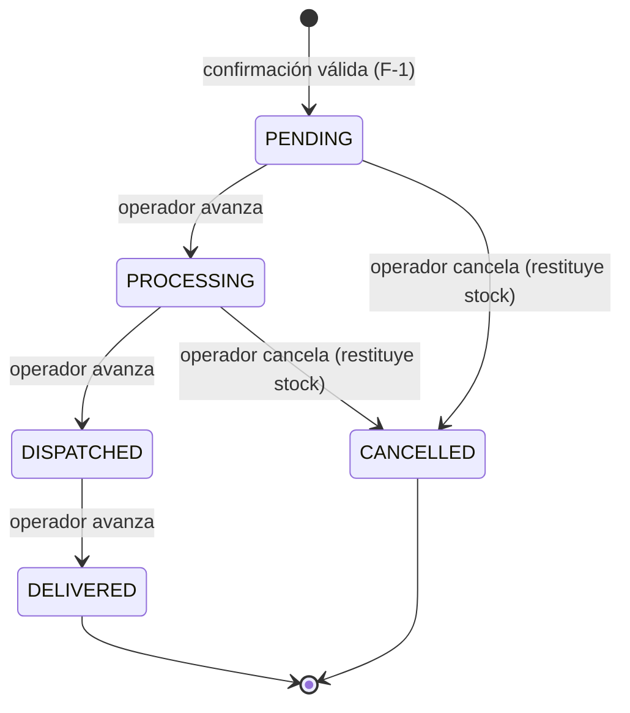
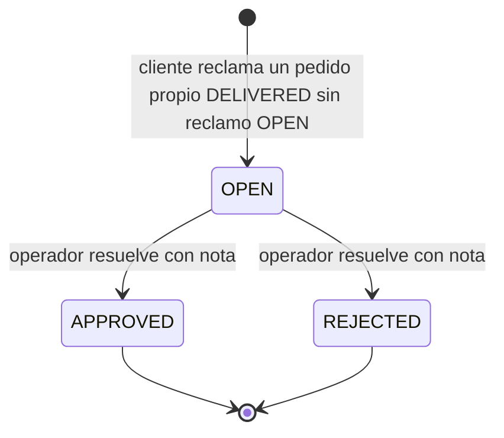

# Spec 04 — Pedidos y reclamos

| Estado | Cubre | Tickets |
|---|---|---|
| Aprobada v1.0 (Entrega 2). Fecha de aprobación: 2026-11-18. | `MVP`: CH-07, CH-08 (consulta por número), PE-01, PE-02, RN-02, RN-03, RN-04, RN-05 (operador), RN-08, RNF-03, RNF-04 · Criterios: CA-03, CA-05, CA-07, CA-12, CA-14, CA-15 · `V2` (conceptual): CH-09, RN-05 (cliente), CH-10, RE-01, RE-02, RN-06, RN-07, CA-08, CA-09, CA-10 | `MVP`: TK-05.3, TK-05.5, TK-06.1, TK-06.2, TK-06.4, TK-06.5 · relacionados: TK-00.3, TK-05.6, TK-06.3 · `V2`: TK-06.6, TK-07.1, TK-07.3, TK-07.4, TK-07.5 |

**Fuentes.** [PRD](../docs/PRD.md) v1.2 · [ARCHITECTURE](../docs/ARCHITECTURE.md) · [`docs/openapi.yaml`](../docs/openapi.yaml) `info.version` 1.0.0 (contrato base, con aspectos provisionales para chat y pedidos: OBS-03) · [spec 01](01_data_models.spec.md) Aprobada v1.1 · [spec 02](02_inventory_system.spec.md) Aprobada v1.1 · [spec 03](03_conversational_bot.spec.md) Aprobada v1.0 · [backlog](../backlog/README.md) US-05, US-06, US-07.

Esta spec define **las reglas y operaciones del dominio de pedidos** (`orders.service`) y el **diseño conceptual V2 de reclamos**. No repite:

- tablas, columnas, restricciones, secuencia ni índices: ver spec 01 (`Order`, `OrderItem`, `next_order_number()`);
- catálogo, ajuste de stock y alertas: ver spec 02;
- sesión, FSM, carrito, resumen, mensajes y cuándo el cliente confirma: ver spec 03;
- payloads, schemas, parámetros y status HTTP: ver `docs/openapi.yaml` por `operationId`.

Las reglas `RN-` se aplican solo en `orders.service` (RNF-07). Los identificadores `ESC-`, `D-`, `DP-` y `OBS-` son **locales de esta spec**; los de otras specs se citan con su spec ("ESC-48 de la spec 03").

## 1. Objetivo

Garantizar que ningún pedido se confirme con stock insuficiente, con un producto inactivo o con un precio distinto del aceptado por el cliente, ni siquiera con confirmaciones simultáneas (PRD §3, objetivo 2); que el cliente consulte solo sus pedidos (objetivo 3); y que el operador consulte, avance y cancele pedidos con restitución de stock exactamente una vez (objetivo 4).

## 2. Alcance

### 2.1 Incluido en el MVP

| Capacidad | Requisitos | Sección |
|---|---|---|
| Confirmación atómica del pedido con revalidación de estado, stock y precio | CH-06, CH-07, RN-01, RN-02, RN-03, RNF-03 | F-1 |
| Número de pedido `MED-` + al menos cinco dígitos, sin máximo, con saltos permitidos | RN-04 | F-1, §5.3 |
| Precio histórico por ítem y total del pedido | RN-03 | F-1, §5.3 |
| Consulta de un pedido propio por número desde el chat | CH-08 (`MVP`), RN-08 | F-2 |
| Listado filtrado y paginado, y detalle para el operador | PE-01 (`MVP`) | F-3 |
| Avance de estado por el operador | PE-02, RN-05 | F-4 |
| Cancelación por el operador con restitución única de stock | PE-02, RN-05, CA-12 | F-5 |
| Concurrencia probada contra PostgreSQL real | RNF-04 | §10 |

### 2.2 Diferido a V2 (no implementable en el MVP)

| Capacidad | IDs | Tickets |
|---|---|---|
| Cancelación por el cliente desde el chat (`PENDING`) | CH-09, RN-05 (cliente), CA-08 | TK-06.6 |
| Reclamos: registro por chat, listado, resolución | CH-10, RE-01, RE-02, RN-06, RN-07, CA-09, CA-10 | TK-07.1..TK-07.5 |
| Reclamos en el detalle del pedido y en "Mis pedidos" | PE-01 (`V2`), CH-08 (`V2`) | TK-07.2, TK-07.3 |

En el MVP no existen la tabla `claims`, el modelo Prisma `Claim`, endpoints de reclamos ni opciones de reclamo o cancelación en el chat (PRD §4.2, spec 01, spec 03 §13). Ver §15.

### 2.3 Fuera de esta spec

- Pagos, facturación, impuestos y logística real (PRD §4.3).
- Historial de cambios de estado y auditoría por operador (spec 01, "Fuera del modelo persistente").
- Cancelación con motivo o nota: el PRD no la prevé.
- Idempotencia de la confirmación entre sesiones o instancias del backend (spec 03 §12.4; §14 de esta spec).

## 3. Actores y responsabilidades

| Actor / componente | Responsabilidad en pedidos | No hace |
|---|---|---|
| **Cliente B2B** (vía chat) | Confirma la compra y consulta pedidos propios por número | En el MVP no cancela pedidos (CH-09 es `V2`) |
| **Chat FSM** (spec 03) | Decide **cuándo** el cliente confirma; envía al servicio el cliente de la sesión y los ítems con su precio mostrado; traduce resultados a mensajes; actualiza la sesión en memoria (cierre de la confirmación, F-7 de la spec 03) | No aplica RN-02..RN-05 ni accede a Prisma |
| **Operador** (dashboard) | Lista, consulta, avanza y cancela pedidos (PE-01, PE-02) | No crea ni edita pedidos ni sus ítems |
| **`orders.service`** | Gobierna la **creación efectiva** del pedido (F-1), las transiciones de RN-05 (F-4, F-5) y las consultas (F-2, F-3) | No conoce HTTP, la sesión ni el carrito |
| **`products.service`** (spec 02) | Dueño del catálogo y del ajuste manual de stock | No descuenta ni restituye stock por pedidos: eso ocurre dentro de las transacciones de `orders.service` (spec 02 F-8, F-9) |
| **PostgreSQL 16** | Atomicidad de la transacción, bloqueo de filas en las actualizaciones condicionales, secuencia del número de pedido y `CHECK` de la spec 01 | — |

## 4. Modelo conceptual y estados

### 4.1 Entidades (MVP)

Las define la spec 01. Aquí solo su papel:

- **Order:** pedido confirmado de un cliente; nace en `PENDING`; su `orderNumber` lo asigna la base; su `totalAmount` es la suma de `quantity × unitPrice` de sus ítems.
- **OrderItem:** una línea por producto (único `(order_id, product_id)`); `unitPrice` es el precio vigente al confirmar y no cambia después (RN-03).
- Un pedido no se borra; un pedido cancelado conserva sus ítems (spec 01).

### 4.2 Estados del pedido (RN-05)

| Origen | Destino permitido (operador, `MVP`) | Efecto en stock |
|---|---|---|
| `PENDING` | `PROCESSING`, `CANCELLED` | `CANCELLED` restituye cada ítem una vez |
| `PROCESSING` | `DISPATCHED`, `CANCELLED` | `CANCELLED` restituye cada ítem una vez |
| `DISPATCHED` | `DELIVERED` | Ninguno |
| `DELIVERED` | — (final para el operador) | — |
| `CANCELLED` | — (final) | — |

Cualquier otro par origen → destino, incluido el mismo estado, es una transición no permitida (D-06). `PENDING` nunca es destino (contrato, `ChangeOrderStatusRequest`). En `V2` el cliente podrá cancelar desde `PENDING` (CH-09, §15.1).

### 4.3 Separación de modelos

El estado del pedido (PostgreSQL) es independiente del estado de la conversación y del carrito (memoria, spec 03 D-01). Ninguna transición de pedido depende de la sesión de chat, y la sesión no forma parte de ninguna transacción de esta spec (§10.2).

## 5. Reglas de negocio y decisiones de diseño

### 5.1 Reglas del PRD aplicadas por `orders.service`

| Regla | Fase | Aplicación |
|---|---|---|
| **RN-01** | `MVP` | El descuento es condicional a `current_stock >= cantidad`; el `CHECK` de la spec 01 es la última barrera |
| **RN-02** | `MVP` | El stock se descuenta solo al confirmar, en una operación atómica que revalida por ítem: producto activo y stock suficiente. El carrito no reserva. Gana el primero en confirmar |
| **RN-03** | `MVP` | Cada ítem guarda el precio vigente al confirmar. Si difiere del precio mostrado en el resumen, el pedido no se crea (`PRICE_CHANGED`). Los cambios posteriores de precio no afectan pedidos existentes |
| **RN-04** | `MVP` | Número único y creciente `MED-` + al menos cinco dígitos, sin máximo, asignado por la base desde la secuencia; se permiten saltos por transacciones revertidas (spec 01) |
| **RN-05** | `MVP` (operador) | Avance al estado siguiente, sin saltos ni retroceso; cancelación desde `PENDING` o `PROCESSING` con restitución exactamente una vez; `CANCELLED` es final |
| **RN-08** | `MVP` | La consulta del chat solo devuelve pedidos del cliente de la sesión; cualquier otro número se trata como no encontrado |
| **RNF-03** | `MVP` | O se crean el pedido y todos sus ítems y se descuenta el stock de todos, o no se persiste nada |
| **RNF-04** | `MVP` | Las garantías anteriores se prueban con conexiones simultáneas reales (§10) |

### 5.2 Decisiones de diseño de esta spec

Propuestas del diseño del servicio. Quedan aprobadas solo si se aprueba esta spec. Ninguna cambia una regla del PRD.

| ID | Decisión | Base |
|---|---|---|
| D-01 | **Resultado de la confirmación.** `orders.service` devuelve una de dos cosas: (a) el pedido creado (identificador, `orderNumber`, estado `PENDING`, total e ítems con su precio), o (b) un rechazo con la **lista completa** de ítems afectados, cada uno con su motivo: `PRODUCT_INACTIVE`; `STOCK_INSUFFICIENT` con el **stock disponible** leído en la transacción; `PRICE_CHANGED` con el **precio vigente**. Los errores no controlados se propagan como error (no como rechazo) | ARCHITECTURE (flujo de confirmación: "se sigue con el resto", "PRICE_CHANGED + precio vigente"); spec 03 `RESOLVE_STOCK` necesita el stock disponible para ofrecer "ajustar al disponible" (CH-06) |
| D-02 | **Un motivo por ítem.** Si el descuento de un ítem no afecta filas, se lee el producto: si está inactivo, el motivo es `PRODUCT_INACTIVE` (prevalece aunque además falte stock); si está activo, `STOCK_INSUFFICIENT`. `PRICE_CHANGED` solo se evalúa en los ítems cuyo descuento sí se aplicó. El servicio devuelve todos los motivos a la vez y **no** decide el orden en que se tratan: lo fija la spec 03 (DP-03), que esta precedencia por ítem respeta: (1) producto inactivo, que se rechaza y se retira del carrito (DP-02 de la spec 03); (2) stock insuficiente, que se resuelve en `RESOLVE_STOCK`; (3) precio modificado, que se absorbe en un nuevo resumen con precios vigentes y exige una nueva confirmación | ARCHITECTURE ("0 filas → se lee el producto para anotar si está inactivo o sin stock"; "precio vigente de cada producto descontado"); RN-02, RN-10; spec 03 DP-02, DP-03 |
| D-03 | **Entrada inválida.** Lista de ítems vacía, cantidad ≤ 0, productos repetidos o un producto inexistente son errores de programación del llamador (el FSM solo envía productos del catálogo, spec 03 D-04): el servicio los rechaza **sin abrir la transacción** y como error, no como rechazo de negocio | spec 01 (único `(order_id, product_id)`, `quantity > 0`); RN-10 (los productos no se borran) |
| D-04 | **Resultado preparado antes del COMMIT.** El resultado de dominio (número de pedido, total e ítems con su precio) se prepara dentro de la transacción, antes de finalizarla; el número se obtiene en el propio `INSERT`. Tras un COMMIT exitoso, la confirmación **no** ejecuta operaciones adicionales de negocio ni de persistencia: solo devuelve ese resultado. Esto reduce la ventana entre el COMMIT y la devolución, pero **no la elimina**: siguen existiendo los riesgos de caída del proceso y de pérdida de conexión durante el COMMIT (§10.3). No amplía las garantías de C1 de la spec 03 | RNF-03; spec 03 F-7 ("Cierre de la confirmación") y §12.4 |
| D-05 | **Orden y reintentos en la cancelación.** La restitución actualiza los productos en orden ascendente de `productId`, y la transacción de cancelación se reintenta entera hasta 3 veces ante `P2034`, igual que la confirmación | ARCHITECTURE, "Prevención de interbloqueos" (regla general: "dentro de una transacción, los ítems se actualizan siempre en orden ascendente de `productId`"; reintento ante `P2034`) |
| D-06 | **Transición pedida → origen esperado.** El servicio deduce el único origen válido para cada destino (`PROCESSING`←`PENDING`, `DISPATCHED`←`PROCESSING`, `DELIVERED`←`DISPATCHED`, `CANCELLED`←`PENDING` o `PROCESSING`) y aplica la actualización condicionada a ese origen. Pedir el mismo estado en que ya está el pedido es una transición no permitida | RN-05; ARCHITECTURE ("Transiciones condicionales"); contrato `changeOrderStatus` |
| D-07 | **Avanzar no toca el stock.** Solo la transición a `CANCELLED` modifica stock | RN-05 |
| D-08 | **Consulta del chat por número.** Se usa el número **completo** de pedido, con los espacios externos recortados y las letras en mayúsculas (normalización que aplica el FSM según DP-10 de la spec 03). El servicio compara ese valor por **igualdad exacta** con `order_number` y filtra **siempre** por el cliente de la sesión. No hay búsquedas parciales ni por solo dígitos (`42` no encuentra `MED-00042`), y nunca se devuelven pedidos de otro cliente. Ajeno e inexistente producen el mismo resultado "no encontrado" (D-12 de la spec 03) | RN-08; spec 03 DP-10, D-12 |

### 5.3 Número de pedido y totales

- `order_number` lo asigna `next_order_number()` como valor por defecto en el `INSERT` (spec 01). El servicio no lo calcula.
- Si una transacción que ya consumió un valor de la secuencia se revierte, ese número no se reutiliza: es el salto permitido por RN-04.
- Los listados nunca se ordenan por `order_number` (`MED-100000` < `MED-99999` alfabéticamente; spec 01).
- `totalAmount` = Σ `quantity × unitPrice` con los precios vigentes al confirmar, que coinciden con los mostrados porque, si no, el pedido no se crea (RN-03). `subtotal` del contrato es derivado y no se persiste.

## 6. Flujos funcionales

### F-1 · Confirmación y creación del pedido (RN-02, RN-03, RN-04, RNF-03 · TK-05.3)

Entrada: cliente de la sesión y ítems `{productId, quantity, precio mostrado}`. Cuándo se invoca lo decide la spec 03 (F-7, estado `SUMMARY`).

1. Valida la entrada (D-03). Si es inválida, error sin abrir transacción.
2. Abre una transacción interactiva con aislamiento `READ COMMITTED` (ARCHITECTURE).
3. Para cada ítem, **en orden ascendente de `productId`**, ejecuta el descuento condicional: producto activo y `current_stock >= quantity`. Si no afecta filas, anota el motivo según D-02 y **sigue con el resto** de ítems.
4. Para cada ítem descontado, lee el precio vigente (la fila ya está bloqueada por el paso 3) y lo compara con el precio mostrado; si difiere, anota `PRICE_CHANGED` con el precio vigente.
5. Si hay algún motivo anotado: **ROLLBACK** y devuelve el rechazo con la lista completa (D-01). No queda pedido, ni ítems, ni cambio de stock.
6. Si todo es válido: inserta el pedido (`PENDING`, número desde la secuencia, total) y sus ítems con el precio vigente; **COMMIT**; devuelve el pedido creado (D-04).
7. Si PostgreSQL aborta la transacción por interbloqueo o conflicto de serialización (`P2034`), la reintenta entera hasta 3 veces; si se agotan, propaga el error. Cualquier otro error antes del COMMIT revierte todo.

El resultado se traduce a mensajes y a estados de conversación en la spec 03 (F-7). Los códigos `PRODUCT_INACTIVE`, `STOCK_INSUFFICIENT` y `PRICE_CHANGED` son **de dominio**: ningún endpoint HTTP del MVP los devuelve (contrato, "Códigos de dominio de la confirmación").

### F-2 · Consulta de un pedido propio por número (CH-08 `MVP`, RN-08 · TK-06.3)

1. El FSM entrega el número completo ya normalizado (espacios externos recortados, mayúsculas; DP-10 de la spec 03) y el cliente de la sesión.
2. El servicio busca por igualdad exacta de `order_number` **y** `customer_id`, sin coincidencias parciales ni por solo dígitos (D-08).
3. Si existe: devuelve número, estado, ítems (producto, cantidad, precio guardado, subtotal) y total. Sin reclamos (CH-08 `V2`).
4. Si no: "no encontrado", sin distinguir ajeno de inexistente. El mensaje "Pedido no encontrado" lo emite el chat (spec 03 F-8).

### F-3 · Consulta del operador (PE-01 `MVP` · TK-06.2)

- **Listado** (`listOrders`): todos los pedidos o los de un estado, paginados, ordenados por `createdAt` descendente y, a igualdad de fecha, por `id` descendente (DP-01, resuelta). Este orden es **determinista**: dos consultas sobre los mismos datos devuelven el mismo orden. **No** garantiza páginas inmutables: con la paginación por número de página del contrato, un pedido creado entre dos consultas desplaza los siguientes. Una página fuera de rango devuelve una lista vacía con los totales reales (contrato).
- **Detalle** (`getOrder`): cliente (razón social, RUT, teléfono normalizado), ítems con el precio guardado y el **nombre actual** del producto, subtotales derivados y total. Sin reclamos (PE-01 `V2`).

### F-4 · Avance de estado por el operador (PE-02, RN-05 · TK-06.1, TK-06.2)

1. El operador pide el estado destino (`changeOrderStatus`).
2. El servicio determina el origen esperado (D-06) y ejecuta una actualización condicional `WHERE id = ? AND status = <origen esperado>`.
3. Si afecta una fila: devuelve el detalle actualizado. El stock no cambia (D-07).
4. Si no afecta filas: si el pedido no existe, "no encontrado"; si existe, transición no permitida o carrera perdida → `INVALID_ORDER_TRANSITION`, sin cambios.

### F-5 · Cancelación por el operador con restitución (PE-02, RN-05, CA-12 · TK-06.1)

1. El operador pide el destino `CANCELLED`.
2. En **una transacción**:
   1. Actualización condicional `WHERE id = ? AND status IN ('PENDING','PROCESSING')` a `CANCELLED`.
   2. Si no afecta filas: ROLLBACK; "no encontrado" o `INVALID_ORDER_TRANSITION`; el stock no se toca.
   3. Si afecta una fila: suma la cantidad de cada ítem al stock de su producto, en orden ascendente de `productId` (D-05), **también si el producto está inactivo** (spec 02 F-9). COMMIT.
3. Ante `P2034`, reintenta la transacción entera hasta 3 veces (D-05).

Como solo una petición puede ganar la actualización condicional del paso 2.1, la restitución ocurre **exactamente una vez**, aunque lleguen cancelaciones repetidas o simultáneas (ARCHITECTURE, "Cancelación por operador").

### F-6 · Seguimiento desde el dashboard (PE-01, PE-02 · TK-06.4)

La pantalla muestra el listado filtrable y el detalle, y ofrece las acciones de avance y cancelación (DP-02, resuelta):

- El frontend usa un **mapa estático** estado → acciones **solo como ayuda visual** para mostrar las acciones del estado actual.
- El **backend es la única autoridad** sobre las transiciones (RN-05 en `orders.service`, RNF-07). El mapa no valida nada.
- Si el backend responde `INVALID_ORDER_TRANSITION`, el frontend **recarga el pedido** y comunica que su estado cambió (TK-06.4).
- El contrato no incluye transiciones permitidas por pedido.

## 7. Contrato API (`docs/openapi.yaml`, tag `Orders`)

Todas exigen sesión de operador (`bearerAuth`); sin ella, `UNAUTHORIZED` (CA-11). Status, payloads y parámetros solo en el contrato.

| `operationId` | Propósito | Reglas | Errores de dominio | Tickets |
|---|---|---|---|---|
| `listOrders` | Listado paginado con filtro opcional por estado, del más reciente al más antiguo | PE-01, RN-04 (no ordenar por número) | `VALIDATION_ERROR` (estado, página o tamaño inválidos) | TK-06.2, TK-06.4 |
| `getOrder` | Detalle con cliente, ítems y total | PE-01, RN-03 | `ORDER_NOT_FOUND` · `VALIDATION_ERROR` (id inválido) | TK-06.2, TK-06.4 |
| `changeOrderStatus` | Avanzar o cancelar | PE-02, RN-05, CA-12 | `ORDER_NOT_FOUND` · `INVALID_ORDER_TRANSITION` · `VALIDATION_ERROR` (destino fuera del enum, incluido `PENDING`) · `MALFORMED_REQUEST` | TK-06.1, TK-06.2, TK-06.4 |

**Operaciones de dominio sin endpoint** (las usa el chat a través de `sendChatMessage`, spec 03 §7):

| Operación de `orders.service` | Consumidor | Reglas | Tickets |
|---|---|---|---|
| Confirmar pedido (F-1) | Chat FSM, estado `SUMMARY` | RN-01..RN-04, RNF-03, RNF-04 | TK-05.3, TK-05.6, TK-05.5 |
| Consultar pedido propio por número (F-2) | Chat FSM, estado `ORDER_LOOKUP` | RN-08 | TK-06.3 |

No se detectó ninguna operación necesaria para el MVP que falte en el contrato. El contrato no incluye endpoints de reclamos ni de cancelación por el cliente, lo que es correcto para el MVP.

## 8. Errores y situaciones excepcionales

| Situación | Tipo | Resultado | Estado tras el evento | Escenario |
|---|---|---|---|---|
| Ítem con stock insuficiente al confirmar | Dominio `STOCK_INSUFFICIENT` (con stock disponible) | Rechazo; nada persistido | Sin cambios | ESC-04 |
| Ítem con producto inactivo | Dominio `PRODUCT_INACTIVE` | Rechazo; nada persistido | Sin cambios | ESC-05, ESC-08 |
| Precio vigente distinto del mostrado | Dominio `PRICE_CHANGED` (con precio vigente) | Rechazo; nada persistido | Sin cambios | ESC-06 |
| Varios motivos | Dominio | Rechazo con la lista completa | Sin cambios | ESC-07 |
| Entrada de confirmación inválida | Error de programación (D-03) | Error; no se abre transacción | Sin cambios | ESC-13 |
| Interbloqueo o serialización | `P2034` | Reintento hasta 3 veces; si se agota, error | Sin cambios si se agota | ESC-12 |
| Fallo antes del COMMIT | Error no controlado | ROLLBACK total; número de secuencia consumido (salto) | Sin cambios | ESC-14 |
| Pedido inexistente | HTTP `ORDER_NOT_FOUND` | — | Sin cambios | ESC-30 |
| Transición no permitida o carrera perdida | HTTP `INVALID_ORDER_TRANSITION` | — | Sin cambios | ESC-17..ESC-21, ESC-24..ESC-27 |
| Destino `PENDING` o fuera del enum | HTTP `VALIDATION_ERROR` | — | Sin cambios | ESC-19 |
| Sin sesión de operador | HTTP `UNAUTHORIZED` | — | Sin cambios | ESC-31 |
| Pedido ajeno o inexistente en el chat | Resultado "no encontrado" | El chat muestra "Pedido no encontrado" | Sin cambios | ESC-35 |
| Error posterior al COMMIT de la confirmación | Coordinación con la sesión | Ver §10.2 y spec 03 F-7 ("Cierre de la confirmación") | Pedido creado | spec 03 ESC-48 |

## 9. Límites con otras specs

| Tema | Spec responsable | Qué define esta spec |
|---|---|---|
| Tablas, restricciones, secuencia e índices de `orders` y `order_items` | 01 | Solo los usa |
| Descuento y restitución vistos desde el inventario; catálogo y ajuste manual | 02 (F-8, F-9) | La transacción que ejecuta el descuento y la restitución |
| Cuándo confirma el cliente, resumen, precio mostrado, mensajes, sesión, carrito y cierre de la confirmación en memoria | 03 (F-6, F-7, DP-07, DP-08) | El resultado de la confirmación (D-01) y que tras el COMMIT no hay pasos que puedan fallar (D-04) |
| Normalización del número de orden escrito por el cliente | 03 (DP-10) | La comparación exacta y el filtro por cliente (D-08) |
| Clientes y normalización de teléfonos; pantallas del operador | 05 (pendiente) | Nada; F-6 solo fija el comportamiento ante conflictos (TK-06.4) |

## 10. Integridad, transacciones y concurrencia

### 10.1 Atomicidad dentro de PostgreSQL (garantizada)

| Garantía | Cómo | Verificación |
|---|---|---|
| Pedido, ítems y descuento de stock se confirman juntos o no se persiste nada | Una transacción interactiva (F-1) | ESC-04..ESC-07, ESC-14 |
| Nunca hay sobreventa ni stock negativo | Descuento condicional; la segunda transacción sobre la misma fila reevalúa la condición tras el commit de la primera; `CHECK` como barrera | ESC-09 |
| Sin interbloqueos por orden de ítems | Orden ascendente de `productId` en confirmación y restitución; reintento ante `P2034` | ESC-10, ESC-12, ESC-29 |
| Precio guardado coherente con el instante de confirmación | El precio se lee con la fila ya bloqueada; un cambio de precio concurrente espera al commit | ESC-11 |
| Restitución exactamente una vez | Actualización condicional del estado en la misma transacción que la restitución | ESC-25, ESC-26, ESC-27 |
| Sin transiciones inválidas, tampoco por carrera | Actualización condicionada al origen esperado (D-06) | ESC-17..ESC-21, ESC-27 |

### 10.2 Coordinación con la sesión conversacional en memoria

La sesión de chat vive en memoria y **no** forma parte de ninguna transacción de esta spec. **No existe atomicidad conjunta entre el pedido y la sesión.** La coordinación es la definida y aprobada en la spec 03 (F-7, "Cierre de la confirmación"; DP-07, DP-08):

1. `orders.service` confirma el pedido en PostgreSQL y lo devuelve (F-1). Con D-04, el resultado se prepara antes del COMMIT y, tras un COMMIT exitoso, la confirmación no ejecuta operaciones adicionales de negocio ni de persistencia. Esto no elimina los riesgos de §10.3.
2. El FSM, como primer paso tras recibir el pedido, pasa la sesión a `MAIN_MENU` y vacía el carrito; un error posterior no la devuelve a `SUMMARY` (spec 03).
3. Los mensajes de una misma sesión se procesan en serie, con una sola instancia del backend (spec 03 DP-08).

Esta spec no añade garantías a esa coordinación ni las amplía.

### 10.3 Garantías que el MVP no ofrece

| Caso | Consecuencia | Referencia |
|---|---|---|
| Conexión con PostgreSQL perdida durante el COMMIT | El servicio no sabe si el pedido se guardó; un reintento desde la misma sesión podría duplicarlo | spec 03 §12.4 (2) |
| Caída del proceso entre el COMMIT y la actualización de la sesión | El pedido existe; la sesión se pierde; el cliente puede no saber el resultado e iniciar otra compra desde una sesión nueva | spec 03 §12.4 (1) |
| Idempotencia entre sesiones o entre instancias del backend | No existe: dos sesiones del mismo cliente pueden crear dos pedidos válidos; varias instancias rompen la serialización por sesión | spec 03 §12.4 (3), DP-09 |
| Reintentos por `P2034` agotados | Error para el llamador. RNF-04 (b) exige que no ocurra en la prueba de productos en orden inverso; el orden ascendente de `productId` lo evita, y el reintento es una red de seguridad | ARCHITECTURE; §14 |

Cerrar estos casos requiere idempotencia de la confirmación o sesiones persistidas: evolución posterior al MVP (spec 03 §12.4).

## 11. Escenarios de aceptación

Nivel: **U** unidad · **I** integración contra PostgreSQL · **C** concurrencia con conexiones paralelas reales · **E** E2E. Los mensajes del chat se verifican en la spec 03; aquí se verifica el dominio.

### 11.1 Confirmación (F-1)

| ID | Precondiciones | Acción | Resultado esperado | Trazas | Nivel |
|---|---|---|---|---|---|
| ESC-01 | Cliente activo; A (stock 10, precio 100.00) y B (stock 5, precio 50.00) activos | Confirmar A × 2 y B × 1 con precios mostrados 100.00 y 50.00 | Pedido `PENDING` con número `^MED-\d{5,}$`; ítems con `unitPrice` 100.00 y 50.00; total 250.00; stock A 8, B 4 | CH-07, RN-02, RN-03, RN-04, CA-03 · TK-05.3 | I |
| ESC-02 | Base recién migrada; secuencia forzada a 99 999 antes del segundo pedido | Confirmar dos pedidos válidos | El primero recibe `MED-00001`; el segundo `MED-100000` (seis dígitos, sin recorte) | RN-04 · TK-00.3, TK-05.3 | I |
| ESC-03 | Una confirmación que se revierte tras consumir un valor de la secuencia (ESC-14) | Confirmar después un pedido válido | El pedido válido recibe el número siguiente al consumido; el salto se acepta | RN-04 · TK-05.3 | I |
| ESC-04 | A stock 1 | Confirmar A × 2 junto con B × 1 válido | Rechazo con A `STOCK_INSUFFICIENT` y stock disponible 1; sin pedido ni ítems; stock de A y B sin cambios | RN-01, RN-02, RNF-03 · US-05 crit. 8 · TK-05.3 | I |
| ESC-05 | B desactivado después de agregarse al carrito | Confirmar A y B | Rechazo con B `PRODUCT_INACTIVE`; sin pedido; stock de A y B sin cambios | RN-02, CA-14 · TK-05.3 | I |
| ESC-06 | A con precio mostrado 100.00 y vigente 120.00 | Confirmar A × 1 | Rechazo con A `PRICE_CHANGED` y precio vigente 120.00; sin pedido; stock sin cambios | RN-03, CA-15 · TK-05.3 | I |
| ESC-07 | A inactivo; B sin stock suficiente; C con precio cambiado; D válido | Confirmar A, B, C y D | Rechazo con tres entradas (A `PRODUCT_INACTIVE`, B `STOCK_INSUFFICIENT` con disponible, C `PRICE_CHANGED` con vigente); D no aparece; nada persistido | RN-02, RN-03, D-01 · TK-05.3 | I |
| ESC-08 | A inactivo **y** con stock menor que lo pedido | Confirmar A | Un solo motivo: `PRODUCT_INACTIVE` | D-02 · TK-05.3 | I |
| ESC-09 | A stock 1; N confirmaciones de A × 1 de clientes distintos | Lanzarlas en paralelo | Exactamente un pedido; las demás `STOCK_INSUFFICIENT`; stock final 0 | RN-01, RN-02, CA-05, RNF-04 (a) · TK-05.5 | C |
| ESC-10 | Carrito 1: A y B; carrito 2: B y A; con stock para ambos y, en otra ejecución, para uno solo | Confirmar en paralelo | Cada una termina confirmada o rechazada, sin error interno ni bloqueo indefinido; sin pedidos parciales; stock final = inicial − confirmado | RNF-04 (b) · TK-05.5 | C |
| ESC-11 | Confirmación de A en curso con la fila bloqueada; cambio de precio de A concurrente | Ambas en paralelo | El cambio de precio espera al commit; el pedido guarda el precio coherente con la comparación (si la confirmación vio el precio mostrado, guarda ese) | RN-03 · ARCHITECTURE · TK-05.3 | C |
| ESC-12 | Se simula `P2034` en el primer intento; en otra ejecución, en los cuatro intentos | Confirmar | Primera: un único pedido tras el reintento. Segunda: error tras 3 reintentos; nada persistido | RNF-04, D-05 (confirmación) · TK-05.3 | I |
| ESC-13 | — | Confirmar con lista vacía; con cantidad 0; con el mismo producto dos veces | Error de programación sin abrir transacción; nada persistido | D-03 · TK-05.3 | U |
| ESC-14 | Se inyecta un fallo al insertar los ítems | Confirmar | ROLLBACK: sin pedido ni ítems; stock sin cambios; la secuencia avanzó (salto) | RNF-03, RN-04 · TK-05.3 | I |
| ESC-15 | Pedido válido | Confirmar observando el acceso a la base | Número, total e ítems del resultado se obtienen dentro de la transacción; tras el COMMIT no hay consultas antes de devolver | D-04 · TK-05.3 | U |

### 11.2 Transiciones del operador (F-4, F-5)

| ID | Precondiciones | Acción | Resultado esperado | Trazas | Nivel |
|---|---|---|---|---|---|
| ESC-16 | Pedido `PENDING` | Avanzar a `PROCESSING`, `DISPATCHED` y `DELIVERED` | Cada paso responde con el detalle actualizado; el stock no cambia | PE-02, RN-05, D-07 · US-06 crit. 4 · TK-06.1, TK-06.2 | I |
| ESC-17 | Pedido `PENDING` | Pedir `DISPATCHED` o `DELIVERED` | `INVALID_ORDER_TRANSITION`; sin cambios | RN-05 · US-06 crit. 4 · TK-06.1 | U, I |
| ESC-18 | Pedido `DISPATCHED` | Pedir `PROCESSING` | `INVALID_ORDER_TRANSITION`; sin cambios | RN-05 · TK-06.1 | U, I |
| ESC-19 | Pedido `PROCESSING` | Pedir `PENDING` | `VALIDATION_ERROR`; sin cambios | RN-05 · contrato · TK-06.2 | I |
| ESC-20 | Pedido `PROCESSING` | Pedir `PROCESSING` | `INVALID_ORDER_TRANSITION`; sin cambios | D-06 · TK-06.1 | U, I |
| ESC-21 | Pedidos `DELIVERED` y `CANCELLED` | Pedir cada destino posible | `INVALID_ORDER_TRANSITION` en todos; sin cambios | RN-05 · TK-06.1 | U, I |
| ESC-22 | Pedido `PENDING` con A × 2 y B × 1; stock A 8, B 4 | Cancelar | `CANCELLED`; stock A 10, B 5 | RN-05, CA-12 (a) · US-06 crit. 5 · TK-06.1 | I |
| ESC-23 | Pedido `PROCESSING` del seed | Cancelar desde el dashboard | `CANCELLED`; stock de cada ítem aumenta en su cantidad | RN-05, CA-12 (a) · TK-06.5 | I, E |
| ESC-24 | Pedidos `DISPATCHED`, `DELIVERED` y `CANCELLED` | Cancelar | `INVALID_ORDER_TRANSITION`; ni el pedido ni el stock cambian | RN-05, CA-12 (b) · US-06 crit. 5 · TK-06.1 | I |
| ESC-25 | Pedido `PENDING` | Cancelar dos veces, una tras otra | La primera cancela y restituye; la segunda `INVALID_ORDER_TRANSITION`; el stock se restituyó una sola vez | CA-12 (c) · TK-06.1 | I |
| ESC-26 | Pedido `PROCESSING` | N cancelaciones en paralelo | Exactamente una responde con éxito; las demás `INVALID_ORDER_TRANSITION`; stock restituido una sola vez | RN-05, CA-12 (c) · TK-06.1 | C |
| ESC-27 | Pedido `PROCESSING` | Avanzar a `DISPATCHED` y cancelar en paralelo | Exactamente una gana; la otra `INVALID_ORDER_TRANSITION`. Si ganó la cancelación, el stock se restituyó una vez; si ganó el avance, el stock no cambia | RN-05, D-06 · TK-06.1 | C |
| ESC-28 | Pedido `PENDING` con un producto desactivado después de confirmarse | Cancelar | `CANCELLED`; el stock del producto inactivo aumenta; sigue inactivo y fuera de alertas | RN-05, RN-10, RN-09 · spec 02 ESC-31 · TK-06.1 | I |
| ESC-29 | Cancelación de un pedido con A y B y confirmación de otro pedido con B y A, en paralelo | Ambas en paralelo | Sin interbloqueo ni error interno; stock final = inicial + restituido − confirmado | D-05, RNF-04 · TK-06.1 | C |
| ESC-30 | Id de pedido inexistente | `getOrder` y `changeOrderStatus` | `ORDER_NOT_FOUND`; sin cambios | PE-01, PE-02 · TK-06.2 | I |
| ESC-31 | Sin token o con token expirado | Cualquier operación de §7 | `UNAUTHORIZED`; sin efectos | AU-01, AU-03, CA-11 · TK-01.1 | I |

### 11.3 Consultas (F-2, F-3)

| ID | Precondiciones | Acción | Resultado esperado | Trazas | Nivel |
|---|---|---|---|---|---|
| ESC-32 | Pedidos en varios estados, dos de ellos con el mismo `createdAt` | `listOrders` con y sin filtro, con varias páginas y una página fuera de rango; después, la misma consulta repetida sobre el mismo conjunto de pedidos, sin inserciones ni modificaciones entre consultas | Solo pedidos del estado pedido, por `createdAt` descendente; los dos de igual fecha, el de mayor `id` primero; al repetir la misma consulta sobre el mismo conjunto de pedidos, sin inserciones ni modificaciones entre consultas, se obtiene el mismo orden (no se verifica la inmutabilidad de páginas ante inserciones, que no está garantizada); paginación con totales reales; la página fuera de rango devuelve lista vacía | PE-01, DP-01 · US-06 crit. 6 · TK-06.2 | I |
| ESC-33 | Pedidos `MED-99999` (más antiguo) y `MED-100000` (más reciente) | `listOrders` | `MED-100000` aparece primero: el orden es por fecha, no por número | RN-04, spec 01 · TK-06.2 | I |
| ESC-34 | Pedido con A a 100.00; después A cambia a 120.00 y se renombra | `getOrder` | Ítem con `unitPrice` 100.00, nombre actual de A, subtotal y total coherentes; incluye razón social, RUT y teléfono del cliente; sin reclamos | PE-01, RN-03 · US-03 crit. 5 · TK-06.2 | I |
| ESC-35 | Cliente X con `MED-00042`; cliente Y con `MED-00043` | Consulta del chat de X por `MED-00042`, `MED-00043` y `MED-99999` | Devuelve `MED-00042`; los otros dos, "no encontrado" sin distinción | RN-08, CA-07, D-08 · US-06 crit. 1, 2 · TK-06.3 | I |
| ESC-36 | MVP desplegado | Revisar contrato y servicio | No hay operación de cancelación por el cliente ni de reclamos; `getOrder` no incluye reclamos | CH-09 (`V2`), RE (`V2`) · TK-06.3 | I |

## 12. Trazabilidad

### 12.1 Requisitos, reglas y criterios

| ID PRD | Fase | Sección | Operación | Criterio PRD | Historia | Tickets | Escenarios |
|---|---|---|---|---|---|---|---|
| CH-06 (lado dominio) | `MVP` | F-1 | Confirmar (dominio) | CA-05, CA-14, CA-15 | US-05 crit. 8–10 | TK-05.3 | ESC-04..ESC-07 |
| CH-07 | `MVP` | F-1 | Confirmar (dominio) | CA-03 | US-05 crit. 7 | TK-05.3, TK-05.6 | ESC-01 |
| CH-08 (`MVP`) | `MVP` | F-2 | Consulta propia (dominio) | CA-07 | US-06 crit. 1, 2 | TK-06.3 | ESC-35 |
| PE-01 (`MVP`) | `MVP` | F-3 | `listOrders`, `getOrder` | — | US-06 crit. 6 | TK-06.2, TK-06.4 | ESC-32..ESC-34 |
| PE-02 | `MVP` | F-4, F-5 | `changeOrderStatus` | CA-12 | US-06 crit. 4, 5 | TK-06.1, TK-06.2, TK-06.4, TK-06.5 | ESC-16..ESC-30 |
| RN-01 | `MVP` | F-1 | Confirmar | CA-05 | US-05 crit. 8 | TK-05.3, TK-05.5 | ESC-04, ESC-09 |
| RN-02 | `MVP` | F-1 | Confirmar | CA-05, CA-14 | US-05 crit. 7–9 | TK-05.3, TK-05.5 | ESC-01, ESC-04, ESC-05, ESC-07..ESC-10 |
| RN-03 | `MVP` | F-1, F-3 | Confirmar, `getOrder` | CA-15 | US-05 crit. 7, 10 · US-03 crit. 5 | TK-05.3, TK-06.2 | ESC-01, ESC-06, ESC-07, ESC-11, ESC-34 |
| RN-04 | `MVP` | §5.3 | Confirmar, `listOrders` | CA-03 | US-05 crit. 7 | TK-00.3, TK-05.3, TK-06.2 | ESC-01..ESC-03, ESC-14, ESC-33 |
| RN-05 (operador) | `MVP` | §4.2, F-4, F-5 | `changeOrderStatus` | CA-12 | US-06 crit. 4, 5 | TK-06.1, TK-06.5 | ESC-16..ESC-29 |
| RN-08 | `MVP` | F-2 | Consulta propia | CA-07 | US-06 crit. 2 | TK-06.3, TK-06.5 | ESC-35 |
| RNF-03 | `MVP` | F-1, §10.1 | Confirmar | — | — | TK-05.3 | ESC-04..ESC-07, ESC-14 |
| RNF-04 | `MVP` | §10.1 | Confirmar, cancelar | CA-05 | — | TK-05.5, TK-06.1 | ESC-09..ESC-12, ESC-26, ESC-27, ESC-29 |
| RNF-07 | `MVP` | §3 | Todas | — | — | Definición de hecho | Revisión de código |
| AU-01, AU-03 | `MVP` | §7 | `listOrders`, `getOrder`, `changeOrderStatus` | CA-11 | US-01 crit. 3 | TK-01.1 | ESC-31 |
| CH-09, RN-05 (cliente) | `V2` | §15.1 | — | CA-08 | US-06 crit. 3 | TK-06.6 | ESC-36 (exclusión) |
| CH-10, RE-01, RE-02, RN-06, RN-07 | `V2` | §15.2 | — | CA-09, CA-10 | US-07 crit. 1–7 | TK-07.1, TK-07.3..TK-07.5 | ESC-36 (exclusión) |

### 12.2 Tickets

| Ticket | Fase | Responsabilidad según esta spec | Spec declarada en el backlog | Escenarios |
|---|---|---|---|---|
| TK-05.3 | `MVP` | F-1, D-01..D-04 | 04 | ESC-01..ESC-08, ESC-11..ESC-15 |
| TK-05.5 | `MVP` | Concurrencia RNF-04 de la confirmación | 04 y 03 | ESC-09, ESC-10 |
| TK-05.6 | `MVP` | Traducción del resultado de F-1 en el chat (spec 03) | 03 | (spec 03) |
| TK-06.1 | `MVP` | F-4, F-5, D-05..D-07 | 04 | ESC-16..ESC-18, ESC-20..ESC-22, ESC-24..ESC-29 |
| TK-06.2 | `MVP` | `listOrders`, `getOrder`, `changeOrderStatus` | 04 | ESC-16, ESC-19, ESC-30, ESC-32..ESC-34 |
| TK-06.3 | `MVP` | F-2 en el servicio; los estados del FSM son de la spec 03 | 03 | ESC-35, ESC-36 |
| TK-06.4 | `MVP` | Pantalla de pedidos (F-6) | 04 | DP-02 |
| TK-06.5 | `MVP` | E2E de CA-07 y CA-12 | 04 | ESC-23, ESC-35 |
| TK-00.3 | `MVP` | Secuencia y `next_order_number()` (spec 01) | 01 | ESC-02 |
| TK-06.6 | `V2` | Cancelación por el cliente | 03 y 04 | — |
| TK-07.1, TK-07.3, TK-07.4, TK-07.5 | `V2` | Reclamos (§15.2) | 04 | — |
| TK-07.2 | `V2` | Opción Reclamo en el chat | 03 | — |

No hay responsabilidades duplicadas con la spec 03: la spec 03 decide cuándo se confirma y qué se muestra; esta spec decide si el pedido se crea y con qué datos. Las únicas brechas de backlog se registran en §14 (OBS-01, OBS-02).

## 13. Decisiones resueltas

Aprobadas por el responsable del proyecto con la alternativa A. Conservan su ID.

| ID | Tema | Resolución aprobada | Se aplica en | Escenarios |
|---|---|---|---|---|
| DP-01 | Orden del listado de pedidos | Orden primario `createdAt` descendente; desempate `id` descendente. Garantiza un orden **determinista** cuando varios pedidos tienen la misma fecha. **No** garantiza páginas inmutables frente a inserciones concurrentes con la paginación por número de página del contrato, que no cambia. Cierra el punto abierto de la spec 01 sobre el desempate | F-3 | ESC-32, ESC-33 |
| DP-02 | Acciones disponibles en el dashboard | El frontend usa un mapa estático solo como ayuda visual; el backend es la autoridad sobre las transiciones; ante `INVALID_ORDER_TRANSITION` el frontend recarga el pedido y comunica que su estado cambió. No se añade al contrato ningún campo de transiciones permitidas. Es la interpretación aprobada de RNF-07 para esta pantalla | F-6 | ESC-17..ESC-21, ESC-27 (rechazos del backend) |

## 14. Observaciones y limitaciones conocidas

### 14.1 Observaciones

| ID | Estado | Observación | Dónde |
|---|---|---|---|
| OBS-01 | Abierta (brecha de backlog) | La spec 03 aprobada (`RESOLVE_STOCK`) necesita el stock disponible de cada ítem rechazado por `STOCK_INSUFFICIENT`, y D-01 lo incluye. El "Hecho cuando" de TK-05.3 solo exige el precio vigente para `PRICE_CHANGED` y no menciona el stock disponible | `backlog/US-05_compra_conversacional.md`, TK-05.3 |
| OBS-02 | Abierta (brecha de backlog) | La regla general de ARCHITECTURE (orden ascendente de `productId` y reintento ante `P2034`) aplica también a la cancelación (D-05), pero TK-06.1 no la menciona ni prueba ESC-29 | `backlog/US-06_seguimiento_pedidos.md`, TK-06.1 |
| OBS-03 | Abierta | El contrato se declara "aprobada provisionalmente para chat y pedidos" (igual que OBS-03 de la spec 03). Esta spec se alinea con la versión 1.0.0 sin declararla aprobada | `docs/openapi.yaml`, "Estado del contrato" |
| OBS-04 | Abierta (dependencia V2) | La confirmación no revalida que el cliente siga activo. En el MVP no puede desactivarse un cliente en ejecución (solo seed; CL-01 es `V2`), así que no hay caso real. Al priorizar CL-01 habrá que decidir si una sesión abierta de un cliente desactivado puede confirmar | PRD CL-01, CL-02 |
| OBS-05 | Abierta (dependencia V2) | PE-01 (`V2`) y TK-07.3 incluirán reclamos en `getOrder`, y TK-07.1 define códigos (`ORDER_NOT_DELIVERED`, `CLAIM_ALREADY_OPEN`) que no están en el contrato. Es correcto para el MVP; en V2 exigirá un cambio de contrato con nueva `info.version` | `docs/openapi.yaml`; US-07 |

### 14.2 Limitaciones conocidas

Ver §10.3. Resumen: no hay atomicidad conjunta entre pedido y sesión; no hay idempotencia entre sesiones ni instancias; el corte de conexión durante el COMMIT puede duplicar un pedido en un reintento; se supone una sola instancia del backend. Todo ello está aceptado en la spec 03 (OBS-08, §12.4) y se resuelve, en su caso, en una evolución posterior.

## 15. Diseño conceptual V2 (no implementable en el MVP)

Se documenta para que el MVP no impida añadirlo. No se crean tablas, modelos Prisma, migraciones, endpoints, opciones de menú ni códigos de contrato (PRD §4.2, spec 01 "Diseño conceptual V2").

### 15.1 Cancelación por el cliente (CH-09)

- **Regla:** el cliente cancela por chat un pedido propio en `PENDING`, con confirmación previa y restitución de stock (RN-05 cliente, CA-08).
- **Diseño:** reutiliza F-5 con el actor `CUSTOMER`, restringido a origen `PENDING` y a pedidos del cliente de la sesión (RN-08). La restitución única la sigue garantizando la actualización condicional.
- **Tickets:** TK-06.6.

### 15.2 Reclamos

**Objetivo.** Que el cliente reporte devoluciones, productos defectuosos o entregas incompletas sobre pedidos entregados, y que el operador los resuelva dejando constancia (US-07).

**Actores.** Cliente (registra por chat, ve el resultado en "Mis pedidos"); operador (lista, filtra y resuelve); `claims.service` (aplica RN-06, RN-07, RN-08).

**Relaciones conceptuales.** `Claim` N:1 `Order` (spec 01 conceptual); el cliente del reclamo es el del pedido, sin relación directa. Un pedido puede tener varios reclamos a lo largo del tiempo, pero como máximo uno `OPEN`.

**Ciclo de vida.**

| Regla | Contenido |
|---|---|
| CH-10 | El cliente indica número de orden, tipo (`RETURN`, `DEFECTIVE`, `INCOMPLETE`) y descripción |
| RN-06 | Solo sobre pedidos `DELIVERED`, sin plazo límite; como máximo un reclamo `OPEN` por pedido. Resuelto el anterior, puede abrirse otro (US-07 crit. 3) |
| RN-07 | Resolver no modifica el stock ni el pedido; reembolsos y reposiciones fuera del sistema |
| RN-08 | Solo pedidos propios; ajeno o inexistente: "Pedido no encontrado" |
| RE-01 | Listado filtrable por estado y tipo, con detalle y pedido asociado |
| RE-02 | Resolución de un `OPEN` a `APPROVED` o `REJECTED` con nota obligatoria y fecha de resolución |

**Flujo de resolución.** El operador abre un reclamo `OPEN`, escribe la nota y elige `APPROVED` o `REJECTED`. La transición debe ser condicional sobre `status = 'OPEN'` para que una resolución concurrente o repetida se rechace. Ni el pedido ni el stock cambian (RN-07).

**Persistencia prevista (spec 01, conceptual).** Índice único parcial `(order_id) WHERE status = 'OPEN'` para RN-06 y `CHECK (status = 'OPEN' OR resolution_note IS NOT NULL)` para RE-02.

**Contrato previsto (ARCHITECTURE, `V2`).** `GET /claims`, `GET /claims/:id`, `POST /claims/:id/resolve`, y reclamos en `getOrder`. Ninguno existe en el contrato del MVP (OBS-05).

**Trazabilidad V2.** CH-10, RE-01, RE-02, RN-06, RN-07, RN-08 · CA-09, CA-10 · US-07 crit. 1–7 · TK-07.1 (servicio), TK-07.2 (chat, spec 03), TK-07.3 (endpoints), TK-07.4 (pantalla), TK-07.5 (pruebas).

**Preguntas para cuando se priorice V2** (no bloquean el MVP): longitud y obligatoriedad de la descripción; textos de los motivos de rechazo en el chat; si el detalle del pedido muestra todos los reclamos o solo el último.
